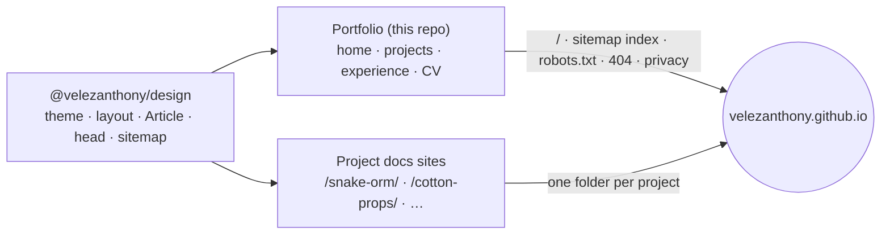

# velezanthony.github.io

The portfolio and printable CV of Anthony Velez Tapia, and the root site of the whole `velezanthony.github.io` domain. Static, two languages (Spanish and English), built with Astro on top of my own design library, [`@velezanthony/design`](https://github.com/velezanthony/design).

**Live:** https://velezanthony.github.io

---

## How it works

Every project I publish has its documentation at `velezanthony.github.io/<project>/`, built with the same design library. This repo is the site at the root of that domain: it renders the portfolio pages, and it owns what a domain can only have once: the sitemap index, `robots.txt`, the 404 page and the privacy policy.



The library brings the look, the page shell, the `<head>`, the cookie consent and the sitemap. The portfolio brings the content, its own pages and the structured data about me. Inside `src/`, the code is split into layers (`core`, `data`, `adapters`, `client`, `ui`, `pages`) whose import rules ESLint enforces.

**[`doc/architecture.md`](doc/architecture.md)** walks through all of it, with diagrams: the library boundary, the layers, how a page becomes HTML, i18n, SEO and the decisions behind them.

## Stack

| | |
| --- | --- |
| [Astro 7](https://astro.build) | Static output, routing, content collections, images |
| [`@velezanthony/design`](https://github.com/velezanthony/design) | Tailwind and the theme, the base layout, `Article`, the page head, fonts, consent, sitemap |
| TypeScript (strict) | Everything, including `astro check` before every build |
| Vitest | Logic, schemas and the behaviour of components |
| ESLint and Prettier | Layer rules and formatting |
| GitHub Actions and GitHub Pages | Lint, test, build and publish on every push to `main` |

## Quick start

Requirements: Node **≥ 22.12**. The design library installs from GitHub with the rest of the dependencies.

```bash
npm install
npx astro dev --background   # http://localhost:4321, the Spanish home
npx astro dev status         # also: logs, stop
```

| Command | What it does |
| --- | --- |
| `npm test` | Vitest, once |
| `npm run check` | `astro check`: types in `.ts` and `.astro` |
| `npm run lint` | ESLint, layer rules included |
| `npm run format:check` | Prettier |
| `npm run todo` | The `todo:` entries still open in the case studies |
| `npm run build` | `astro check`, then `astro build` into `dist/` |

No environment variable is needed. `PUBLIC_GTM_ID` (see `.env.example`) turns analytics on; without it there is no tracking, no cookie banner and no cookie control.

## Where to edit content

| What | Where |
| --- | --- |
| A project case study | `src/data/projects/<locale>/<slug>.md` |
| The privacy policy | `src/data/privacies/<locale>.md` |
| Profile, contact, experience, education | `src/data/profile.ts`, `experience.ts`, `education.ts` |
| Interface phrases | `src/data/ui.ts` (the library's own phrases are overridden in `docs.config.mjs`, `ui`) |
| Route names per language | `routes` in `src/core/i18n/locales.ts` |
| Colours, the CV type scale, column widths | `@theme` in `src/site.css` (the library's tokens come with it) |

## Deploy

A push to `main` runs `.github/workflows/deploy.yml`: lint, format check, tests, then `npm run build` with `PUBLIC_GTM_ID` from the repository secrets, and publishes `dist/` to GitHub Pages. The checkout keeps the full git history, because the sitemap `lastmod` and the case studies' `dateModified` come from it.

## Licence

MIT.
