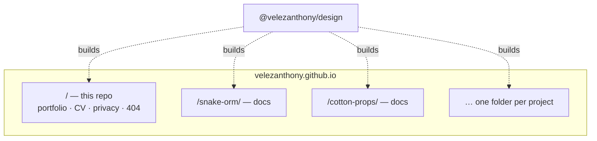
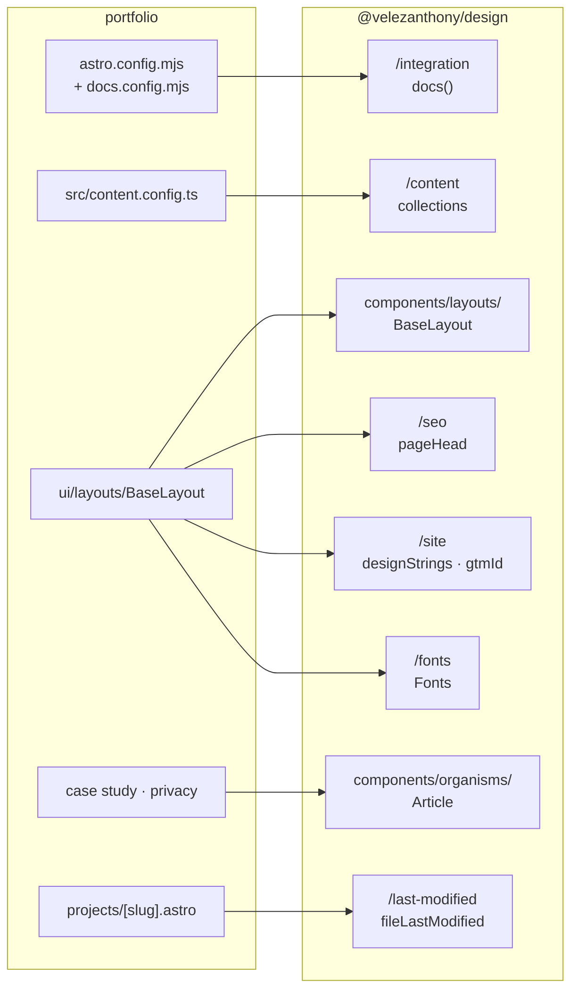
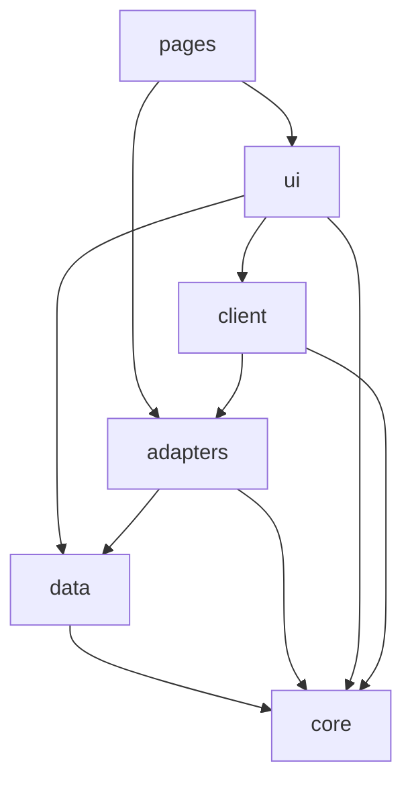
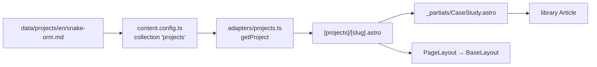
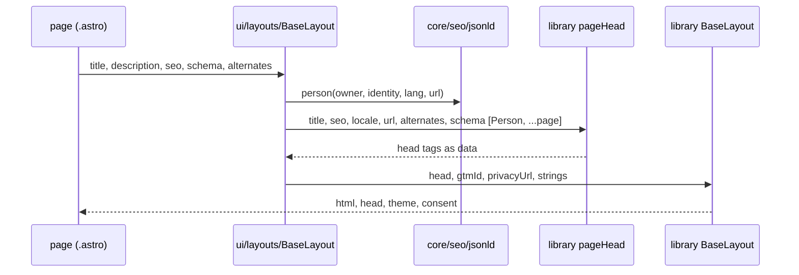
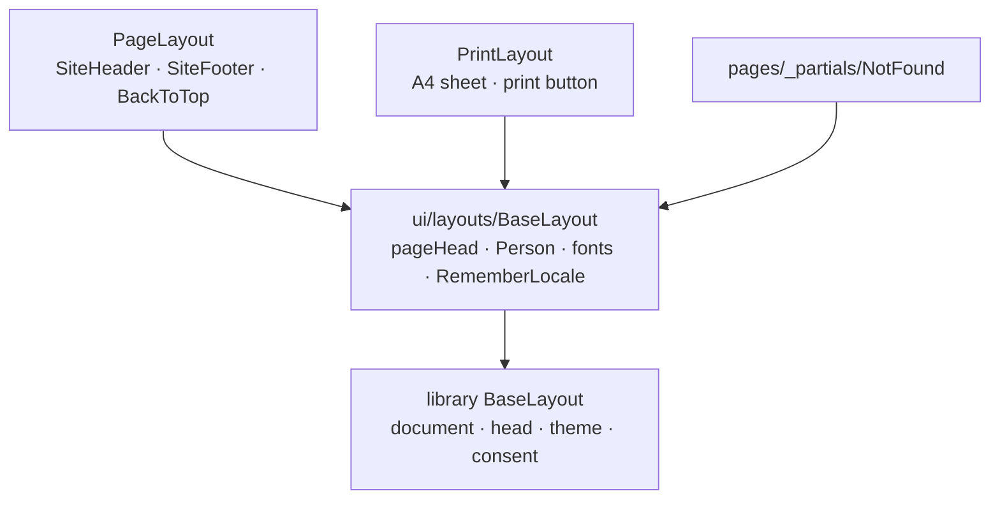
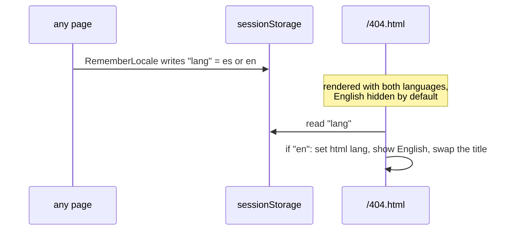
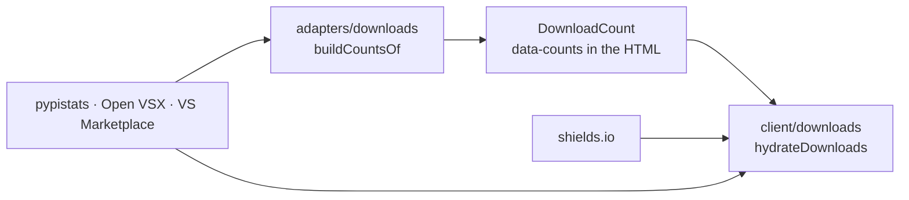

# Architecture

How the portfolio is put together, how it leans on the design library, and why it is shaped this way. Astro 7, static output, Spanish and English, published to GitHub Pages at `https://velezanthony.github.io`.

1. [The big picture](#1-the-big-picture)
2. [The library boundary](#2-the-library-boundary)
3. [Layers inside the portfolio](#3-layers-inside-the-portfolio)
4. [From request to HTML](#4-from-request-to-html)
5. [i18n](#5-i18n)
6. [SEO](#6-seo)
7. [Styles](#7-styles)
8. [The 404](#8-the-404)
9. [Privacy and analytics](#9-privacy-and-analytics)
10. [Download counts](#10-download-counts)
11. [Testing and quality](#11-testing-and-quality)
12. [Decisions and trade-offs](#12-decisions-and-trade-offs)
13. [Conventions](#13-conventions)

---

## 1. The big picture

`velezanthony.github.io` is one domain with several sites in it. GitHub Pages serves this repo at the root, and every project repo publishes its documentation in a folder of its own (`/snake-orm/`, `/cotton-props/`…). All of them are built with the same library, `@velezanthony/design`, so they look and behave as one site.



A project site lives under a path, so some things can only exist once, at the root. This repo owns them for the whole domain:

| Owned by the root | Why here |
| --- | --- |
| `/sitemap.xml`, an index | Search Console and `robots.txt` point at one URL; the index lists the root's pages and every project's sitemap |
| `/robots.txt` | Crawlers only read it at the root of the host (`src/pages/robots.txt.ts`) |
| `/404.html` | GitHub Pages serves a single 404 for the whole domain (`src/pages/404.astro`) |
| The privacy policy | One policy covers every site; the project sites link to it through their own `privacyUrl` |
| `/llms.txt` | A map of the portfolio for language models, generated from the same data as the pages (`src/pages/llms.txt.ts`) |

## 2. The library boundary

The library is the shell; the portfolio is the content and everything that is about me. The rule of thumb: **if every site on the domain needs it, it belongs to the library; if it describes Anthony Velez Tapia or his work, it belongs here.**

| The library provides | The portfolio owns |
| --- | --- |
| Tailwind, `theme.css`, light and dark themes | Its extra tokens and utilities, `src/site.css` |
| The document shell, `BaseLayout`: `<html>`, `<head>`, theme script, consent banner | Its own header, footer and print sheet (`PageLayout`, `PrintLayout`) |
| `Article`: prose, table of contents, code copy, image zoom | The case-study sidebar and the privacy page around it |
| `pageHead`: title, description, canonical, `hreflang`, Open Graph, JSON-LD slot | The JSON-LD itself: `Person`, `SoftwareSourceCode`, `TechArticle`, `BreadcrumbList` |
| Interface phrases for its own components | The portfolio's phrases (`src/data/ui.ts`) and its wording of the library's ones (`ui` in `docs.config.mjs`) |
| The sitemap, its index and `lastmod` from git | The list of project sitemaps to include, `robots.txt`, `llms.txt` |
| Fonts (IBM Plex), self-hosted | — |
| Analytics through GTM, only after consent | The privacy policy and the domain-wide 404 |
| Atoms and molecules: `Heading`, `Text`, `Link`, `LocaleSwitch`, `ThemeToggle`… | Components that know about projects, jobs or downloads (`src/ui/components/`) |

### The integration points

Everything crosses the boundary in a handful of places. One configuration file, `docs.config.mjs`, feeds the integration; the rest are imports.



| Entry point | Used in | What it does here |
| --- | --- | --- |
| `docs(docsConfig)` | `astro.config.mjs` | Registers Tailwind, the fonts, the code themes, the sitemap routes and the `theme` CSS |
| `defineDocsConfig` | `docs.config.mjs` | The site config: name, locales, `seo`, `favicon`, `ogLocales`, `theme`, `ui`, `privacyUrl`, `sitemap.include` |
| `collections` (`/content`) | `src/content.config.ts` | The library's own `docs` collection, spread next to `projects` and `privacies` |
| `BaseLayout` | `src/ui/layouts/BaseLayout.astro` | The document shell every page renders into |
| `pageHead` (`/seo`) | `src/ui/layouts/BaseLayout.astro` | Builds the `<head>` tags from the site config and the page's values |
| `designStrings`, `gtmId` (`/site`) | layouts and pages | The library phrases already merged with `ui` overrides; the resolved GTM id |
| `Fonts` (`/fonts`) | `src/ui/layouts/BaseLayout.astro` | The font tags, in the `head` slot |
| `Article` | `_partials/CaseStudy.astro`, `[privacy]/index.astro` | Renders the Markdown body |
| `seoSchema` (`/seo-schema`) | `src/adapters/*-schema.ts` | Lets the frontmatter carry the library's `seo` block |
| `fileLastModified` (`/last-modified`) | `[projects]/[slug].astro` | The case study's `dateModified`, from git, like the sitemap's `lastmod` |

`docs.config.mjs` is loaded by the library outside Vite, so it cannot import the TypeScript sources. What it repeats from them (`ogLocales`, the owner's name, the project sitemaps) is kept honest by `docs.config.test.ts`.

## 3. Layers inside the portfolio

```
src/
├── core/       pure logic: no Astro, no fetch, no DOM; what it needs arrives as a parameter
├── data/       content: profile, experience, education, UI phrases, and the Markdown collections
├── adapters/   what touches Astro or the network: collection schemas and readers, store counts
├── client/     browser scripts
├── ui/         components and layouts reused across pages
└── pages/      routes, each with its own `_partials/`
```

Dependencies point down. The diagram shows what each layer may import; `pages` may use every layer, and `core` uses nothing but itself.



ESLint (`no-restricted-imports` in `eslint.config.mjs`) enforces the forbidden directions:

| Layer | May not import |
| --- | --- |
| `core/` | `astro`, `astro:*`, `virtual:*`, `@data`, `@adapters`, `@ui`, `@pages`, `@client` |
| `data/` | `@adapters`, `@ui`, `@pages` |
| `adapters/` | `@ui`, `@pages` |
| `ui/` | `@adapters`, `@pages` |

That is why `core/seo/jsonld.ts` takes the owner and the site identity as parameters (`data/person.ts` and the pages hand them in), and why `core/i18n/translate.ts` receives the phrase catalogue instead of importing it (`ui/translations.ts` binds the two). `client/downloads.ts` reuses `adapters/downloads.ts` in the browser: that adapter only needs `fetch`.

### Aliases

One alias per layer, declared in `tsconfig.json`: `@core/*`, `@data/*`, `@adapters/*`, `@client/*` and `@ui/*`, each mapping to `src/<layer>/*`. There is no `@pages`, because nothing imports a route, and no alias for the whole of `src/`, so a layer cannot be skipped by accident.

Any import that leaves the file's own folder goes through an alias, so the layer is written on the import line; ESLint rejects `../` anywhere in `src/`. Only `./` is relative: the file's own folder and the `_partials/` below it. Relative means colocated; an alias means shared.

```ts
import { alternates, path } from '@core/i18n/utils';
import { profile } from '@data/profile';
import { getProject } from '@adapters/projects';
import { useTranslations } from '@ui/translations';
```

### Partials and components

| | Used by | Lives in |
| --- | --- | --- |
| Partial | One page | `_partials/` next to that page |
| Component | More than one page | `src/ui/components/` |
| Layout | The page shell | `src/ui/layouts/`, its own pieces in `_partials/` |

A partial used by a second page is promoted to `ui/components/`; until then it stays with its page. Folders and files starting with `_` are excluded from routing by Astro, which is what lets `_partials/` sit inside `src/pages/`. Generic atoms and molecules are not written here: they come from the library.

## 4. From request to HTML

The site is static: every URL below is a file in `dist/`, produced at build time.

### A case study page

`/proyectos/snake-orm/` and `/en/projects/snake-orm/` come from one Markdown file per language.



1. **Content.** `src/data/projects/<locale>/<slug>.md`: structured frontmatter (name, headline, status, stack, links, downloads…) and the write-up as the body.
2. **Collection.** `src/content.config.ts` loads them with a glob loader. The default `generateId` drops the folder, so `es/foo.md` and `en/foo.md` would collide; it is overridden to keep the locale in the id. `adapters/project-schema.ts` validates the frontmatter, including the library's `seo` block.
3. **Adapter.** `adapters/projects.ts` resolves the locale through `core/i18n/localized.ts`: the English entry when it exists, otherwise the Spanish source flagged `translationPending`, so the page shows a notice instead of a 404.
4. **Route.** `src/pages/[...lang]/[projects]/[slug].astro` enumerates every slug in every locale. `[...lang]` is empty for Spanish and `en` for English; `[projects]` becomes `proyectos` or `projects` from `routes` in `core/i18n/locales.ts`. The page renders the entry, reads `dateModified` from git, gets the build's download counts and builds its JSON-LD.
5. **Partial.** `_partials/CaseStudy.astro` lays out the header, the status, and a sidebar (role, downloads, stack, compatibility, links) passed into the library `Article`'s `aside` slot, beside its table of contents.
6. **Shell.** `PageLayout` adds the site header and footer; `BaseLayout` builds the head (next walkthrough).

### The head of any page

Every page hands `title`, `description`, optional `seo` and `schema`, and its `alternates` to a layout; the head is assembled in one place.



1. `PageLayout` (or `PrintLayout` for the CV, or `NotFound` directly) passes the page's values to `src/ui/layouts/BaseLayout.astro`.
2. It builds the site's one `Person` with `person()` from `core/seo/jsonld.ts`, fed by `data/person.ts` and `PERSON_ID` from `data/site.ts`, and puts it before the page's own schemas.
3. `pageHead()` from the library merges the page's values with the site config (`seo.titleSuffix`, the social image, the favicon, `ogLocales`) and returns the tags: `<title>`, description, canonical, `hreflang`, Open Graph, Twitter and one JSON-LD script per schema.
4. The library `BaseLayout` renders them, loads `theme.css` and the theme script, and the consent banner when there is a `gtmId`. The portfolio's `head` slot adds the font tags (`<Fonts />`), `color-scheme`, the Apple touch icon and the generator meta.

### Layouts



`PageLayout` serves every public page except the CV and the 404. Its header and footer are in `ui/layouts/_partials/`. `PrintLayout` frames the CV as an A4 sheet that prints as shown.

## 5. i18n

Astro's i18n handles routing; translation is the portfolio's own.

```js
i18n: { defaultLocale, locales: [...locales], routing: { prefixDefaultLocale: false } }
```

Spanish is unprefixed (`/proyectos/`), English is prefixed (`/en/projects/`). The root serves the Spanish home rather than redirecting to it: it is the URL people paste, and GitHub Pages has no 301.

Four kinds of text, four homes:

| Kind | Lives in |
| --- | --- |
| Portfolio interface phrases | `src/data/ui.ts`, used through `useTranslations` from `src/ui/translations.ts` |
| Library interface phrases | The library; `ui` in `docs.config.mjs` overrides the ones the portfolio words differently, and `designStrings(lang)` from `@velezanthony/design/site` returns the merged result |
| Route segments | `routes` in `src/core/i18n/locales.ts` |
| Content | `src/data/`: Markdown per locale folder, or records that carry both languages |

**The source sentence is the key.** `t('Proyectos')` returns the argument in Spanish and the English value otherwise. The `Phrase` type is derived from the English catalogue, so a phrase missing from it fails `astro check`. A phrase present but not translated yet is marked `PENDING` (`TODO:translate`) and falls back to Spanish; `rg TODO:translate src/data` lists them.

Typed records in `src/data/` carry both languages on the same object (`Localized`), so a missing translation is a type error. Dates are stored as `YYYY-MM` and formatted with `Intl` at render time, so no month name enters the catalogue.

`src/core/i18n/utils.ts` holds the route helpers: `path(lang, route, ...rest)` builds every internal URL, `alternates()` gives a page's URL in each locale for `hreflang` and the language switch, and `localeOfPath()` reads the locale off a URL.

## 6. SEO

### The title

The `<title>` is `title | suffix`. Each part is resolved separately by the library, most specific first:

| Suffix comes from | Example |
| --- | --- |
| 1. The page's `seo.titleSuffix` (the `.md` frontmatter, or what the page passes) | case studies pass `titleSuffix: false` |
| 2. The site's `seo.titleSuffix` in `docs.config.mjs` | `Anthony Velez Tapia` |
| 3. The site's `name` | `Anthony Velez Tapia` |

A case study's title is already `name · headline`, the phrase someone would search for; adding the suffix would push it past what results pages show. Its frontmatter `seo` is spread after that default, so one file can still bring the suffix back.

### Structured data

The library draws no JSON-LD of its own; the portfolio declares it in `src/core/seo/jsonld.ts`:

| Schema | On | Why |
| --- | --- | --- |
| `Person` | Every page | One `@id` (`PERSON_ID`) everywhere, so search engines see one person with many mentions |
| `SoftwareSourceCode` | Case studies | Ties the write-up to the repository and packages through `sameAs` |
| `TechArticle` | Case studies | Lets answer engines quote the write-up as an article |
| `BreadcrumbList` | Case studies | Projects index → project |

### Sitemap, robots and llms.txt

With `sitemap.include` set, the library turns `/sitemap.xml` into an index: first `/sitemap-pages.xml` with the portfolio's own pages, then every project's sitemap. Each URL carries `lastmod` from the git history of its source file, which is why the deploy checks out the full history (`fetch-depth: 0`). Pages with `noindex` (the privacy policy, the 404) are left out.

`docs.config.test.ts` checks that `sitemap.include` lists exactly the projects whose frontmatter declares a `docs` link. `robots.txt` names only the index. `llms.txt` is generated from the same data and `path()` helper as the pages, so it cannot drift from the site.

## 7. Styles

The library owns Tailwind: there is no `@import 'tailwindcss'` in this repo. `theme: 'src/site.css'` in `docs.config.mjs` points the library at the portfolio's CSS, and its `theme.css` imports that file last. One Tailwind compilation covers both, so the portfolio's `@theme` tokens (the to-do colours, the CV type scale and sheet size, the aside width) get utilities like any library token, and `src/site.css` can extend or override what came before.

## 8. The 404

GitHub Pages serves one `/404.html` for the whole domain, at any path, and it cannot know the reader's language. So there is one 404, built in Spanish, carrying both languages.



- `src/ui/layouts/_partials/RememberLocale.astro` runs on every indexable page and stores the locale of the path being read (`localeOfPath`), under `LANG_KEY` from `src/core/i18n/locales.ts`.
- `src/pages/404.astro` renders `pages/_partials/NotFound.astro` with the default locale. It renders a block per language and an inline style that hides English unless `<html data-locale="en">`.
- Its script reads the stored locale; for `en` it switches `lang`, `data-locale` and the document title (carried in `data-title-en`). Without JavaScript, Spanish stays.
- `RememberLocale` is skipped on `noindex` pages, so the 404 does not overwrite the value it is about to read.

## 9. Privacy and analytics

Analytics is off unless the build has a GTM id. The library resolves it from `PUBLIC_GTM_ID` (only set in the deploy workflow, from a repository secret) and exposes it as `gtmId` from `@velezanthony/design/site`.

| `gtmId` | Result |
| --- | --- |
| Set | The library `BaseLayout` renders the consent banner, linking to the policy (`privacyUrl`). GTM loads only after the visitor accepts. `PageLayout` passes `cookieControl` to the footer, which shows a button (`data-consent-open`) to change the choice |
| Unset | No banner, no GTM, no cookie control; local and fork builds stay untracked with no code path of their own |

The policy is Markdown, `src/data/privacies/<locale>.md`, loaded as the `privacies` collection (`adapters/privacy-schema.ts`: `title`, `description`, `updated`, `seo`) and rendered by `[privacy]/index.astro` with the library `Article`. It is `noindex`. `privacyUrl` in `docs.config.mjs` names it for the library; the project sites are meant to link to the same page rather than carry a policy of their own. `src/data/privacies.test.ts` checks that every `mailto:` in it is the profile email.

## 10. Download counts

Case studies, project cards and the CV show how often each tool is downloaded. The figure is read twice: at build, so it is in the HTML, and in the browser, so it does not go stale between deploys.



- **Build.** `adapters/downloads.ts` asks each store a project declares (`downloads` in its frontmatter), once per project for every page (`buildCountsOf`). A store that fails is left out; it never fails the build.
- **HTML.** `ui/components/DownloadCount.astro` writes the build's counts as text, plus the sources and counts as `data-*` attributes.
- **Browser.** `client/downloads.ts` asks again and replaces a store's figure only if it answers. PyPI goes through shields.io in the browser because pypistats sends no CORS header; shields rounds past a thousand, so the figure is marked approximate.

The arithmetic and the formatting (`core/downloads/`) are pure and shared by both sides.

## 11. Testing and quality

Tests sit next to the file they test (`*.test.ts`) and run with Vitest through Astro's own Vite config (`vitest.config.ts`), so aliases and `.astro` files resolve as in the build.

| What | Where |
| --- | --- |
| Pure logic: routes and locales, translation, localized fallback, dates, download maths and parsing, timeline, project links, JSON-LD | `src/core/**` |
| Frontmatter schemas, store requests with a fake `fetch` | `src/adapters/**` |
| Refreshing the counts in a document | `src/client/downloads.test.ts` |
| Component behaviour: links, `aria-current`, heading levels, what renders when a list is empty | `src/ui/**`, `_partials/*.test.ts`, rendered with `AstroContainer` and queried with linkedom (`src/ui/test-utils.ts`) |
| Config repeated across files: project sitemaps, `ogLocales`, the owner name; the policy's email | `docs.config.test.ts`, `src/data/privacies.test.ts` |

**Deliberately not tested:** visual markup, classes and layout. A test that asserts a class name only proves the class is there; the page is checked by looking at it.

Around the tests:

- `astro check` types `.ts` and `.astro`, and runs before every `astro build`.
- ESLint enforces the layers and the import rule, plus accessibility rules for `.astro` (`jsx-a11y`).
- Prettier formats code; Markdown is excluded (`.prettierignore`) because the prose is wrapped by hand.
- [knip](https://knip.dev) finds unused files, exports and dependencies (`npx knip`); `knip.json` only tells it that `rg`, used by `npm run todo`, is a system binary.
- In `astro dev`, the library serves an SEO review panel at `/seo-on-page/`.

CI runs lint, format check, tests and the build, in that order, before anything is published.

## 12. Decisions and trade-offs

- **One 404 for the whole domain.** GitHub Pages allows one. It carries both languages and picks one on the client, instead of guessing from the path.
- **The root owns what is domain-wide.** Sitemap index, `robots.txt`, privacy policy and 404 live here, once; project sites only link to them.
- **No redirects when a URL changes.** GitHub Pages has no 301, and HTML redirect pages are clutter. The links are edited, and Search Console handles the move.
- **Spanish at `/`, unprefixed.** The root is the URL people paste, so it serves the home instead of redirecting to `/es/`.
- **`Person` JSON-LD stays in code.** It varies per locale (job title, description, URL) and per page (`mainEntityOfPage`), so it cannot be one static block in `docs.config.mjs`.
- **`titleSuffix: false` on case studies.** Their title is already the search phrase plus the name; a suffix would get it truncated.
- **The privacy policy is Markdown.** It is prose with a date, rendered by the same `Article` as the case studies, and a test keeps its email in step with the profile.
- **Download counts are refreshed on the client.** The build's figure is the baseline and what readers without JavaScript see; the browser updates it store by store, so a static site does not show numbers months old.
- **`dateModified` and `lastmod` come from git.** A date someone has to remember to bump stops being true.
- **`docs.config.mjs` repeats a few values.** It is loaded outside Vite and cannot import TypeScript; a test checks every repeated value instead.
- **The library owns Tailwind.** One compilation, one set of tokens, no duplicated CSS between the portfolio and the project sites.

## 13. Conventions

- English for folders, files, component names, branches and commit messages; Conventional Commits.
- Components are `PascalCase.astro`, one per file, with full names and no abbreviations. Props are typed with `interface Props`.
- A heading level is a prop, never hardcoded: the caller knows what precedes it.
- Unknown content is a visible `todo`, never a guess: `todo[]` in a project's frontmatter renders as a placeholder, and `npm run todo` lists them.
- Dev server: `astro dev --background`, managed with `astro dev stop`, `status` and `logs`.
