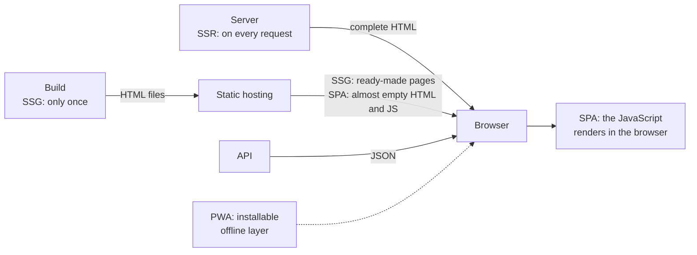

# SSR, SPA, SSG, PWA and API: what each one is and what builds it

I have built websites with Django and Flask that return HTML already rendered, an API for an
Angular front end and for a mobile app, and this portfolio, which is static pages generated with
Astro. Here are the five acronyms on a single map: what each one is, what builds it and how I
choose.

## The five acronyms as a meal

| Acronym | What it is | As a meal |
|---|---|---|
| **SSR** (*Server-Side Rendering*) | The server generates the HTML on every request | The restaurant serves you the dish freshly made |
| **SPA** (*Single-Page Application*) | The browser downloads a JavaScript application that renders the page | You are given the ingredients and cook at home |
| **SSG** (*Static Site Generation*) | The HTML is generated once, at build time, and served as files | A ready meal: made beforehand, it only needs serving |
| **API** | The server returns data (JSON), not pages | The supplier that provides ingredients to whoever asks |
| **PWA** (*Progressive Web App*) | A layer on top of any of the above: installable and with an offline mode | The lunchbox: you take the meal with you and have it even if the restaurant closes |

Only the first three are ways of rendering a page. The API feeds a SPA or a mobile app, and the PWA
is added on top of whatever you already have.

Where and when the HTML is produced in each case:



## SSR: the server renders every page

It is the web as it has always been: the request arrives, the server fills in a template and returns
complete HTML.

| Framework | How |
|---|---|
| [Django](https://docs.djangoproject.com/) | Django views and templates |
| [Flask](https://flask.palletsprojects.com/) | Routes and [Jinja](https://jinja.palletsprojects.com/) templates |
| [Angular](https://angular.dev/guide/ssr) | `@angular/ssr` |
| [Next.js](https://nextjs.org/docs) | React rendered on the server |
| [Nuxt](https://nuxt.com/docs) | Vue; renders on the server by default |
| [ASP.NET Core](https://learn.microsoft.com/en-us/aspnet/core/razor-pages/) (.NET) | Razor Pages or MVC; and [Blazor](https://learn.microsoft.com/en-us/aspnet/core/blazor/components/render-modes) with its static SSR |
| [Spring Boot](https://spring.io/guides/gs/serving-web-content) (Java) | Controllers with [Thymeleaf](https://www.thymeleaf.org/) templates |
| Go | The standard library: `net/http` and [`html/template`](https://pkg.go.dev/html/template) |
| Rust | [Axum](https://docs.rs/axum/latest/axum/) with [Askama](https://askama.rs/) templates, similar to Jinja; or [Leptos](https://book.leptos.dev/), with SSR and *hydration* |

With Django and Flask I usually add [htmx](https://htmx.org/), which asks the server for HTML
fragments and places them in the page without reloading it. What I install in Flask for forms, CSRF
or login is in [Flask dependencies](../python/flask/flask-dependencias.md). And for putting it in
production, behind Gunicorn and Nginx, see
[Django with Docker, Gunicorn and Nginx](../../sistemas/contenedores/django-docker-gunicorn-nginx.md).

Angular is no longer only a SPA. Since version 17, SSR lives in the `@angular/ssr` package (it used
to be Angular Universal) and *hydration* is stable. Version 19 brought, in *developer preview*,
choosing the rendering mode per route, and in version 20 it became stable. It is declared in
`app.routes.server.ts`:

```ts
import { RenderMode, ServerRoute } from '@angular/ssr';

export const serverRoutes: ServerRoute[] = [
  { path: '', renderMode: RenderMode.Prerender }, // SSG at build time
  { path: 'dashboard/**', renderMode: RenderMode.Client }, // SPA
  { path: '**', renderMode: RenderMode.Server }, // SSR on every request
];
```

:::note[What hydration is]

The server sends the rendered HTML and, when the JavaScript arrives, the framework **reuses** it
and attaches events and state to it, instead of rendering it again: the first load of SSR, the
interactivity of a SPA. In Angular it is enabled with `provideClientHydration()`, and the CLI
already sets it up when you add SSR.

:::

## SPA: the browser does the work

The server delivers an almost empty HTML page and a JavaScript bundle that renders each screen and
fetches the data from an API.

| Framework | How |
|---|---|
| [Angular](https://angular.dev/) | The default mode if you do not add `@angular/ssr`; with it, `RenderMode.Client` on the routes you want |
| [React](https://react.dev/) | With a build tool such as [Vite](https://vite.dev/) |
| [Vue](https://vuejs.org/) | Usually also with Vite |
| [Blazor WebAssembly](https://learn.microsoft.com/en-us/aspnet/core/blazor/hosting-models) (.NET) | The SPA is written in C# and runs in the browser with WebAssembly |
| [Leptos](https://book.leptos.dev/) or [Yew](https://yew.rs/) (Rust) | The same in Rust: compiled to WebAssembly |

The first load is slower and SEO depends on the search engine running JavaScript, but navigation
is smooth and the state lives on the client. If you are torn between a SPA with an API and a
monolith with htmx and Alpine, I compare them aspect by aspect in
[REST API and SPA vs a monolith with htmx and Alpine](./api-rest-spa-vs-htmx.md).

A built SPA is just files, so it does not need its own server: an S3 *bucket* with CloudFront in
front is enough. How to set it up, and how to stop a route like `/orders/42` from returning a 404,
is in [Basic architecture on AWS](../../sistemas/cloud/aws/aws-arquitectura-basica.md).

## SSG: pages made in advance

All the HTML is generated at build time and files are published: static hosting is enough.

| Framework | How |
|---|---|
| [Astro](https://docs.astro.build/) | Static by default; a page moves to the server with `prerender = false` and an adapter |
| [Next.js](https://nextjs.org/docs/app/guides/static-exports) | `output: 'export'` in `next.config.js` |
| [Angular](https://angular.dev/guide/ssr) | `RenderMode.Prerender` on the routes you want |
| [Nuxt](https://nuxt.com/docs/4.x/guide/concepts/rendering) | `prerender: true` in `routeRules` |
| [Hugo](https://gohugo.io/) (Go) | A static generator: Markdown and templates, no server |
| [Zola](https://www.getzola.org/) (Rust) | The same as Hugo, in Rust |
| Django | With [django-distill](https://github.com/meeb/django-distill) or [django-bakery](https://palewi.re/docs/django-bakery/) |

This portfolio works like that: Astro with `output: 'static'`, built in GitHub Actions and published
on GitHub Pages, with no server to maintain. On AWS, the same site goes in an S3 *bucket* with
CloudFront; the step by step is in
[Basic architecture on AWS](../../sistemas/cloud/aws/aws-arquitectura-basica.md).

### Django generates a static site too

With django-distill you swap `path` for `distill_path` and pass it a function that lists the URL's
parameters; then `./manage.py distill generate` writes every page to disk:

```python
from django_distill import distill_path


def get_years():
    return [{"year": year} for year in range(2020, 2027)]


urlpatterns = [
    distill_path(
        "posts-by-year/<int:year>/",
        PostYear.as_view(),
        name="blog-year",
        distill_func=get_years,
    ),
]
```

It works **only if** your site meets these conditions:

| Condition | Why |
|---|---|
| Views respond to `GET` with a `200` | It is the only thing distill knows how to save as a file |
| URLs can be listed at build time | `distill_func` has to return every value of each parameter |
| No parameters in the *query string* | A static file cannot vary depending on `?q=` |
| The same pages for everyone | There is no request or session when serving: no logged-in user, no personalised content |
| No forms processed by your server | There is no `POST`; a form would have to go to an external service |
| No per-request dynamic translation | The documentation itself warns that content is not translated on the fly |
| The content changes rarely | Every change means generating and publishing again |

Both libraries are still alive: django-distill 4.0.6 (September 2026, Django 5.2 or later) and
django-bakery 0.14.0 (August 2026, Django 5.2 to 6.1), which bakes the site into flat files to host
it on services such as Amazon S3.

### ISR: static that refreshes itself

Next.js has a middle ground: the page is served statically and regenerated in the background every
so often (`export const revalidate = 3600`). It needs a server, so `output: 'export'` will not do.

## API: data only

An API does not render pages: it returns JSON, and a SPA, a mobile app or another service can
consume it. I have served the same one to an Angular front end and to a mobile app.

| Framework | What it brings |
|---|---|
| [Django REST framework](https://www.django-rest-framework.org/) | The veteran: serialisers, authentication and an API you can browse from the browser |
| [Django Ninja](https://django-ninja.dev/) | Python types and Pydantic, automatic OpenAPI documentation and `async` support |
| [APIFlask](https://apiflask.com/) | On top of Flask; schemas with marshmallow or Pydantic and automatic OpenAPI |
| [FastAPI](https://fastapi.tiangolo.com/) | Independent of Django and Flask; types, Pydantic and documentation with Swagger UI |
| [ASP.NET Core](https://learn.microsoft.com/en-us/aspnet/core/fundamentals/minimal-apis) (.NET) | Controllers or *minimal APIs* (`app.MapGet(...)`) |
| [Spring Boot](https://spring.io/guides/gs/rest-service) (Java) | Controllers with `@RestController` |
| Go | `net/http`, which [since Go 1.22](https://go.dev/blog/routing-enhancements) routes by method and path (`GET /orders/{id}`), or [Gin](https://gin-gonic.com/) |
| Rust | [Axum](https://docs.rs/axum/latest/axum/) or [Actix Web](https://actix.rs/) |

The same backend can serve SSR and an API at once. How I organise the code so as not to duplicate
the rules is in
[How I organise a growing Python project](../python/organizar-proyecto-django.md).

## PWA: a layer, not a mode

It is not a way of rendering: it is what you add to a SPA, an SSR website or a static site so it can
be **installed** and work **offline**.

| Piece | What for |
|---|---|
| Manifest (`manifest.webmanifest`) | Name, 192 and 512 px icons, `start_url` and `display`: what the browser asks for before offering to install it |
| HTTPS | Mandatory, except on `localhost` |
| *Service worker* | Caches the resources for offline mode. It is not required to install the app, but without it there is no *offline* |

| Tool | How |
|---|---|
| [Angular](https://angular.dev/ecosystem/service-workers/getting-started) | `ng add @angular/pwa`: creates `ngsw-config.json`, adds the icons and links the manifest |
| [vite-plugin-pwa](https://vite-pwa-org.netlify.app/guide/) | For React, Vue, Astro and others: generates the manifest and the *service worker* with Workbox |

## The comparison table

| | SSR | SPA | SSG | API | PWA |
|---|---|---|---|---|---|
| **First load** | Fast | Slow | The fastest | Not applicable | That of the mode underneath; later ones, from cache |
| **SEO** | Good | Weak without SSR | Good | Not applicable | That of the mode underneath |
| **Interactivity** | With htmx, Alpine or *hydration* | Full | With islands or *hydration* | Not applicable | That of the mode underneath |
| **Server** | Yes, always | Static only, plus the API | Only to build | Yes | That of the mode underneath |
| **Offline** | No | Only with a *service worker* | Only with a *service worker* | No | Yes |
| **Typical cost** | A server always on | Static hosting plus the API | Static hosting, often free | A server always on | Almost nothing on top of what you have |

## How I choose

| If… | I choose |
|---|---|
| The content is the same for everyone and changes rarely (blog, portfolio, documentation) | **SSG**: Astro, or django-distill if everything is already in Django |
| It is an application with login, forms and changing data | **SSR** with Django or Flask and htmx |
| The interface holds a lot of state on the client (editors, dashboards that react to everything) | **SPA** with Angular, React or Vue, plus an **API** |
| There is a mobile app or other systems reading the same data | **API**, and the website in SSR or SPA depending on the above |
| I need SEO and a lot of interactivity at the same time | **Hybrid**: Next.js, Nuxt or Angular with per-route mode |
| Users work with poor coverage or want an icon on their phone | I add a **PWA** to whatever I already have |

You do not have to marry one: you can mix them by route, with a static home page, the dashboard as
a SPA and the rest in SSR.

## In short

- **SSR**: the server renders every page. Django, Flask, Angular, Next.js, Nuxt, ASP.NET Core,
  Spring Boot, Go, Rust.
- **SPA**: the browser renders and asks an API for data. Angular, React with Vite, Vue, Blazor
  WebAssembly, Leptos or Yew.
- **SSG**: pages made at build time. Astro, Next.js, Angular, Hugo, Zola, and Django with
  django-distill if the site is the same for everyone and its URLs can be listed.
- **API**: data only. DRF, Django Ninja, APIFlask, FastAPI, ASP.NET Core, Spring Boot, Go,
  Axum, Actix Web.
- **PWA**: a layer (manifest, HTTPS and *service worker*) on top of any of the above.

## References

- [Angular: Server and hybrid rendering](https://angular.dev/guide/ssr)
- [Angular: Hydration](https://angular.dev/guide/hydration)
- [Angular: Service workers](https://angular.dev/ecosystem/service-workers/getting-started)
- [Next.js: Static Exports](https://nextjs.org/docs/app/guides/static-exports)
- [Next.js: Incremental Static Regeneration](https://nextjs.org/docs/app/guides/incremental-static-regeneration)
- [Nuxt: Rendering Modes](https://nuxt.com/docs/4.x/guide/concepts/rendering)
- [Astro: On-demand rendering](https://docs.astro.build/en/guides/on-demand-rendering/)
- [django-distill](https://github.com/meeb/django-distill)
- [django-bakery](https://palewi.re/docs/django-bakery/)
- [Django REST framework](https://www.django-rest-framework.org/)
- [Django Ninja](https://django-ninja.dev/)
- [APIFlask](https://apiflask.com/)
- [FastAPI](https://fastapi.tiangolo.com/)
- [ASP.NET Core: Blazor render modes](https://learn.microsoft.com/en-us/aspnet/core/blazor/components/render-modes)
- [ASP.NET Core: minimal APIs](https://learn.microsoft.com/en-us/aspnet/core/fundamentals/minimal-apis)
- [Spring: Serving Web Content with Spring MVC](https://spring.io/guides/gs/serving-web-content)
- [Spring: Building a RESTful Web Service](https://spring.io/guides/gs/rest-service)
- [Go: Routing Enhancements for Go 1.22](https://go.dev/blog/routing-enhancements)
- [Hugo](https://gohugo.io/)
- [Axum](https://docs.rs/axum/latest/axum/)
- [Leptos](https://book.leptos.dev/)
- [Zola](https://www.getzola.org/)
- [htmx](https://htmx.org/docs/)
- [MDN: Making PWAs installable](https://developer.mozilla.org/en-US/docs/Web/Progressive_web_apps/Guides/Making_PWAs_installable)
- [vite-plugin-pwa](https://vite-pwa-org.netlify.app/guide/)
