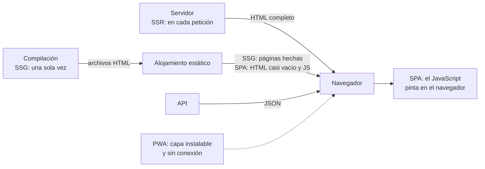

---
seo:
  title: "SSR, SPA, SSG, PWA y API"
  description: "Qué diferencia SSR, SPA, SSG, PWA y una API, con qué frameworks se hace cada uno (Django, Flask, Angular, Next.js, Astro) y cómo decido cuál usar."
  image:
    src: /og/articulos/desarrollo/conceptos/ssr-spa-ssg-pwa-api.png
    alt: "SSR, SPA, SSG, PWA y API"
  schema:
    - '@type': TechArticle
      headline: "SSR, SPA, SSG, PWA y API: qué es cada uno y con qué se hace"
      description: "Qué diferencia SSR, SPA, SSG, PWA y una API, con qué frameworks se hace cada uno (Django, Flask, Angular, Next.js, Astro) y cómo decido cuál usar."
      image: https://velezanthony.github.io/og/articulos/desarrollo/conceptos/ssr-spa-ssg-pwa-api.png
      inLanguage: es
      datePublished: '2026-11-24'
      dateModified: '2026-11-24'
      author:
        '@type': Person
        '@id': https://velezanthony.github.io/#anthony
        name: Anthony Velez Tapia
        url: https://velezanthony.github.io/
---

# SSR, SPA, SSG, PWA y API: qué es cada uno y con qué se hace

He hecho webs con Django y con Flask que devuelven el HTML ya pintado, una API para un front en
Angular y para una aplicación móvil, y este portfolio, que son páginas estáticas generadas con Astro.
Aquí van las cinco siglas en un solo mapa: qué es cada una, con qué se hace y cómo decido.

## Las cinco siglas en una comida

| Sigla | Qué es | En la comida |
|---|---|---|
| **SSR** (*Server-Side Rendering*) | El servidor genera el HTML en cada petición | El restaurante te sirve el plato recién hecho |
| **SPA** (*Single-Page Application*) | El navegador descarga una aplicación JavaScript que pinta la página | Te dan los ingredientes y cocinas en casa |
| **SSG** (*Static Site Generation*) | El HTML se genera una vez, al compilar, y se sirve como archivos | Comida precocinada: hecha antes, solo hay que servirla |
| **API** | El servidor devuelve datos (JSON), no páginas | El proveedor que surte de ingredientes a quien los pida |
| **PWA** (*Progressive Web App*) | Una capa encima de cualquiera de las anteriores: instalable y con modo sin conexión | La fiambrera: te llevas la comida y la tienes aunque cierre el restaurante |

Solo las tres primeras son formas de pintar una página. La API alimenta a una SPA o a una app
móvil, y la PWA se suma a lo que ya tengas.

Dónde y cuándo se genera el HTML en cada caso:



## SSR: el servidor pinta cada página

Es la web de toda la vida: llega la petición, el servidor rellena una plantilla y devuelve HTML
completo.

| Framework | Cómo |
|---|---|
| [Django](https://docs.djangoproject.com/) | Vistas y plantillas de Django |
| [Flask](https://flask.palletsprojects.com/) | Rutas y plantillas [Jinja](https://jinja.palletsprojects.com/) |
| [Angular](https://angular.dev/guide/ssr) | `@angular/ssr` |
| [Next.js](https://nextjs.org/docs) | React renderizado en el servidor |
| [Nuxt](https://nuxt.com/docs) | Vue; renderiza en el servidor por defecto |
| [ASP.NET Core](https://learn.microsoft.com/es-es/aspnet/core/razor-pages/) (.NET) | Razor Pages o MVC; y [Blazor](https://learn.microsoft.com/es-es/aspnet/core/blazor/components/render-modes) con su SSR estático |
| [Spring Boot](https://spring.io/guides/gs/serving-web-content) (Java) | Controladores con plantillas [Thymeleaf](https://www.thymeleaf.org/) |
| Go | La biblioteca estándar: `net/http` y [`html/template`](https://pkg.go.dev/html/template) |
| Rust | [Axum](https://docs.rs/axum/latest/axum/) con plantillas [Askama](https://askama.rs/), parecidas a Jinja; o [Leptos](https://book.leptos.dev/), con SSR e *hydration* |

Con Django y Flask suelo sumarle [htmx](https://htmx.org/), que pide fragmentos de HTML al servidor
y los coloca en la página sin recargarla. Qué instalo en Flask para formularios, CSRF o login lo
cuento en [Dependencias de Flask](../python/flask/flask-dependencias.md). Y para ponerlo en
producción, detrás de Gunicorn y Nginx, en
[Django con Docker, Gunicorn y Nginx](../../sistemas/contenedores/django-docker-gunicorn-nginx.md).

Angular ya no es solo SPA. Desde la versión 17 el SSR vive en el paquete `@angular/ssr` (antes era
Angular Universal) y la *hydration* es estable. En la 19 llegó, en *developer preview*, elegir el
modo de renderizado por ruta, y en la 20 pasó a estable. Se declara en `app.routes.server.ts`:

```ts
import { RenderMode, ServerRoute } from '@angular/ssr';

export const serverRoutes: ServerRoute[] = [
  { path: '', renderMode: RenderMode.Prerender }, // SSG al compilar
  { path: 'panel/**', renderMode: RenderMode.Client }, // SPA
  { path: '**', renderMode: RenderMode.Server }, // SSR en cada petición
];
```

:::note[Qué es la hydration]

El servidor manda el HTML pintado y, cuando llega el JavaScript, el framework lo **reutiliza** y le
engancha eventos y estado, en lugar de pintarlo de nuevo: primera carga de SSR, interactividad de
SPA. En Angular se activa con `provideClientHydration()`, y el CLI ya lo deja puesto al añadir SSR.

:::

## SPA: el navegador hace el trabajo

El servidor entrega un HTML casi vacío y un paquete de JavaScript que pinta cada pantalla y pide los
datos a una API.

| Framework | Cómo |
|---|---|
| [Angular](https://angular.dev/) | El modo por defecto si no añades `@angular/ssr`; con él, `RenderMode.Client` en las rutas que quieras |
| [React](https://react.dev/) | Con una herramienta de compilación como [Vite](https://vite.dev/) |
| [Vue](https://vuejs.org/) | Normalmente también con Vite |
| [Blazor WebAssembly](https://learn.microsoft.com/es-es/aspnet/core/blazor/hosting-models) (.NET) | La SPA se escribe en C# y corre en el navegador con WebAssembly |
| [Leptos](https://book.leptos.dev/) o [Yew](https://yew.rs/) (Rust) | Lo mismo en Rust: compilado a WebAssembly |

La primera carga es más lenta y el SEO depende de que el buscador ejecute JavaScript, pero la
navegación es fluida y el estado vive en el cliente. Si dudas entre una SPA con API y un monolito con
htmx y Alpine, lo comparo aspecto por aspecto en
[API REST y SPA vs monolito con HTMX y Alpine](./api-rest-spa-vs-htmx.md).

Una SPA compilada son archivos, así que no necesita servidor propio: basta un *bucket* de S3 con
CloudFront delante. Cómo montarlo, y cómo evitar que una ruta como `/pedidos/42` dé 404, lo cuento en
[Arquitectura básica en AWS](../../sistemas/cloud/aws/aws-arquitectura-basica.md).

## SSG: páginas hechas de antemano

Todo el HTML se genera al compilar y se publican archivos: basta un alojamiento estático.

| Framework | Cómo |
|---|---|
| [Astro](https://docs.astro.build/) | Estático por defecto; una página pasa a servidor con `prerender = false` y un adaptador |
| [Next.js](https://nextjs.org/docs/app/guides/static-exports) | `output: 'export'` en `next.config.js` |
| [Angular](https://angular.dev/guide/ssr) | `RenderMode.Prerender` en las rutas que quieras |
| [Nuxt](https://nuxt.com/docs/4.x/guide/concepts/rendering) | `prerender: true` en `routeRules` |
| [Hugo](https://gohugo.io/) (Go) | Un generador estático: Markdown y plantillas, sin servidor |
| [Zola](https://www.getzola.org/) (Rust) | Lo mismo que Hugo, en Rust |
| Django | Con [django-distill](https://github.com/meeb/django-distill) o [django-bakery](https://palewi.re/docs/django-bakery/) |

Este portfolio es así: Astro con `output: 'static'`, compilado en GitHub Actions y publicado en
GitHub Pages, sin servidor que mantener. En AWS, el mismo sitio va en un *bucket* de S3 con
CloudFront; el paso a paso está en [Arquitectura básica en AWS](../../sistemas/cloud/aws/aws-arquitectura-basica.md).

### Django también genera un sitio estático

Con django-distill cambias `path` por `distill_path` y le pasas una función que enumera los
parámetros de la URL; luego `./manage.py distill generate` escribe cada página en disco:

```python
from django_distill import distill_path


def get_years():
    return [{"year": year} for year in range(2020, 2027)]


urlpatterns = [
    distill_path(
        "posts-by-year/<int:year>/",
        PostYear.as_view(),
        name="blog-year",
        distill_func=get_years,
    ),
]
```

Sirve **solo si** tu sitio cumple esto:

| Condición | Por qué |
|---|---|
| Las vistas responden a `GET` con un `200` | Es lo único que distill sabe guardar como archivo |
| Las URL se pueden enumerar al compilar | `distill_func` tiene que devolver todos los valores de cada parámetro |
| Sin parámetros en la *query string* | Un archivo estático no puede variar según `?q=` |
| Las mismas páginas para todo el mundo | No hay petición ni sesión al servir: nada de usuario logueado ni contenido personalizado |
| Sin formularios que procese tu servidor | No hay `POST`; un formulario tendría que ir a un servicio externo |
| Sin traducción dinámica por petición | La propia documentación avisa de que el contenido no se traduce al vuelo |
| El contenido cambia poco | Cada cambio exige volver a generar y publicar |

Las dos librerías siguen vivas: django-distill 4.0.6 (septiembre de 2026, Django 5.2 o superior) y
django-bakery 0.14.0 (agosto de 2026, Django 5.2 a 6.1), que hornea el sitio en archivos planos para
alojarlo en servicios como Amazon S3.

### ISR: estático que se renueva

Next.js tiene un punto intermedio: la página se sirve estática y se regenera en segundo plano cada
cierto tiempo (`export const revalidate = 3600`). Necesita servidor, así que no vale con
`output: 'export'`.

## API: solo datos

Una API no pinta páginas: devuelve JSON, y la puede consumir una SPA, una app móvil u otro servicio.
Yo he servido la misma a un front en Angular y a una app móvil.

| Framework | Qué aporta |
|---|---|
| [Django REST framework](https://www.django-rest-framework.org/) | El veterano: serializadores, autenticación y una API navegable desde el navegador |
| [Django Ninja](https://django-ninja.dev/) | Tipos de Python y Pydantic, documentación OpenAPI automática y soporte `async` |
| [APIFlask](https://apiflask.com/) | Encima de Flask; esquemas con marshmallow o Pydantic y OpenAPI automático |
| [FastAPI](https://fastapi.tiangolo.com/) | Independiente de Django y Flask; tipos, Pydantic y documentación con Swagger UI |
| [ASP.NET Core](https://learn.microsoft.com/es-es/aspnet/core/fundamentals/minimal-apis) (.NET) | Controladores o *minimal APIs* (`app.MapGet(...)`) |
| [Spring Boot](https://spring.io/guides/gs/rest-service) (Java) | Controladores con `@RestController` |
| Go | `net/http`, que [desde Go 1.22](https://go.dev/blog/routing-enhancements) enruta por método y ruta (`GET /orders/{id}`), o [Gin](https://gin-gonic.com/) |
| Rust | [Axum](https://docs.rs/axum/latest/axum/) o [Actix Web](https://actix.rs/) |

Un mismo backend puede servir SSR y API a la vez. Cómo organizo el código para no duplicar las
reglas lo cuento en
[Cómo organizo un proyecto Python que crece](../python/organizar-proyecto-django.md).

## PWA: una capa, no un modo

No es una forma de renderizar: es lo que añades a una SPA, una web SSR o un sitio estático para que
se pueda **instalar** y funcione **sin conexión**.

| Pieza | Para qué |
|---|---|
| Manifiesto (`manifest.webmanifest`) | Nombre, iconos de 192 y 512 px, `start_url` y `display`: lo que el navegador pide para ofrecer instalarla |
| HTTPS | Obligatorio, salvo en `localhost` |
| *Service worker* | Guarda en caché los recursos para el modo sin conexión. No es obligatorio para instalarla, pero sin él no hay *offline* |

| Herramienta | Cómo |
|---|---|
| [Angular](https://angular.dev/ecosystem/service-workers/getting-started) | `ng add @angular/pwa`: crea `ngsw-config.json`, añade los iconos y enlaza el manifiesto |
| [vite-plugin-pwa](https://vite-pwa-org.netlify.app/guide/) | Para React, Vue, Astro y otros: genera el manifiesto y el *service worker* con Workbox |

## La tabla para comparar

| | SSR | SPA | SSG | API | PWA |
|---|---|---|---|---|---|
| **Primera carga** | Rápida | Lenta | La más rápida | No aplica | La del modo de debajo; las siguientes, desde caché |
| **SEO** | Bueno | Flojo sin SSR | Bueno | No aplica | El del modo de debajo |
| **Interactividad** | Con htmx, Alpine o *hydration* | Total | Con islas o *hydration* | No aplica | La del modo de debajo |
| **Servidor** | Sí, siempre | Solo estático, más la API | Solo para compilar | Sí | El del modo de debajo |
| **Sin conexión** | No | Solo con *service worker* | Solo con *service worker* | No | Sí |
| **Coste típico** | Servidor encendido | Hosting estático más la API | Hosting estático, a menudo gratis | Servidor encendido | Casi nada sobre lo que ya tienes |

## Cómo decido

| Si… | Elijo |
|---|---|
| El contenido es el mismo para todos y cambia poco (blog, portfolio, documentación) | **SSG**: Astro, o django-distill si ya está todo en Django |
| Es una aplicación con login, formularios y datos que cambian | **SSR** con Django o Flask y htmx |
| La interfaz tiene mucho estado en el cliente (editores, paneles que reaccionan a todo) | **SPA** con Angular, React o Vue, más una **API** |
| Hay app móvil u otros sistemas que leen los mismos datos | **API**, y la web en SSR o SPA según lo anterior |
| Necesito SEO y mucha interactividad a la vez | **Híbrido**: Next.js, Nuxt o Angular con modo por ruta |
| Los usuarios trabajan con mala cobertura o quieren un icono en el móvil | Añado **PWA** a lo que ya tenga |

No hace falta casarse con uno: se puede mezclar por rutas, con la portada estática, el panel como SPA
y el resto en SSR.

## En resumen

- **SSR**: el servidor pinta cada página. Django, Flask, Angular, Next.js, Nuxt, ASP.NET Core,
  Spring Boot, Go, Rust.
- **SPA**: el navegador pinta y pide datos a una API. Angular, React con Vite, Vue, Blazor
  WebAssembly, Leptos o Yew.
- **SSG**: páginas hechas al compilar. Astro, Next.js, Angular, Hugo, Zola, y Django con
  django-distill si el sitio es igual para todos y sus URL se pueden enumerar.
- **API**: solo datos. DRF, Django Ninja, APIFlask, FastAPI, ASP.NET Core, Spring Boot, Go,
  Axum, Actix Web.
- **PWA**: una capa (manifiesto, HTTPS y *service worker*) sobre cualquiera de los anteriores.

## Referencias

- [Angular: Server and hybrid rendering](https://angular.dev/guide/ssr)
- [Angular: Hydration](https://angular.dev/guide/hydration)
- [Angular: Service workers](https://angular.dev/ecosystem/service-workers/getting-started)
- [Next.js: Static Exports](https://nextjs.org/docs/app/guides/static-exports)
- [Next.js: Incremental Static Regeneration](https://nextjs.org/docs/app/guides/incremental-static-regeneration)
- [Nuxt: Rendering Modes](https://nuxt.com/docs/4.x/guide/concepts/rendering)
- [Astro: On-demand rendering](https://docs.astro.build/en/guides/on-demand-rendering/)
- [django-distill](https://github.com/meeb/django-distill)
- [django-bakery](https://palewi.re/docs/django-bakery/)
- [Django REST framework](https://www.django-rest-framework.org/)
- [Django Ninja](https://django-ninja.dev/)
- [APIFlask](https://apiflask.com/)
- [FastAPI](https://fastapi.tiangolo.com/)
- [ASP.NET Core: modos de renderizado de Blazor](https://learn.microsoft.com/es-es/aspnet/core/blazor/components/render-modes)
- [ASP.NET Core: minimal APIs](https://learn.microsoft.com/es-es/aspnet/core/fundamentals/minimal-apis)
- [Spring: Serving Web Content with Spring MVC](https://spring.io/guides/gs/serving-web-content)
- [Spring: Building a RESTful Web Service](https://spring.io/guides/gs/rest-service)
- [Go: Routing Enhancements for Go 1.22](https://go.dev/blog/routing-enhancements)
- [Hugo](https://gohugo.io/)
- [Axum](https://docs.rs/axum/latest/axum/)
- [Leptos](https://book.leptos.dev/)
- [Zola](https://www.getzola.org/)
- [htmx](https://htmx.org/docs/)
- [MDN: Making PWAs installable](https://developer.mozilla.org/en-US/docs/Web/Progressive_web_apps/Guides/Making_PWAs_installable)
- [vite-plugin-pwa](https://vite-pwa-org.netlify.app/guide/)
