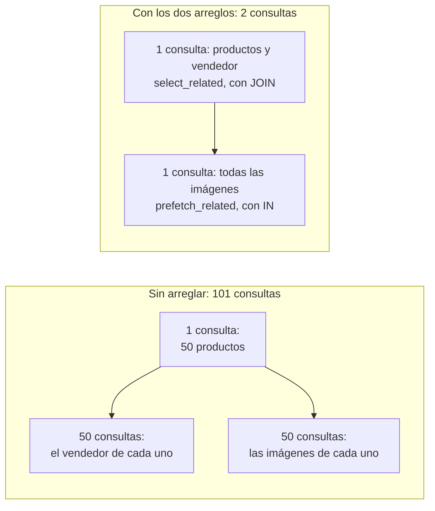

---
seo:
  title: "Consultas N+1 en Django"
  description: "Cómo encontrar y arreglar consultas N+1 en Django paso a paso: de 101 consultas a 1 con debug-toolbar, select_related, prefetch_related y annotate."
  image:
    src: /og/articulos/desarrollo/python/django/consultas-n-mas-1-django.png
    alt: "Consultas N+1 en Django"
  schema:
    - '@type': TechArticle
      headline: "Consultas N+1 en Django: de 101 consultas a 1"
      description: "Cómo encontrar y arreglar consultas N+1 en Django paso a paso: de 101 consultas a 1 con debug-toolbar, select_related, prefetch_related y annotate."
      image: https://velezanthony.github.io/og/articulos/desarrollo/python/django/consultas-n-mas-1-django.png
      inLanguage: es
      datePublished: '2026-11-21'
      dateModified: '2026-11-22'
      author:
        '@type': Person
        '@id': https://velezanthony.github.io/#anthony
        name: Anthony Velez Tapia
        url: https://velezanthony.github.io/
---

# Consultas N+1 en Django: de 101 consultas a 1

En un proyecto en el que trabajé, la página principal tardaba unos 12 segundos. Tras revisar las
consultas, pasó a tardar entre 1 y 2. La causa era la más común en Django: **consultas N+1**.

Aquí lo cuento como lo arreglaría hoy, paso a paso, con un contador que va bajando: el número de
consultas que hace la página.

:::note[Lo que necesitas]

- **[django-debug-toolbar](https://django-debug-toolbar.readthedocs.io/)** instalado en desarrollo.
  Es lo único imprescindible.
- Tres modelos de ejemplo: un vendedor, sus productos y las imágenes de cada producto.

```python
class Seller(models.Model):
    name = models.CharField(max_length=100)


class Product(models.Model):
    name = models.CharField(max_length=200)
    seller = models.ForeignKey(Seller, on_delete=models.CASCADE, related_name="products")


class ProductImage(models.Model):
    product = models.ForeignKey(Product, on_delete=models.CASCADE, related_name="images")
    url = models.URLField()
```

:::

## 1. El síntoma: una lista que va lenta

Una vista que lista 50 productos con su vendedor y cuántas imágenes tiene cada uno:

```python
products = Product.objects.all()[:50]
for product in products:
    print(product.name, product.seller.name, product.images.count())
```

Leyéndola no se ve nada raro. Por eso no hay que leer: hay que **contar**.

## 2. Mirar: abrir debug-toolbar

Abres la página y miras el panel **SQL** de debug-toolbar. Muestra cuántas consultas ha hecho la
petición y cuáles son, y agrupa las que se repiten:

- **Similares**: el mismo SQL con parámetros distintos. Es la firma del N+1.
- **Duplicadas**: el mismo SQL con los mismos parámetros. Estás leyendo lo mismo dos veces.

En nuestro ejemplo verás algo así:

| Consulta | Veces |
|---|---|
| `SELECT … FROM product LIMIT 50` | 1 |
| `SELECT … FROM seller WHERE id = %s` | 50 (similares) |
| `SELECT COUNT(*) FROM productimage WHERE product_id = %s` | 50 (similares) |

**Contador: 101 consultas.**

## 3. Entender: por qué pasa

El ORM de Django es **perezoso**: una relación no se carga hasta que la tocas. Pides 50 productos
(la «1») y, dentro del bucle, cada `product.seller` y cada `product.images.count()` va a la base de
datos por su cuenta (las «N»).

Cada consulta es rápida, pero las idas y vueltas se suman. Con plantillas que tocan varias
relaciones, el número se dispara.

### Por qué en local no lo notas

Para entenderlo hay que saber qué pasa cuando pides datos a la base de datos. Intervienen tres
cosas:

| Concepto | Qué es | Analogía |
|---|---|---|
| **Latencia** | El tiempo que tarda un viaje de ida y vuelta: la consulta sale, la base de datos responde | Lo que tarda un coche en ir y volver |
| **IOPS** | Cuántas operaciones de lectura o escritura puede hacer el disco por segundo. Cada una lee un bloque pequeño (en PostgreSQL, páginas de 8 kB) | Cuántos coches pueden salir por segundo |
| **Rendimiento (MiB/s)** | Cuántos datos puede mover el disco por segundo, en total | Cuántos carriles tiene la carretera |

Además, la base de datos guarda en **memoria (RAM)** los datos que usa a menudo. Si lo que pides
está ahí, ni siquiera toca el disco. Si no, tiene que leerlo del disco, y ahí mandan las IOPS y los
MiB/s.

#### En tu máquina

Django y la base de datos están en el mismo ordenador. La consulta no sale a ninguna red: la
latencia es casi cero. Y con los pocos datos de desarrollo, todo cabe en RAM, así que el disco ni
participa.

Pides 101 consultas y cada una se resuelve al instante. No notas nada.

#### En la nube

La aplicación y la base de datos son **máquinas distintas** dentro de la misma red privada. Aparecen
los tres costes:

1. **Latencia en cada viaje.** Cada consulta cruza la red y vuelve. Es poco por viaje (en una prueba
   de Google entre dos máquinas de la misma zona, del orden de 0,1 ms; más entre zonas o con un proxy por
   medio), pero el N+1 lo multiplica: 101 consultas son 101 viajes.
2. **Los datos ya no caben en RAM.** Con los datos reales de producción, la base de datos tiene que
   ir al disco con más frecuencia, y el disco tiene un límite de IOPS: muchas lecturas pequeñas
   dispersas, justo lo que provoca un N+1, hacen cola.
3. **El caudal tiene un techo.** Si pides muchos datos de golpe, manda el límite de MiB/s. Por
   ejemplo, 80.000 filas que ocupan 800 MiB, con un disco limitado a 300 MiB/s, necesitan unos
   **2,7 segundos** solo para leerse (800 ÷ 300). En tu máquina, con esos datos ya en RAM, sería
   cuestión de milisegundos.

Por eso el N+1 se esconde en desarrollo y aparece en producción: no cambia el código, cambia
**dónde viven los datos y cuánto cuesta llegar a ellos**.

:::note[Los límites dependen de la instancia]

En los servicios gestionados, las IOPS y los MiB/s los fija el proveedor según el tipo de máquina,
el tipo de disco y su tamaño. En Google Cloud SQL, por ejemplo, un disco **Hyperdisk Balanced** de
20 a 256 GB parte de 4.000 IOPS y 170 MiB/s; los discos SSD y HDD clásicos tienen otros límites. Merece la pena mirar los de tu instancia: son el techo real de tu base de datos.

:::

## 4. Primer arreglo: `select_related` para el vendedor

Cada producto tiene **un** vendedor. Para relaciones «hacia uno» (clave foránea o uno a uno),
`select_related` lo trae en la misma consulta con un JOIN:

```python
products = Product.objects.select_related("seller")[:50]
```

Las 50 consultas del vendedor desaparecen.

**Contador: 51 consultas.**

## 5. Segundo arreglo: `prefetch_related` para las imágenes

Cada producto tiene **muchas** imágenes. Un JOIN repetiría el producto por cada imagen, así que
`prefetch_related` hace una consulta aparte con `IN (…)` y reparte los resultados en Python:

```python
products = Product.objects.select_related("seller").prefetch_related("images")[:50]
```

Ahora `product.images.count()` no va a la base de datos: Django cuenta lo que ya precargó.

**Contador: 2 consultas.** Da igual que sean 5 productos o 500.

Los 50 productos, antes y después de los dos arreglos:



### Y si solo necesitas el número: `annotate`

En este ejemplo no usamos las imágenes, solo cuántas hay. Entonces no hace falta traerlas: que lo
cuente la base de datos.

```python
from django.db.models import Count

products = Product.objects.select_related("seller").annotate(image_count=Count("images"))[:50]
for product in products:
    print(product.name, product.seller.name, product.image_count)
```

**Contador: 1 consulta.**

:::tip[Qué usar en cada caso]

| Necesitas… | Usa |
|---|---|
| Un objeto relacionado (FK, uno a uno) | `select_related` |
| Varios objetos relacionados (inversa, muchos a muchos) | `prefetch_related` |
| Solo un número o un agregado | `annotate` |

:::

## 6. Que no vuelva a pasar

Arreglarlo es fácil. Lo difícil es que nadie lo rompa la semana que viene. Uso dos cosas.

### Un test que cuenta consultas

`assertNumQueries` convierte el contador en un contrato. Si alguien toca una relación sin
precargarla, el test falla. Este pide la URL de la vista `seller_products`, la que verás en el
siguiente apartado:

```python
from django.test import TestCase
from django.urls import reverse

from sales.models import Product, Seller


class SellerProductsTests(TestCase):
    @classmethod
    def setUpTestData(cls):
        cls.seller = Seller.objects.create(name="Ana")
        Product.objects.bulk_create(
            Product(name=f"Producto {i}", seller=cls.seller) for i in range(5)
        )

    def test_seller_products_makes_one_query(self):
        url = reverse("seller_products", args=[self.seller.pk])
        with self.assertNumQueries(1):
            self.client.get(url)
```

El `1` da por hecho una petición **anónima**: sin cookie de sesión, ni la sesión ni el usuario van a
la base de datos. Si la vista exige login, cuenta también esas consultas (con `force_login` suelen
ser dos más: la sesión y el usuario).

### Las consultas, en un solo sitio: `selectors.py`

Organizo cada proyecto con **una app por dominio** (por ejemplo, `sales`) y, dentro, las lecturas
reutilizables en `selectors.py`: funciones pequeñas que devuelven un `QuerySet` con la precarga ya
decidida.

```python
# sales/selectors.py
from django.db.models import Count, QuerySet

from sales.models import Product


def products_for_listing() -> QuerySet[Product]:
    return Product.objects.select_related("seller").annotate(image_count=Count("images"))
```

La vista lo usa y solo añade lo suyo:

```python
# sales/views.py
def seller_products(request, seller_id):
    products = products_for_listing().filter(seller_id=seller_id).order_by("name")
    return render(request, "sales/products.html", {"products": products})
```

La ventaja: la estrategia de carga vive en **una sola función**. Si mañana la lista muestra otra
relación, la añado en el selector y quedan arregladas todas las vistas que lo usan. La escritura
(`services.py`) y los formularios que se validan en el servidor (`forms.py`) completan la
estructura; los explico en
[API REST y SPA vs monolito con HTMX y Alpine](../../conceptos/api-rest-spa-vs-htmx.md).

## 7. Trampas habituales

- **Filtrar una relación precargada.** `product.images.filter(...)` es una consulta nueva y tira la
  precarga. Si necesitas un subconjunto, precárgalo con
  `Prefetch("images", queryset=..., to_attr="...")`.
- **`.first()` sobre una relación precargada sin orden.** Django añade `order_by("pk")` y vuelve a
  consultar. `.count()` y `.exists()`, en cambio, sí usan la precarga.
- **La plantilla.** Precargas en la vista y la plantilla toca otra relación. Es donde más N+1
  aparecen, porque nadie la lee pensando en SQL.
- **Serializadores anidados** (Django REST Framework): el `queryset` de la vista debe precargar todo
  lo que el serializador toca.
- **`only()` y `defer()`.** Leer menos columnas está bien, pero acceder luego a un campo diferido
  lanza una consulta por objeto: otro N+1.

## En resumen

1. No leas el código: **cuenta las consultas** con debug-toolbar.
2. Una relación «hacia uno» → `select_related`. «Hacia muchos» → `prefetch_related`. Solo un
   número → `annotate`.
3. Fíjalo con `assertNumQueries` y deja la consulta en un selector para que nadie la rompa.

## Referencias

- [QuerySet API: `select_related`, `prefetch_related` y `Prefetch`](https://docs.djangoproject.com/en/stable/ref/models/querysets/)
- [Optimización del acceso a la base de datos](https://docs.djangoproject.com/en/stable/topics/db/optimization/)
- [Agregación y `annotate()`](https://docs.djangoproject.com/en/stable/topics/db/aggregation/)
- [Herramientas de test: `assertNumQueries`](https://docs.djangoproject.com/en/stable/topics/testing/tools/)
- [django-debug-toolbar: paneles](https://django-debug-toolbar.readthedocs.io/en/latest/panels.html)
- [django-debug-toolbar: historial de cambios (consultas similares y duplicadas)](https://django-debug-toolbar.readthedocs.io/en/latest/changes.html)
- [Google Cloud: medir la latencia de red con netperf y ping](https://cloud.google.com/blog/products/networking/using-netperf-and-ping-to-measure-network-latency)
- [Cloud SQL: opciones de almacenamiento, IOPS y rendimiento](https://docs.cloud.google.com/sql/docs/postgres/storage-options-overview)
- [Compute Engine: ancho de banda de red](https://docs.cloud.google.com/compute/docs/network-bandwidth)
