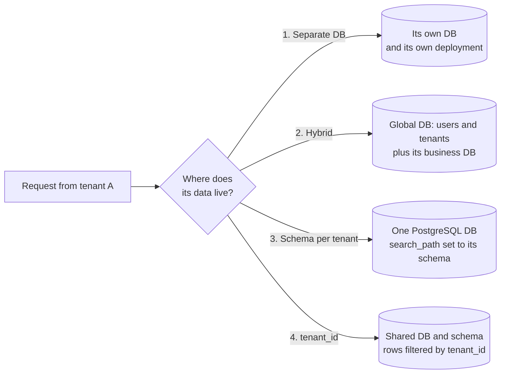

# Multi-tenancy in Django: four strategies

A multi-tenant SaaS serves several customers (tenants) with the same application. The design
question that shapes everything else is where each one's data lives and how much isolation there
is between them. In this article I go through the four strategies I know, from most to least
isolation, and how to choose between them.

The examples use a minimal `Tenant` model and generic business models such as `Order`.

Where the data of the same tenant ends up with each strategy:



## 1. A completely separate database per tenant

Each customer has its own database, and often its own deployment. Nothing is shared between
tenants in the data layer.

- **Pros**: the strongest isolation. A bug in the code cannot mix two customers' data, backups and
  restores are per customer, and you can move a large customer to another server without affecting
  the rest.
- **Cons**: cost and operations grow with every customer. Migrations run N times, global reports
  need to query N databases, and managing users who belong to several tenants gets complicated.

It fits when there are contractual or regulatory isolation requirements, or when there are few
customers, each with a lot of volume.

## 2. Hybrid: a global database plus one database per tenant

A global database holds what is shared: users, the tenant registry and each tenant's connection
settings. Each tenant also has its own database with the business data. On every request the
tenant is resolved and its queries are routed to its database.

In Django this relies on multiple database support: `DATABASES` with several aliases, a
*database router* (`db_for_read`, `db_for_write`, `allow_relation`, `allow_migrate`) and `using()`
when you want to choose the database explicitly.

```python
# tenancy/context.py
from contextvars import ContextVar

current_tenant_db: ContextVar[str | None] = ContextVar("current_tenant_db", default=None)
current_tenant_id: ContextVar[int | None] = ContextVar("current_tenant_id", default=None)


# tenancy/routers.py
from tenancy.context import current_tenant_db

GLOBAL_APPS = {"auth", "contenttypes", "sessions", "tenancy"}


class TenantRouter:
    def db_for_read(self, model, **hints):
        if model._meta.app_label in GLOBAL_APPS:
            return "default"
        return current_tenant_db.get()

    db_for_write = db_for_read

    def allow_migrate(self, db, app_label, model_name=None, **hints):
        if app_label in GLOBAL_APPS:
            return db == "default"
        return db != "default"
```

A middleware resolves the tenant, sets `current_tenant_db` and resets it when the request ends.
The router doesn't receive the request, so some context mechanism (here `contextvars`) is needed;
Django doesn't ship one of its own for this. Watch out for the no-context case: if
`current_tenant_db` isn't set, `db_for_read` and `db_for_write` return `None` and Django silently
uses `default` (unless an instance passed as a hint already comes from another database); a
business query outside a request would end up in the global database. If that must never happen,
make the router raise an exception instead of returning `None`.

There are two details worth knowing before choosing this model:

- Django doesn't support foreign keys or many-to-many relations across different databases.
  A tenant's `Order` cannot have a `ForeignKey` to a `User` in the global database: you store the
  identifier and resolve the relation in code.
- `migrate` works on one database at a time (`migrate --database=<alias>`), so you need a command
  or a script that loops over the tenants.

It is a good middle ground: real isolation of business data, but a single place for
authentication and billing.

## 3. One schema per tenant in a single PostgreSQL database

PostgreSQL allows several schemas inside one database. Each tenant has its schema with the same
tables, and a shared schema (`public`) holds what is common. On every request the `search_path`
is set to the tenant's schema.

The best-known library for this is **django-tenants**: it identifies the tenant by host name,
splits apps into shared ones (in `public`) and tenant-specific ones, and provides commands to
migrate every schema.

- **Pros**: a single server and a single connection, good logical isolation, and per-schema
  backups are possible (`pg_dump --schema`).
- **Cons**: it depends on PostgreSQL, migrations run per schema (with thousands of tenants,
  deployment drags on) and global reports need to loop over schemas or maintain aggregate tables.

## 4. A shared database and schema with `tenant_id`

Every business table has a `tenant_id` column, and every query filters by it. It is the cheapest
option and the simplest to operate, but it moves isolation into the code.

So as not to depend on every developer remembering the filter, I centralise the filtering in a
manager:

```python
from django.db import models

from tenancy.context import current_tenant_id


class TenantScopedManager(models.Manager):
    def get_queryset(self):
        tenant_id = current_tenant_id.get()
        if tenant_id is None:
            raise RuntimeError("No tenant in context")
        return super().get_queryset().filter(tenant_id=tenant_id)


class Order(models.Model):
    tenant = models.ForeignKey("tenancy.Tenant", on_delete=models.CASCADE)
    total = models.DecimalField(max_digits=10, decimal_places=2)

    objects = TenantScopedManager()
    all_tenants = models.Manager()  # unfiltered, only for explicit cross-tenant code
```

:::warning[More code uses the default manager than you think]

Django takes the first declared manager as `_default_manager`, and it is used by the admin
(`ModelAdmin.get_queryset`), `ModelForm` uniqueness validation (`validate_unique`), `dumpdata`
(unless you pass `--all`) and whatever you do in `shell`. If its `get_queryset()` raises an
exception when there is no tenant, all of them fail outside a request with context.

Having `all_tenants` isn't enough for the admin: you have to override `ModelAdmin.get_queryset` so
it uses `Order.all_tenants` (and restrict who gets in). In commands and in `shell`, set the tenant
or use `all_tenants` on purpose. You can also declare `Meta.default_manager_name = "all_tenants"`,
carefully: everything that uses `_default_manager` will stop filtering, and isolation once again
depends on the code using `objects`.

:::

Even so, the risk is real: a raw query, a `Model._base_manager` or a background task without
context can skip the filter and return another customer's data.

An extra safety net in PostgreSQL is **row-level security (RLS)**: with `ALTER TABLE ...
ENABLE ROW LEVEL SECURITY` and a policy, the database filters the rows even if the application
forgets to. Bear in mind that superusers and roles with `BYPASSRLS` always bypass the policies, and
so does the table owner, unless you enable `FORCE ROW LEVEL SECURITY`. If the application connects
as the table's owner and you don't enable `FORCE ROW LEVEL SECURITY`, RLS doesn't protect it.

```sql
ALTER TABLE orders_order ENABLE ROW LEVEL SECURITY;
ALTER TABLE orders_order FORCE ROW LEVEL SECURITY;
CREATE POLICY tenant_isolation ON orders_order
    USING (tenant_id = current_setting('app.tenant_id')::bigint);
```

The `::bigint` is there because Django's `id`s are `BigAutoField` by default. The application sets
`app.tenant_id` in every transaction, and there are three details here that are easy to miss:

- Django works in **autocommit**: outside `transaction.atomic()`, each query is its own
  transaction. A standalone `SET LOCAL` ends with that same query and doesn't affect the next ones.
  That is why the value is set inside `transaction.atomic()` (or with `ATOMIC_REQUESTS`, at the
  start of the view), and the tenant's queries go in that same transaction.
- `SET` doesn't accept bound parameters (`%s`): you would have to build the SQL by concatenating
  text. The function `set_config('app.tenant_id', value, true)` does accept them, and with `true`
  the value only lasts until the end of the transaction, just like `SET LOCAL`.
- `current_setting('app.tenant_id')` raises an error if the parameter doesn't exist, and if it was
  already set earlier on that connection it is left empty and the `::bigint` fails anyway. If you
  forget to set it, the query errors instead of returning data: it fails closed.

```python
# tenancy/middleware.py: after the middleware that resolves request.tenant
from django.db import connection, transaction


class TenantRLSMiddleware:
    def __init__(self, get_response):
        self.get_response = get_response

    def __call__(self, request):
        with transaction.atomic():
            with connection.cursor() as cursor:
                cursor.execute(
                    "SELECT set_config('app.tenant_id', %s, true)", [str(request.tenant.pk)]
                )
            return self.get_response(request)
```

Wrapping the whole request in a transaction has the same cost as `ATOMIC_REQUESTS`: the
connection stays busy for as long as the view runs.

## Resolving the tenant on every request

Where the data lives is one decision; how you know which tenant a request belongs to is another,
independent one. The usual options:

| Method           | Example                         | Comment                                                    |
| ---------------- | ------------------------------- | ---------------------------------------------------------- |
| Subdomain        | `acme.example.com`              | The most common; needs DNS and a wildcard certificate.     |
| Custom domain    | `app.acme.com`                  | The customer points their domain; certificates to manage.  |
| Header           | `X-Tenant: acme`                | Useful in APIs; must never be the only proof of access.    |
| Path             | `example.com/acme/...`          | Simple, but it pollutes URLs and links.                    |
| User             | The logged-in user's tenant     | Valid if each user belongs to a single tenant.             |

Whatever the method, the middleware that resolves the tenant must also check that the
authenticated user has access to it. Resolving the tenant is not authorising.

## Comparison

| Criterion                   | Separate DB      | Hybrid                | Schema per tenant       | `tenant_id`             |
| --------------------------- | ---------------- | --------------------- | ----------------------- | ----------------------- |
| Isolation                   | Maximum          | High                  | High (logical)          | Depends on the code     |
| Infrastructure cost         | High             | Medium-high           | Low                     | The lowest              |
| Migrations                  | N databases      | N + 1 databases       | N schemas               | Once                    |
| Per-tenant backup/restore   | Trivial          | Trivial               | Possible per schema     | Hard (filter rows)      |
| Cross-tenant reports        | Hard             | Hard                  | Medium                  | Trivial                 |
| Application complexity      | Low              | Medium-high (routers) | Medium (library)        | Low, with discipline    |

## When I choose each one

- **`tenant_id`** if I'm starting a product with many small customers and no special isolation
  requirements. I add the scoped manager from day one and consider RLS if I'm using PostgreSQL.
- **Schema per tenant** if I need more isolation without multiplying servers and the number of
  tenants is moderate.
- **Hybrid** when each customer's business data must be physically separate, but I want a single
  user and billing system.
- **Separate DB** when isolation is a business or legal requirement, or customers are few and
  large.

Moving from one model to another later on is expensive, especially from shared to isolated. It is
worth spending time on this decision at the start.

## Summary

The four strategies are a trade-off between isolation and operational cost. The more you share,
the cheaper it is and the more responsibility falls on the code. Decide separately how the tenant
is resolved on each request, and don't confuse resolving it with authorising access.

## References

- [Django: multiple databases and routers](https://docs.djangoproject.com/en/stable/topics/db/multi-db/)
- [Django: managers](https://docs.djangoproject.com/en/stable/topics/db/managers/)
- [PostgreSQL: schemas](https://www.postgresql.org/docs/current/ddl-schemas.html)
- [PostgreSQL: row-level security](https://www.postgresql.org/docs/current/ddl-rowsecurity.html)
- [django-tenants](https://django-tenants.readthedocs.io/en/latest/)
- [Python: `contextvars`](https://docs.python.org/3/library/contextvars.html)
