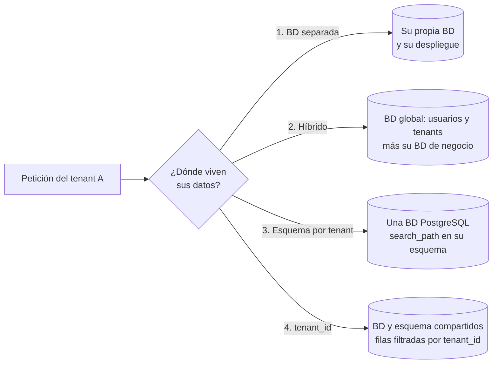

---
seo:
  title: "Multi-tenancy en Django"
  description: "Cuatro formas de aislar a los clientes de un SaaS en Django: bases de datos separadas, híbrido, esquema por tenant y tenant_id, y cuándo usar cada una."
  image:
    src: /og/articulos/desarrollo/python/django/multi-tenancy-django.png
    alt: "Multi-tenancy en Django"
  schema:
    - '@type': TechArticle
      headline: "Multi-tenancy en Django: cuatro estrategias"
      description: "Cuatro formas de aislar a los clientes de un SaaS en Django: bases de datos separadas, híbrido, esquema por tenant y tenant_id, y cuándo usar cada una."
      image: https://velezanthony.github.io/og/articulos/desarrollo/python/django/multi-tenancy-django.png
      inLanguage: es
      datePublished: '2026-11-21'
      dateModified: '2026-11-22'
      author:
        '@type': Person
        '@id': https://velezanthony.github.io/#anthony
        name: Anthony Velez Tapia
        url: https://velezanthony.github.io/
---

# Multi-tenancy en Django: cuatro estrategias

Un SaaS multi-tenant sirve a varios clientes (tenants) con la misma aplicación. La pregunta de
diseño que más condiciona el resto es dónde viven los datos de cada uno y cuánto aislamiento hay
entre ellos. En este artículo repaso las cuatro estrategias que conozco, de más a menos aislamiento,
y cómo elegir entre ellas.

Los ejemplos usan un modelo `Tenant` mínimo y modelos de negocio genéricos como `Order`.

Dónde acaban los datos de un mismo tenant en cada estrategia:



## 1. Una base de datos completamente separada por tenant

Cada cliente tiene su propia base de datos, y a menudo su propio despliegue. No hay nada
compartido entre tenants en la capa de datos.

- **Ventajas**: el aislamiento más fuerte. Un error de código no puede mezclar datos de dos
  clientes, las copias de seguridad y restauraciones son por cliente, y puedes mover a un cliente
  grande a otro servidor sin afectar al resto.
- **Inconvenientes**: el coste y la operación crecen con cada cliente. Las migraciones se ejecutan N
  veces, los informes globales requieren consultar N bases de datos y la gestión de usuarios que
  pertenecen a varios tenants se complica.

Encaja cuando hay requisitos contractuales o regulatorios de aislamiento, o cuando hay pocos
clientes con mucho volumen cada uno.

## 2. Híbrido: base de datos global más una base de datos por tenant

Una base de datos global contiene lo que es común: usuarios, el registro de tenants y la
configuración de conexión de cada uno. Cada tenant tiene además su propia base de datos con los
datos de negocio. En cada petición se resuelve el tenant y se dirigen sus consultas a su base de
datos.

En Django esto se apoya en el soporte de varias bases de datos: `DATABASES` con varios alias, un
*database router* (`db_for_read`, `db_for_write`, `allow_relation`, `allow_migrate`) y `using()`
cuando quieres elegir la base de datos de forma explícita.

```python
# tenancy/context.py
from contextvars import ContextVar

current_tenant_db: ContextVar[str | None] = ContextVar("current_tenant_db", default=None)
current_tenant_id: ContextVar[int | None] = ContextVar("current_tenant_id", default=None)


# tenancy/routers.py
from tenancy.context import current_tenant_db

GLOBAL_APPS = {"auth", "contenttypes", "sessions", "tenancy"}


class TenantRouter:
    def db_for_read(self, model, **hints):
        if model._meta.app_label in GLOBAL_APPS:
            return "default"
        return current_tenant_db.get()

    db_for_write = db_for_read

    def allow_migrate(self, db, app_label, model_name=None, **hints):
        if app_label in GLOBAL_APPS:
            return db == "default"
        return db != "default"
```

Un middleware resuelve el tenant, fija `current_tenant_db` y lo restablece al terminar la petición.
El router no recibe la petición, así que algún mecanismo de contexto (aquí `contextvars`) es
necesario; Django no trae uno propio para esto. Ojo con el caso sin contexto: si
`current_tenant_db` no está fijado, `db_for_read` y `db_for_write` devuelven `None` y Django, sin
avisar, usa `default` (salvo que una instancia pasada como pista ya venga de otra base de datos); una consulta de negocio fuera de una petición acabaría en la base global.
Si eso no debe pasar nunca, que el router lance una excepción en vez de devolver `None`.

Hay dos detalles que conviene conocer antes de elegir este modelo:

- Django no admite claves foráneas ni relaciones muchos a muchos entre bases de datos distintas.
  Un `Order` de un tenant no puede tener una `ForeignKey` a un `User` de la base global: guardas el
  identificador y resuelves la relación en código.
- `migrate` trabaja sobre una base de datos cada vez (`migrate --database=<alias>`), así que
  necesitas un comando o un script que recorra los tenants.

Es un buen punto medio: aislamiento real de los datos de negocio, pero un único sitio para la
autenticación y la facturación.

## 3. Un esquema por tenant en una sola base de datos PostgreSQL

PostgreSQL permite varios esquemas dentro de una base de datos. Cada tenant tiene su esquema con
las mismas tablas, y un esquema compartido (`public`) guarda lo común. En cada petición se ajusta
el `search_path` al esquema del tenant.

La librería más conocida para esto es **django-tenants**: identifica el tenant por el nombre de
host, separa las apps en compartidas (en `public`) y propias de cada tenant, y aporta comandos para
migrar todos los esquemas.

- **Ventajas**: un único servidor y una única conexión, buen aislamiento lógico y copias por
  esquema posibles (`pg_dump --schema`).
- **Inconvenientes**: depende de PostgreSQL, las migraciones se ejecutan por esquema (con miles de
  tenants, el despliegue se alarga) y los informes globales necesitan recorrer esquemas o mantener
  tablas agregadas.

## 4. Una base de datos y un esquema compartidos con `tenant_id`

Todas las tablas de negocio tienen una columna `tenant_id`, y cada consulta filtra por ella. Es la
opción más barata y la más sencilla de operar, pero traslada el aislamiento al código.

Para no depender de que cada desarrollador recuerde el filtro, centralizo el filtrado en un manager:

```python
from django.db import models

from tenancy.context import current_tenant_id


class TenantScopedManager(models.Manager):
    def get_queryset(self):
        tenant_id = current_tenant_id.get()
        if tenant_id is None:
            raise RuntimeError("No tenant in context")
        return super().get_queryset().filter(tenant_id=tenant_id)


class Order(models.Model):
    tenant = models.ForeignKey("tenancy.Tenant", on_delete=models.CASCADE)
    total = models.DecimalField(max_digits=10, decimal_places=2)

    objects = TenantScopedManager()
    all_tenants = models.Manager()  # unfiltered, only for explicit cross-tenant code
```

:::warning[El manager por defecto lo usa más código del que parece]

Django toma el primer manager declarado como `_default_manager`, y de él tiran el admin
(`ModelAdmin.get_queryset`), la validación de unicidad de los `ModelForm` (`validate_unique`),
`dumpdata` (salvo con `--all`) y lo que hagas en `shell`. Si su `get_queryset()` lanza una excepción
cuando no hay tenant, todos ellos fallan fuera de una petición con contexto.

Tener `all_tenants` no basta para el admin: hay que sobrescribir `ModelAdmin.get_queryset` para que
use `Order.all_tenants` (y limitar quién entra). En comandos y en `shell`, fija el tenant o usa
`all_tenants` a propósito. También puedes declarar `Meta.default_manager_name = "all_tenants"`, con
cuidado: todo lo que usa `_default_manager` dejará de filtrar, y el aislamiento vuelve a depender
de que el código use `objects`.

:::

Aun así, el riesgo es real: una consulta cruda, un `Model._base_manager` o una tarea en segundo
plano sin contexto pueden saltarse el filtro y devolver datos de otro cliente.

Una red de seguridad adicional en PostgreSQL es **row-level security (RLS)**: con `ALTER TABLE ...
ENABLE ROW LEVEL SECURITY` y una política, la base de datos filtra las filas aunque la aplicación
olvide hacerlo. Hay que tener en cuenta que los superusuarios y los roles con `BYPASSRLS` se saltan
siempre las políticas, y que el propietario de la tabla también, salvo que actives `FORCE ROW LEVEL
SECURITY`. Si la aplicación se conecta con el usuario propietario de la tabla y no activas `FORCE
ROW LEVEL SECURITY`, RLS no la protege.

```sql
ALTER TABLE orders_order ENABLE ROW LEVEL SECURITY;
ALTER TABLE orders_order FORCE ROW LEVEL SECURITY;
CREATE POLICY tenant_isolation ON orders_order
    USING (tenant_id = current_setting('app.tenant_id')::bigint);
```

El `::bigint` es porque los `id` de Django son `BigAutoField` por defecto. La aplicación fija
`app.tenant_id` en cada transacción, y aquí hay tres detalles que cuesta ver:

- Django trabaja en **autocommit**: fuera de `transaction.atomic()`, cada consulta es su propia
  transacción. Un `SET LOCAL` suelto termina con esa misma consulta y no afecta a las siguientes.
  Por eso el valor se fija dentro de `transaction.atomic()` (o con `ATOMIC_REQUESTS`, al principio
  de la vista), y las consultas del tenant van en esa misma transacción.
- `SET` no admite parámetros enlazados (`%s`): tendrías que montar el SQL concatenando texto. La
  función `set_config('app.tenant_id', valor, true)` sí los admite, y con `true` el valor dura solo
  hasta el final de la transacción, igual que `SET LOCAL`.
- `current_setting('app.tenant_id')` lanza un error si el parámetro no existe, y si ya se fijó antes
  en esa conexión queda vacío y el `::bigint` falla igual. Si olvidas fijarlo, la consulta da error en
  vez de devolver datos: falla cerrado.

```python
# tenancy/middleware.py: after the middleware that resolves request.tenant
from django.db import connection, transaction


class TenantRLSMiddleware:
    def __init__(self, get_response):
        self.get_response = get_response

    def __call__(self, request):
        with transaction.atomic():
            with connection.cursor() as cursor:
                cursor.execute(
                    "SELECT set_config('app.tenant_id', %s, true)", [str(request.tenant.pk)]
                )
            return self.get_response(request)
```

Envolver toda la petición en una transacción tiene el mismo coste que `ATOMIC_REQUESTS`: la
conexión queda ocupada mientras dura la vista.

## Resolver el tenant en cada petición

Dónde están los datos es una decisión; cómo sabes de qué tenant es una petición es otra,
independiente. Las opciones habituales:

| Método           | Ejemplo                       | Comentario                                              |
| ---------------- | ----------------------------- | ------------------------------------------------------- |
| Subdominio       | `acme.example.com`            | El más común; requiere DNS y certificado comodín.       |
| Dominio propio   | `app.acme.com`                | El cliente apunta su dominio; gestionar certificados.   |
| Cabecera         | `X-Tenant: acme`              | Útil en APIs; nunca debe ser la única prueba de acceso. |
| Ruta             | `example.com/acme/...`        | Sencillo, pero contamina las URLs y los enlaces.        |
| Usuario          | El tenant del usuario logueado | Válido si cada usuario pertenece a un único tenant.     |

Sea cual sea el método, el middleware que resuelve el tenant debe comprobar también que el usuario
autenticado tiene acceso a él. Resolver el tenant no es autorizar.

## Comparativa

| Criterio                    | BD separada      | Híbrido               | Esquema por tenant      | `tenant_id`             |
| --------------------------- | ---------------- | --------------------- | ----------------------- | ----------------------- |
| Aislamiento                 | Máximo           | Alto                  | Alto (lógico)           | Depende del código      |
| Coste de infraestructura    | Alto             | Medio-alto            | Bajo                    | El más bajo             |
| Migraciones                 | N bases de datos | N + 1 bases de datos  | N esquemas              | Una vez                 |
| Backup/restore por tenant   | Trivial          | Trivial               | Posible por esquema     | Difícil (filtrar filas) |
| Informes entre tenants      | Difícil          | Difícil               | Medio                   | Trivial                 |
| Complejidad de la aplicación | Baja             | Media-alta (routers)  | Media (librería)        | Baja, con disciplina    |

## Cuándo elijo cada una

- **`tenant_id`** si empiezo un producto con muchos clientes pequeños y sin requisitos especiales
  de aislamiento. Añado el manager con ámbito desde el primer día y considero RLS si uso
  PostgreSQL.
- **Esquema por tenant** si necesito más aislamiento sin multiplicar servidores y el número de
  tenants es moderado.
- **Híbrido** cuando los datos de negocio de cada cliente deben estar separados físicamente, pero
  quiero un único sistema de usuarios y facturación.
- **BD separada** cuando el aislamiento es un requisito de negocio o legal, o los clientes son pocos
  y grandes.

Migrar de un modelo a otro más adelante es caro, sobre todo del compartido a los aislados. Merece
la pena dedicar tiempo a esta decisión al principio.

## En resumen

Las cuatro estrategias son un intercambio entre aislamiento y coste operativo. Cuanto más
compartes, más barato es y más responsabilidad recae en el código. Decide por separado cómo se
resuelve el tenant en cada petición, y no confundas resolverlo con autorizar el acceso.

## Referencias

- [Django: varias bases de datos y routers](https://docs.djangoproject.com/en/stable/topics/db/multi-db/)
- [Django: managers](https://docs.djangoproject.com/en/stable/topics/db/managers/)
- [PostgreSQL: esquemas](https://www.postgresql.org/docs/current/ddl-schemas.html)
- [PostgreSQL: row-level security](https://www.postgresql.org/docs/current/ddl-rowsecurity.html)
- [django-tenants](https://django-tenants.readthedocs.io/en/latest/)
- [Python: `contextvars`](https://docs.python.org/3/library/contextvars.html)
