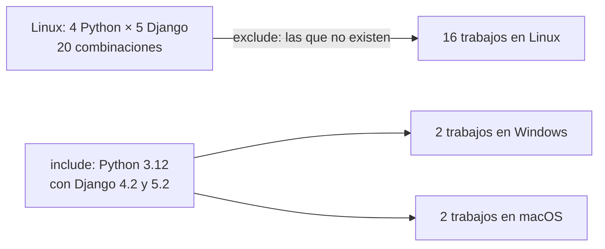

---
seo:
  title: "Matriz de CI en Python: casos reales"
  description: "Cómo montar una matriz de CI con tox y GitHub Actions para Python, Django, bases de datos, Windows y macOS, contada con los fallos reales que destapó."
  image:
    src: /og/articulos/desarrollo/python/estricto/matriz-ci-python.png
    alt: "Matriz de CI en Python: casos reales"
  schema:
    - '@type': TechArticle
      headline: "La matriz de CI: lo que solo falla en otra versión o en otro sistema"
      description: "Cómo montar una matriz de CI con tox y GitHub Actions para Python, Django, bases de datos, Windows y macOS, contada con los fallos reales que destapó."
      image: https://velezanthony.github.io/og/articulos/desarrollo/python/estricto/matriz-ci-python.png
      inLanguage: es
      datePublished: '2026-11-23'
      dateModified: '2026-11-23'
      author:
        '@type': Person
        '@id': https://velezanthony.github.io/#anthony
        name: Anthony Velez Tapia
        url: https://velezanthony.github.io/
---

# La matriz de CI: lo que solo falla en otra versión o en otro sistema

`requires-python = ">=3.10"` es una promesa: «funciono en 3.10, 3.11, 3.12 y 3.13». La única forma
de cumplirla es probarla en todas, y en cada sistema donde se va a ejecutar. Eso es una **matriz de
CI**: los mismos tests, repetidos en cada combinación.

Aquí la cuento con los fallos reales que encontró en
[Django Cotton Gallery](https://velezanthony.github.io/django-cotton-gallery/) y
[SnakeORM](https://velezanthony.github.io/snake-orm/), empezando por el más incómodo: una matriz que
mentía.

Forma parte de la serie [Python estricto](stack-python-estricto.md).

## 1. La matriz que mentía

La primera versión del CI de Django Cotton Gallery tenía combinaciones para Python 3.10, 3.11, 3.12 y
3.13.
En la [primera ejecución](https://github.com/velezanthony/django-cotton-gallery/actions/runs/28533252434)
fallaron casi todos los trabajos al instalar. El
[log del trabajo de 3.10](https://github.com/velezanthony/django-cotton-gallery/actions/runs/28533252434/job/84587968951)
lo explica en tres líneas:

```text
Installed Python 3.10.20 in 1.04s
Using Python 3.12.3 environment at: /usr
error: The interpreter at /usr is externally managed
```

Instalaba Python 3.10 y luego **instalaba el proyecto en el Python 3.12 del sistema**, con
`uv pip install --system`. Ubuntu marca ese Python como gestionado por el sistema
([PEP 668](https://peps.python.org/pep-0668/)) y prohíbe instalarle paquetes, así que falló.

Lo peor no es el error, es lo que había detrás: aunque hubiera instalado, todos los trabajos habrían
probado Python 3.12. Era un examen con cuatro nombres en la cabecera y el mismo alumno respondiendo
los cuatro.

[El arreglo](https://github.com/velezanthony/django-cotton-gallery/commit/06cb6ec6df9db18e0218cae1643bea371b53465c)
fue crear un entorno virtual con la versión de cada combinación y ejecutarlo todo dentro:

::::tabs
:::tab[Antes]
```yaml
- run: uv python install ${{ matrix.python }}
- run: uv pip install --system -e ".[test]"
```
:::
:::tab[Después]
```yaml
- run: uv venv --python ${{ matrix.python }}
- run: uv pip install -e ".[test]"
- name: Show resolved versions
  run: |
    uv run --no-sync python --version
    uv run --no-sync python -c "import django; print(django.get_version())"
```
:::
::::

:::tip[Imprime las versiones]

El paso «Show resolved versions» cuesta un segundo y responde a la única pregunta que importa en una
matriz: ¿este trabajo prueba de verdad lo que dice su nombre?

:::

## 2. Cómo se monta, sin que se dispare

Django Cotton Gallery admite 4 versiones de Python y 5 de Django. Todas contra todas son 20
combinaciones; en tres sistemas, 60. Se recortan con dos herramientas:

- **`exclude`** quita lo que no existe: Django 6.0 exige Python 3.12, y Django 4.2 y 5.0 no admiten
  3.13.
- **`include`** añade solo lo que aporta: en Windows y macOS no se repite todo, solo Python 3.12 con
  las dos versiones de Django de soporte largo.

Así queda el recorte:



El resultado: 16 trabajos en Linux y 4 en Windows y macOS:

```yaml
strategy:
  fail-fast: false
  matrix:
    os: [ubuntu-latest]
    python: ["3.10", "3.11", "3.12", "3.13"]
    django: ["4.2", "5.0", "5.1", "5.2", "6.0"]
    exclude:
      - { python: "3.10", django: "6.0" }
      - { python: "3.11", django: "6.0" }
      - { python: "3.13", django: "4.2" }
      - { python: "3.13", django: "5.0" }
    include:
      - { os: windows-latest, python: "3.12", django: "4.2" }
      - { os: windows-latest, python: "3.12", django: "5.2" }
      - { os: macos-latest, python: "3.12", django: "4.2" }
      - { os: macos-latest, python: "3.12", django: "5.2" }
```

Está resumido; el completo es
[`test.yml`](https://github.com/velezanthony/django-cotton-gallery/blob/main/.github/workflows/test.yml).
En local, [`tox.ini`](https://github.com/velezanthony/django-cotton-gallery/blob/main/tox.ini)
describe la misma matriz en cuatro líneas.

`fail-fast: false` es importante. Por defecto, GitHub cancela el resto de la matriz en cuanto falla
un trabajo, y te quedas sin saber si el fallo es de una versión o de todas.

SnakeORM sigue otra estrategia, porque su riesgo está en la base de datos y no en el framework
([`ci.yml`](https://github.com/velezanthony/snake-orm/blob/main/.github/workflows/ci.yml)):

| | Django Cotton Gallery | SnakeORM |
|---|---|---|
| Ejes | Python × Django, y sistema operativo | Python × motor (Postgres y SQLite) |
| Recorte | `exclude` e `include` | Ninguno: producto completo, 4 × 2 |
| Antes de la matriz | — | Un trabajo de lint y tipos que tarda 30 segundos; si falla, no se levanta ninguna base de datos |

Ese primer trabajo es la mejor idea para ahorrar: lo barato primero. Un error de tipos no necesita
ocho bases de datos para descubrirse.

## 3. Lo que solo falla en Windows

Los cuatro trabajos de Windows y macOS parecen pocos. Han cazado dos fallos que Linux nunca habría
visto. El primero, las barras invertidas de `str(path)`, está en el
[artículo de la serie](stack-python-estricto.md). El segundo es más traicionero.

**La codificación.** Un test escribía una plantilla con `write_text()` sin decir en qué codificación,
y la plantilla llevaba una raya (`—`). En Linux, Python suele escribir UTF-8; en Windows, la página
de códigos del sistema. Django lee las plantillas en UTF-8, así que en Windows
[fallaron tres tests de Playwright](https://github.com/velezanthony/django-cotton-gallery/actions/runs/36460206483/job/109056586911)
sin encontrar la página.
[El arreglo](https://github.com/velezanthony/django-cotton-gallery/commit/c589f52eb26269e3fe62da8d6578389ca51c3448)
([PR #16](https://github.com/velezanthony/django-cotton-gallery/pull/16)):

```python
(atoms / "button.html").write_text(template, encoding="utf-8")
```

:::note[Esto cambiará en Python 3.15]

La [PEP 686](https://peps.python.org/pep-0686/) hace que Python use UTF-8 por defecto en todos los
sistemas a partir de 3.15. Hasta entonces, indica siempre `encoding` al leer o escribir texto.

:::

## 4. Lo que solo falla en una versión

**Las anotaciones de Python 3.14.** Con la PEP 649, SnakeORM dejó de encontrar los tipos de sus
columnas y rompió 18 tests, solo en 3.14. Lo cuento en [mypy y Pyright](mypy-pyright-estricto.md).

**Un aviso ajeno.** Un test de SnakeORM contaba avisos y, solo en Python 3.14, recibió uno de más que
no era suyo. Lo cuento en [pytest a fondo](pytest-a-fondo.md).

**826 commits sin verlo.** SnakeORM promete Python 3.11 o superior, y pydantic rechaza el `TypedDict`
de `typing` por debajo de 3.12: exige el de `typing_extensions`. La máquina de desarrollo tenía
Python 3.13, donde todo funciona, así que pasaron **826 commits** sin que nada avisara, hasta que la
demo de FastAPI dejó de arrancar en el CI. El
[arreglo](https://github.com/velezanthony/snake-orm/commit/081c3d23a1b2eb4396a31792259e6587da628c3e)
fue cambiar el import:

```python
from typing_extensions import TypedDict  # y no `from typing import TypedDict`
```

**Siete de golpe.** Al ampliar la matriz de SnakeORM a todas las versiones que promete, salieron
[siete fallos en un commit](https://github.com/velezanthony/snake-orm/commit/54066912c773e3888943d97641850a2f2c8814e1).
Algunos:

| Fallo | Depende de |
|---|---|
| Un test daba por hecho que SQLite rechaza un `CHECK` sobre una tabla existente; solo es cierto por debajo de SQLite 3.53 | la versión de SQLite |
| Un ejemplo de la documentación con un docstring: Python 3.13 le quita la sangría al compilarlo, 3.11 y 3.12 no | la versión de Python |
| Rutas `async def` sin ningún `await`: FastAPI abría la conexión en un hilo y la usaba en otro, y SQLite no lo permite | el framework |

## 5. Lo que solo falla en el CI

La matriz también compara tu máquina con una limpia. Lo que tienes tú y el CI no, falla allí.

- **Una variable de entorno.** La documentación de SnakeORM abre una segunda conexión, que necesita
  `SNAKEORM_DSN_ANALYTICS`. Todas las máquinas la tenían en su `.env`; el CI no.
  [Solo lo notó el test que ejecuta los ejemplos de la documentación](https://github.com/velezanthony/snake-orm/commit/7493b1712776724bbb1edaee9dfd647dd7546350).
- **Un archivo que no estaba en el repositorio.** Una regla `lib/` del `.gitignore`, sin barra al
  principio, ignoraba **cualquier** carpeta `lib`, también una con código real. En local compilaba,
  porque los archivos estaban en el disco; en el CI fallaba con 20 errores de importación.
  [El arreglo](https://github.com/velezanthony/snake-orm/commit/1777f62ca656113e8c7fc4837e4cd3610ba1bd18):
  `/lib/`, anclado a la raíz.

## En resumen

| Lo que falla | Ejemplo real | Qué lo caza |
|---|---|---|
| La propia matriz | todos los trabajos probaban Python 3.12 | imprimir las versiones en cada trabajo |
| El sistema operativo | `str(path)` y la codificación en Windows | unos pocos trabajos en Windows y macOS |
| La versión | anotaciones de 3.14, `TypedDict` en 3.11, SQLite 3.53, docstrings de 3.13 | todas las versiones que prometes |
| Tu máquina | variables de entorno, archivos ignorados | un CI que empieza de cero |

- Recorta con `exclude` e `include`, no probando menos versiones de las que prometes.
- Pon delante un trabajo barato de lint y tipos.
- Usa `fail-fast: false` para ver todos los fallos a la vez.

## Referencias

- [GitHub Actions: matrices](https://docs.github.com/es/actions/how-tos/write-workflows/choose-what-workflows-do/run-job-variations)
- [tox](https://tox.wiki/)
- [uv: entornos virtuales](https://docs.astral.sh/uv/pip/environments/)
- [PEP 668: entornos gestionados por el sistema](https://peps.python.org/pep-0668/)
- [PEP 686: UTF-8 por defecto](https://peps.python.org/pep-0686/)
- [`pathlib.PurePath.as_posix`](https://docs.python.org/3/library/pathlib.html#pathlib.PurePath.as_posix)
- [Python 3.13: cambios en los docstrings](https://docs.python.org/3/whatsnew/3.13.html)
- [Git: patrones de `.gitignore`](https://git-scm.com/docs/gitignore#_pattern_format)
