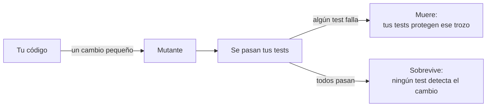

---
seo:
  title: "Mutation testing en Python con mutmut"
  description: "Por qué un 100 % de cobertura no basta: mutation testing con mutmut, un mutante real que sobrevive y cómo repartirlo en el CI con trozos en paralelo y caché."
  image:
    src: /og/articulos/desarrollo/python/estricto/mutation-testing.png
    alt: "Mutation testing en Python con mutmut"
  schema:
    - '@type': TechArticle
      headline: "Mutation testing: el test que prueba tus tests"
      description: "Por qué un 100 % de cobertura no basta: mutation testing con mutmut, un mutante real que sobrevive y cómo repartirlo en el CI con trozos en paralelo y caché."
      image: https://velezanthony.github.io/og/articulos/desarrollo/python/estricto/mutation-testing.png
      inLanguage: es
      datePublished: '2026-11-23'
      dateModified: '2026-11-23'
      author:
        '@type': Person
        '@id': https://velezanthony.github.io/#anthony
        name: Anthony Velez Tapia
        url: https://velezanthony.github.io/
---

# Mutation testing: el test que prueba tus tests

Tienes un 100 % de cobertura y todo en verde. Y aun así puede haber un error que ningún test vería.
La cobertura dice qué líneas **pasan** los tests, no si **comprueban** lo que hacen.

El mutation testing lo mide al revés: estropea tu código a propósito y mira si algún test se queja.
Aquí lo cuento con un ejemplo de Python que he ejecutado de verdad y con el montaje que uso en el CI
de mi librería [@velezanthony/design](https://velezanthony.github.io/design/).

Forma parte de la serie [Python estricto](stack-python-estricto.md).

## 1. La idea: estropear el código y ver quién se queja

Es un simulacro de incendio: provocas un fuego pequeño a propósito y miras si la alarma suena. La
herramienta hace pequeños cambios en tu código, uno cada vez. Cada versión cambiada es un
**mutante**. Algunos ejemplos típicos:

| Original | Mutante |
|---|---|
| `if total >= 100:` | `if total > 100:` |
| `return total * 0.9` | `return total / 0.9` |
| `return True` | `return False` |

Para cada mutante pasa tus tests:

- **Algún test falla**: el mutante muere. Tus tests protegen ese trozo.
- **Todos pasan**: el mutante sobrevive. Has encontrado un cambio de comportamiento que ningún test
  detecta.

La nota es el porcentaje de mutantes muertos.

El recorrido de cada mutante:



## 2. Un mutante que sobrevive, de verdad

Un descuento del 10 % a partir de 100 €, con sus tests. Es un ejemplo genérico, pero lo he ejecutado
con [mutmut](https://mutmut.readthedocs.io/) 3.8.1:

::::tabs
:::tab[discount.py]
```python
def discount(total: float) -> float:
    """10 % off from 100 euros upwards."""
    if total >= 100:
        return total * 0.9
    return total
```
:::
:::tab[test_discount.py]
```python
def test_big_order_gets_discount() -> None:
    assert discount(200) == 180


def test_small_order_pays_full_price() -> None:
    assert discount(50) == 50
```
:::
::::

Los dos tests pasan y la cobertura es del 100 %: se ejecutan las dos ramas del `if`. mutmut genera
cuatro mutantes, mata dos y **sobreviven otros dos**:

```diff
-    if total >= 100:
+    if total > 100:
```

```diff
-    if total >= 100:
+    if total >= 101:
```

Ningún test prueba **exactamente** 100 €, el límite. Si alguien cambia `>=` por `>`, un cliente que
gasta 100 € pierde su descuento y todo sigue en verde. Un test más, y los cuatro mutantes mueren:

```python
def test_exactly_100_gets_discount() -> None:
    assert discount(100) == 90
```

Ese es el valor del mutation testing: no te dice que te falten líneas por cubrir, te dice **qué
caso concreto** no estás probando.

## 3. mutmut: la configuración mínima

En Python, la herramienta es mutmut, y funciona con pytest. Se configura en el `pyproject.toml`:

```toml
[tool.mutmut]
source_paths = ["src/shop/"]
pytest_add_cli_args_test_selection = ["tests/"]
```

Y se usa con tres órdenes:

| Orden | Qué hace |
|---|---|
| `mutmut run` | Genera los mutantes y pasa los tests contra cada uno |
| `mutmut results` | Lista los mutantes que han sobrevivido |
| `mutmut show <nombre>` | Enseña el cambio de un mutante, como el `diff` de arriba |

:::warning[Los nombres antiguos ya están obsoletos]

Muchos ejemplos de internet usan `paths_to_mutate` y `tests_dir`. En mutmut 3.8 siguen funcionando,
pero avisan de que están obsoletos: ahora son `source_paths` y
`pytest_add_cli_args_test_selection`.

:::

## 4. El problema: el tiempo

Cada mutante vuelve a pasar los tests, así que el coste es **mutantes por tests**. En el ejemplo son
4 mutantes y no se nota. En un proyecto de verdad, sí.

Todavía no uso mutmut en mis proyectos de Python, pero sí el mismo principio con
[Stryker](https://stryker-mutator.io/), la herramienta equivalente para TypeScript, en
@velezanthony/design. Allí, mutar toda la librería son unos 12.000 mutantes. Para hacerte una idea:
una sola de las máquinas de la última pasada, con 885 mutantes, tardó 7 min 24 s.

Multiplica eso por todo el proyecto y no cabe en cada PR. Hace falta repartirlo.

## 5. El montaje: trozos en paralelo y caché

Lo resolví con dos workflows y una caché compartida: en cada PR, 2 máquinas que solo repiten lo que
ha cambiado ([`mutation-incremental.yml`](https://github.com/velezanthony/design/blob/main/.github/workflows/mutation-incremental.yml)),
y a mano sobre `main`, una pasada completa con 12 máquinas que regenera la caché
([`mutation.yml`](https://github.com/velezanthony/design/blob/main/.github/workflows/mutation.yml)).
Las cifras de esa pasada están en el [artículo de la serie](stack-python-estricto.md); aquí va cómo
se reparte el trabajo.

Un pequeño programa, [`scripts/mutation/cli.ts`](https://github.com/velezanthony/design/blob/main/scripts/mutation/cli.ts),
hace de director:

1. **`plan`** reparte los archivos entre las máquinas. Pesa cada archivo por sus líneas de código,
   porque los mutantes crecen con ellas, y los coloca del más pesado al más ligero para que todas
   tarden parecido ([`shards.ts`](https://github.com/velezanthony/design/blob/main/scripts/mutation/shards.ts)).
   Como cargar maletas en varios coches: primero las grandes, cada una en el coche más vacío.
2. Cada máquina pasa Stryker solo sobre sus archivos y guarda su resultado.
3. **`merge`** une los resultados de todas en un único informe, que se guarda como caché.

:::note[Por qué la pasada completa va sobre `main`]

Una PR solo puede leer las cachés de su propia rama, de su rama de destino y de la rama principal,
nunca las de una rama hermana. Si la pasada completa se lanzara desde otra rama, las PR no verían su
caché y tendrían que mutarlo todo.

:::

## 6. Un error fácil: probar el enum con el propio enum

Parece inofensivo: el código devuelve un `StrEnum` y el test lo compara con el mismo enum.

```python
class Status(StrEnum):
    PAID = "paid"
    PENDING = "pending"


def test_paid_when_fully_paid():
    assert status_for(100, 100) == Status.PAID
```

El problema es el valor, `"paid"`. Es lo que se guarda en la base de datos o sale en la API, y si
alguien lo cambia, rompe datos que ya existen. Pero ese cambio no lo ve nadie:

- **El test no**, porque compara el enum consigo mismo, como medir una regla con ella misma: si `"paid"` pasa a `"payed"`, cambian los dos
  lados a la vez y sigue en verde.
- **El mutation testing tampoco**, porque no llega a probarlo. Lo he comprobado: mutmut 3.8 solo
  muta el código de dentro de las funciones y deja los valores del enum como están. Stryker hace lo
  mismo en TypeScript: se salta los `enum` y los `as const`.

La salida es congelar esos valores **en los tests**, escritos a mano en un módulo propio, e importarlos
desde ahí en lugar de desde el código:

::::tabs
:::tab[tests/frozen.py]
```python
"""Valores que salen del sistema (base de datos, API). Cambiarlos rompe datos guardados."""

STATUS_PAID = "paid"
STATUS_PENDING = "pending"
```
:::
:::tab[tests/test_orders.py]
```python
from shop.orders import Status, status_for
from tests import frozen


def test_status_values_are_the_stored_ones():
    assert {status.name: status.value for status in Status} == {
        "PAID": frozen.STATUS_PAID,
        "PENDING": frozen.STATUS_PENDING,
    }


def test_paid_when_fully_paid():
    assert status_for(100, 100) == frozen.STATUS_PAID
```
:::
::::

Si alguien cambia `"paid"` en el código, los dos tests fallan. Lo he comprobado: con el test que
comparaba el enum consigo mismo, el cambio pasaba en verde. Y si el cambio es a propósito, se nota
en la PR, porque hay que tocar `frozen.py`.

Con `IntEnum` pasa lo mismo: el número que guardas es el contrato, y va congelado en los tests.

## 7. Cuándo merece la pena

No lo actives sobre todo el proyecto ni en cada commit. Elige los módulos donde un fallo silencioso
sale caro:

| Sí | No tanto |
|---|---|
| Lógica de negocio: precios, descuentos, permisos | Plantillas y vistas que solo enseñan datos |
| Cálculos y conversiones | Configuración |
| Validación de datos de entrada | Código generado |

En mutmut, eso es acotar `source_paths` a esas carpetas.

## En resumen

- La cobertura dice qué código se ejecuta; el mutation testing dice si los tests **comprueban** algo.
- Un mutante que sobrevive señala un caso concreto sin probar, como el límite de los 100 € del
  ejemplo.
- En Python, la herramienta es mutmut: `source_paths` en el `pyproject.toml` y `mutmut run`.
- Cuesta mutantes por tests. Acótalo a lo crítico y, si crece, repártelo en el CI con trozos en
  paralelo y una caché que solo repite lo que cambia.
- Ni mutmut ni Stryker mutan los valores de un enum. Si se guardan o se publican, congélalos en un
  módulo de tests y compáralos con él.

## Referencias

- [mutmut](https://mutmut.readthedocs.io/)
- [Stryker](https://stryker-mutator.io/)
- [Stryker: modo incremental](https://stryker-mutator.io/docs/stryker-js/incremental/)
- [GitHub Actions: restricciones de acceso a la caché](https://docs.github.com/es/actions/reference/workflows-and-actions/dependency-caching#restrictions-for-accessing-a-cache)
- [@velezanthony/design: `mutation.yml`](https://github.com/velezanthony/design/blob/main/.github/workflows/mutation.yml)
- [@velezanthony/design: `mutation-incremental.yml`](https://github.com/velezanthony/design/blob/main/.github/workflows/mutation-incremental.yml)
- [@velezanthony/design: `scripts/mutation/`](https://github.com/velezanthony/design/tree/main/scripts/mutation)
