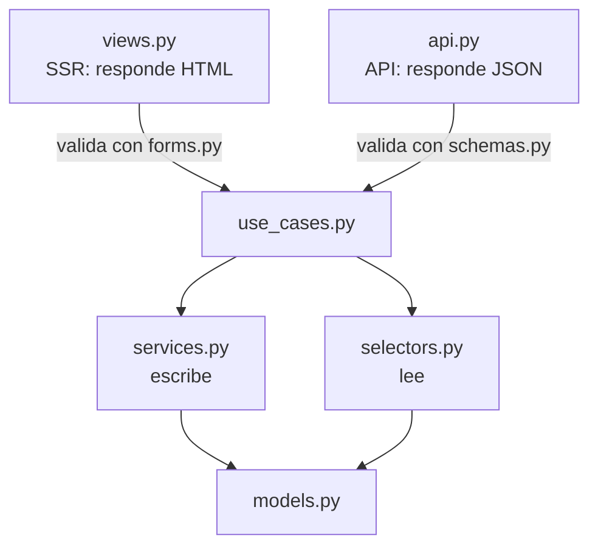

---
seo:
  title: "Organizar un proyecto Django o Flask"
  description: "La estructura con la que organizo proyectos Django y Flask que crecen: dominio, servicios, selectors y casos de uso para servir HTML y JSON a la vez."
  image:
    src: /og/articulos/desarrollo/python/organizar-proyecto-django.png
    alt: "Organizar un proyecto Django o Flask"
  schema:
    - '@type': TechArticle
      headline: "Cómo organizo un proyecto Python que crece: la misma estructura en Django y en Flask"
      description: "La estructura con la que organizo proyectos Django y Flask que crecen: dominio, servicios, selectors y casos de uso para servir HTML y JSON a la vez."
      image: https://velezanthony.github.io/og/articulos/desarrollo/python/organizar-proyecto-django.png
      inLanguage: es
      datePublished: '2026-11-23'
      dateModified: '2026-11-23'
      author:
        '@type': Person
        '@id': https://velezanthony.github.io/#anthony
        name: Anthony Velez Tapia
        url: https://velezanthony.github.io/
---

# Cómo organizo un proyecto Python que crece: la misma estructura en Django y en Flask

He trabajado en varios proyectos Django y en varios Flask. Todos empiezan igual: unas pocas vistas
que consultan, validan y guardan, todo en el mismo sitio. Funciona hasta que el proyecto crece y
cada cambio obliga a buscar la misma regla en cinco vistas.

Con el tiempo me he quedado con una estructura que uso en los dos. Aquí cuento cómo es, qué me gusta,
qué limitaciones tiene y cómo las resuelvo, y la pieza que añado cuando el proyecto tiene que servir
a más de un cliente, por ejemplo la web y una aplicación en Angular o móvil.

Cada ejemplo va en dos pestañas: **Django**, con su ORM, y **Flask**, con SQLAlchemy. Elige la tuya:
la estructura es la misma.

## 1. Cada cosa en su sitio

La idea es que cada archivo tenga un trabajo, y solo uno:

| Archivo | Qué hace | Qué no hace nunca |
|---|---|---|
| `views.py` | Lee la petición, llama a quien sabe y responde | Lógica de negocio |
| `forms.py` | Valida la entrada de una pantalla: tipos, obligatorios, longitudes | Reglas de negocio: esas son del servicio |
| `schemas.py` | Valida la entrada de la API y tipa lo que devuelve | Consultar la base de datos |
| `services.py` | Escribe: crea, cambia, borra, y aplica las reglas | Leer para pintar una pantalla |
| `selectors.py` | Lee: devuelve una entidad o una dataclass | Escribir, ni devolver un dict suelto |
| `models.py` | Los datos | Saber de pantallas |

Es como un restaurante: la vista es el camarero, que toma la comanda y sirve el plato; los servicios
son la cocina y los *selectors*, la despensa. El camarero no cocina, y la cocina no sale a la sala.

La carpeta del dominio no sabe nada de pantallas, y las plantillas van aparte, siguiendo a la
interfaz:

::::tabs
:::tab[Django]
```text
apps/
├── core/                ← el dominio: una carpeta por entidad, sin vistas ni rutas
│   └── orders/
│       ├── models.py    ← los datos
│       ├── forms.py     ← la entrada de una pantalla
│       ├── schemas.py   ← la entrada y la salida de la API
│       ├── services.py  ← escribe y aplica las reglas
│       ├── selectors.py ← lee
│       ├── queries.py   ← condiciones sueltas, en proyectos grandes
│       └── use_cases.py ← orquesta, cuando hay varios clientes
└── portals/             ← la interfaz, una carpeta por público
    ├── backoffice/      ← el equipo que gestiona los pedidos
    │   ├── urls.py      ← las rutas de las dos, separadas
    │   ├── views.py     ← las vistas SSR: pintan la pantalla
    │   └── api.py       ← las vistas de la API: responden JSON
    └── storefront/      ← la tienda, para los clientes
templates/               ← sigue a la interfaz, no al dominio
└── cotton/              ← los componentes: átomos, moléculas y layouts
```
:::
:::tab[Flask]
```text
apps/
├── core/                ← el dominio: una carpeta por entidad, sin vistas ni rutas
│   └── orders/
│       ├── models.py    ← los datos
│       ├── forms.py     ← la entrada de una pantalla
│       ├── schemas.py   ← la entrada y la salida de la API
│       ├── services.py  ← escribe y aplica las reglas
│       ├── selectors.py ← lee
│       ├── queries.py   ← condiciones sueltas, en proyectos grandes
│       └── use_cases.py ← orquesta, cuando hay varios clientes
└── portals/             ← la interfaz, una carpeta por público
    ├── backoffice/      ← el equipo que gestiona los pedidos
    │   ├── __init__.py  ← crea los dos blueprints
    │   ├── views.py     ← las vistas SSR, con su ruta en el decorador
    │   └── api.py       ← las vistas de la API, con su ruta en el decorador
    └── storefront/      ← la tienda, para los clientes
templates/               ← sigue a la interfaz, no al dominio
└── components/          ← las macros de Jinja: átomos, moléculas y layouts
```
:::
::::

El árbol es el mismo, y en los dos las vistas SSR y las de la API van en archivos distintos. Solo
cambia cómo se declaran las rutas: en Django, en `urls.py`; en Flask, en el decorador de cada vista,
con un *blueprint* para las pantallas y otro para la API.

:::note[En Flask, los formularios se instalan aparte]

Django trae un conjunto cerrado: ORM, migraciones, formularios, CSRF, usuarios, traducciones y el
admin. Flask trae las rutas y las plantillas; el resto lo eliges e instalas tú, o lo escribes a mano.
Para los formularios, lo habitual es [Flask-WTF](https://flask-wtf.readthedocs.io/), que une
WTForms y la protección CSRF. A mano, con `request.form`, también funciona, pero repites en cada
vista la conversión de tipos, los obligatorios y los mensajes de error. Qué instalo para tener lo
mismo que Django lo cuento en [Montar tu Flask](flask/flask-dependencias.md).

:::

## 2. Escribir y leer, por separado

Los servicios escriben y aplican las reglas; los *selectors* leen. Que estén separados evita lo más
habitual: una lectura que, de paso, crea filas, y nadie lo espera.

::::tabs
:::tab[Django]
```python
# services.py
def create_order(order: Order) -> Order:
    if order.quantity > order.product.stock:
        raise OrderError("No hay stock suficiente")
    order.save()
    return order  # la transacción la abre el dueño de la operación


# selectors.py
def pending_orders(*, customer_id: int) -> QuerySet[Order]:
    return (
        Order.objects.filter(customer_id=customer_id, status=OrderStatus.PENDING)
        .select_related("product")
        .order_by("-created_at")
    )
```
:::
:::tab[Flask]
```python
# services.py
def create_order(order: Order) -> Order:
    if order.quantity > order.product.stock:
        raise OrderError("No hay stock suficiente")
    db.session.add(order)
    return order  # la transacción la abre el dueño de la operación


# selectors.py
def pending_orders(*, customer_id: int) -> Sequence[Order]:
    stmt = (
        select(Order)
        .where(Order.customer_id == customer_id, Order.status == OrderStatus.PENDING)
        .options(joinedload(Order.product))
        .order_by(Order.created_at.desc())
    )
    return db.session.scalars(stmt).all()
```
:::
::::

El servicio recibe la instancia sin guardar y, si algo no cuadra, lanza una excepción. Quien lo
llama la traduce a su contexto: un mensaje en pantalla, un 422 en la API, un error en un comando.

Para dudar menos dónde va algo, una pregunta: **¿lo llamaría algo que no sea una vista?** Si un
comando o una tarea programada lo necesitaría, va en un servicio.

## 3. Quién valida qué

Validar no es un solo paso, son tres, como en un aeropuerto: el control comprueba que traes los
documentos en regla, el mostrador decide si puedes subir a **ese** vuelo, y la tarjeta de embarque
sale igual para todos.

| Paso | Dónde | Qué comprueba |
|---|---|---|
| La entrada | `forms.py` (pantalla) o `schemas.py` (API) | La forma: tipos, obligatorios, longitudes |
| Las reglas | `services.py` | Lo que depende del estado: «un pedido pagado no se cancela» |
| La salida | `schemas.py` | Lo que la API promete devolver, tipado |

La entrada de una pantalla va en un formulario:

::::tabs
:::tab[Django]
```python
# forms.py
class OrderForm(forms.Form):
    product_id = forms.IntegerField()
    quantity = forms.IntegerField(min_value=1, max_value=99)
```
:::
:::tab[Flask]
```python
# forms.py
class OrderForm(FlaskForm):
    product_id = IntegerField(validators=[InputRequired()])
    quantity = IntegerField(validators=[InputRequired(), NumberRange(min=1, max=99)])
```
:::
::::

La de la API, y su salida, en *schemas* de [Pydantic](https://docs.pydantic.dev/), iguales en los
dos frameworks:

```python
# schemas.py
class OrderIn(BaseModel):
    product_id: int
    quantity: int = Field(ge=1, le=99)


class OrderOut(BaseModel):
    id: int
    status: OrderStatus
    total: Decimal
```

La vista responde `OrderOut.model_validate(order, from_attributes=True)` y nunca un `dict` armado a
mano: si alguien añade un campo al modelo, no sale en la API por accidente, y el front sabe
exactamente qué recibe.

Las reglas, en cambio, viven una sola vez en el servicio, porque valen igual para la pantalla, la API
y un comando:

```python
# services.py
def cancel_order(order: Order) -> Order:
    if order.status == OrderStatus.PAID:
        raise OrderError("Un pedido pagado no se cancela")
    ...
```

El formulario y el *schema* dicen si el dato **tiene sentido**; el servicio, si **se puede hacer**.

## 4. Lo que me gusta, y lo que cuesta

Me gusta porque cada cambio tiene un solo sitio. Si cambia una regla, toco un servicio; si una
pantalla va lenta, miro su *selector*. Y los tests se escriben solos: un servicio se prueba sin
levantar ninguna vista.

Pero tiene dos limitaciones, y las dos tienen arreglo:

| Limitación | Cómo la resuelvo |
|---|---|
| **Más archivos y más ceremonia.** En un proyecto pequeño, tres archivos para una consulta es exagerar | Las capas se añaden cuando hacen falta, no antes. Un proyecto pequeño empieza con servicios y *selectors*; lo demás llega con el tamaño |
| **Se degrada sola.** Basta una vista con una consulta «solo esta vez» | Algo que la vigile en el CI (en el punto 7) |

Y nada de cajones de sastre: ni `utils/`, ni `helpers.py`. Un cajón es una decisión aplazada, y en
un año nadie sabe qué hay dentro. Cuando un archivo crece, se convierte en carpeta con el mismo
nombre: `services.py` pasa a `services/billing.py`, `services/refunds.py`…

## 5. Cuando hay dos clientes: los casos de uso

Esta es la pieza que añado cuando el proyecto lo pide. En uno de mis proyectos Flask, la misma
aplicación servía las pantallas en HTML (SSR) y, a la vez, una API JSON para otro cliente: un front
aparte y una aplicación móvil. Cada pantalla tenía un gemelo JSON. Qué es cada cosa, SSR, SPA o
API, lo cuento en [SSR, SPA, SSG, PWA y API](../conceptos/ssr-spa-ssg-pwa-api.md).

Con la lógica en las vistas, cada arreglo había que hacerlo dos veces. La solución es un archivo más,
`use_cases.py`, con una regla: **el caso de uso no conoce la petición**. Recibe datos ya limpios,
orquesta la operación y devuelve un resultado. Cada vista lee su entrada, lo llama y traduce el
resultado a su formato.

Las dos vistas entran por el mismo caso de uso:



En el restaurante, el caso de uso es la receta: no sabe si el pedido llegó por la barra o por
teléfono.

```python
@dataclass(frozen=True)
class OnCallOutcome:
    ok: bool
    name: str | None = None
    error: str | None = None


def assign_on_call(*, week_start: date, user_id: int, actor_id: int) -> OnCallOutcome:
    """Asigna la guardia de la semana. No sabe quién la pide: una pantalla o la API."""
    ...
```

::::tabs
:::tab[Django · SSR]
```python
# views.py
@require_POST
def on_call_submit(request: HttpRequest) -> HttpResponse:
    form = OnCallForm(request.POST)
    if not form.is_valid():
        return render(request, "on_call/board.html", {"form": form}, status=422)
    outcome = assign_on_call(
        week_start=form.cleaned_data["week_start"],
        user_id=form.cleaned_data["user_id"],
        actor_id=request.user.id,
    )
    if outcome.ok:
        messages.success(request, f"Guardia asignada a {outcome.name}")
    else:
        messages.error(request, outcome.error)
    return redirect("on_call:board")
```
:::
:::tab[Django · API]
```python
# api.py
@require_POST
def on_call_api(request: HttpRequest) -> JsonResponse:
    data = OnCallIn.model_validate_json(request.body)
    outcome = assign_on_call(**data.model_dump(), actor_id=request.user.id)
    if not outcome.ok:
        return JsonResponse({"error": outcome.error}, status=422)
    return JsonResponse({"user_id": data.user_id, "name": outcome.name})
```
:::
:::tab[Flask · SSR]
```python
# views.py
@bp.post("/guardias")
def on_call_submit() -> ResponseReturnValue:
    form = OnCallForm(request.form)
    if not form.validate():
        return render_template("on_call/board.html", form=form), 422
    outcome = assign_on_call(
        week_start=form.week_start.data,
        user_id=form.user_id.data,
        actor_id=current_user.id,
    )
    if outcome.ok:
        flash(f"Guardia asignada a {outcome.name}", "success")
    else:
        flash(outcome.error, "error")
    return redirect(url_for("on_call.board"))
```
:::
:::tab[Flask · API]
```python
# api.py
@api.post("/guardias")
def on_call_api() -> ResponseReturnValue:
    data = OnCallIn.model_validate_json(request.get_data())
    outcome = assign_on_call(**data.model_dump(), actor_id=current_user.id)
    if not outcome.ok:
        return {"error": outcome.error}, 422
    return {"user_id": data.user_id, "name": outcome.name}
```
:::
::::

Las vistas son finas y distintas, y tienen que serlo: una redirige con un mensaje y la otra
responde un 422. La regla de quién puede hacer guardia vive una sola vez. En ese proyecto, un cambio
de quién puede ver qué llegó a la pantalla y a su gemelo JSON en el mismo commit, sin tocar dos
sitios.

:::note[¿Quién hace el commit de la base de datos?]

Quien es dueño de la operación completa. Si el caso de uso combina varios servicios, el commit es
suyo y los servicios no lo hacen: o se guarda todo, o nada. En Django, el caso de uso lleva
`@transaction.atomic`; en Flask, llama a `db.session.commit()` al final.

:::

Si el proyecto solo tiene un cliente, no añado esta capa: la vista llama al servicio y al *selector*
directamente.

## 6. En proyectos grandes: las lecturas en átomos y moléculas

Cuando el proyecto es grande, muchas lecturas repiten la misma condición: «pedido pendiente»,
«usuario activo». Copiarla en cada consulta es la forma más segura de que un día dos pantallas
cuenten distinto. Así que parto las lecturas en dos niveles, con la idea de Atomic Design:

- **`queries.py` son los átomos:** condiciones sueltas, que no consultan nada.
- **`selectors.py` son las moléculas:** combinan átomos y ejecutan la consulta.

::::tabs
:::tab[Django]
```python
# queries.py
def is_pending() -> Q:
    return Q(status=OrderStatus.PENDING, cancelled_at__isnull=True)


# selectors.py
def pending_orders(*, customer_id: int) -> QuerySet[Order]:
    return Order.objects.filter(queries.is_pending(), customer_id=customer_id).order_by(
        "-created_at"
    )
```
:::
:::tab[Flask]
```python
# queries.py
def is_pending() -> ColumnElement[bool]:
    return and_(Order.status == OrderStatus.PENDING, Order.cancelled_at.is_(None))


# selectors.py
def pending_orders(*, customer_id: int) -> Sequence[Order]:
    stmt = select(Order).where(queries.is_pending(), Order.customer_id == customer_id)
    return db.session.scalars(stmt.order_by(Order.created_at.desc())).all()
```
:::
::::

Un átomo solo se extrae cuando lo usan **dos o más** lecturas. Si solo lo usa una, se queda en su
*selector*: extraerlo sería ceremonia. En un proyecto mediano, con `selectors.py` basta.

## 7. La interfaz y la vigilancia

**La UI sigue la misma idea.** Los componentes, con [Django Cotton](https://django-cotton.com/) en
Django o con macros de Jinja en Flask, van en átomos, moléculas y layouts: un botón, un campo, un
modal, la página. Y los colores y la tipografía salen de un único archivo de tokens, el `@theme` de
Tailwind: ningún componente lleva un color escrito a mano.

**Y algo que lo vigile.** En uno de los proyectos Flask, un auditor propio recorre el código y
cuenta, capa por capa, lo que está donde no debe: un `commit()` en un servicio, una consulta en una
vista, un `redirect` en un caso de uso. Compara el recuento con una referencia que **solo puede
bajar**, así que quien añade una de más ve el test en rojo. Si no quieres escribir el tuyo,
[import-linter](https://import-linter.readthedocs.io/) hace lo básico: prohibir que una capa importe
de otra.

## En resumen

| Pieza | Cuándo la uso |
|---|---|
| Servicios y *selectors* | Siempre: escribir y leer, por separado |
| Formularios y *schemas* | Siempre: la forma del dato en la entrada; los *schemas*, también en la salida de la API |
| Dominio aparte de la interfaz | Siempre: el dominio no sabe de pantallas |
| Casos de uso | Cuando hay más de un cliente: web y API, Angular o móvil |
| Átomos (`queries.py`) | En proyectos grandes, cuando una condición la usan dos o más lecturas |
| Un vigilante en el CI | En cuanto trabaja más de una persona |

La estructura es la misma en Django y en Flask. Cambia dónde la pone cada framework, no la idea.

## Referencias

- [Django: transacciones de base de datos](https://docs.djangoproject.com/es/5.2/topics/db/transactions/)
- [Django: objetos `Q`](https://docs.djangoproject.com/es/5.2/topics/db/queries/#complex-lookups-with-q-objects)
- [Pydantic](https://docs.pydantic.dev/)
- [Flask-WTF](https://flask-wtf.readthedocs.io/)
- [Flask: blueprints](https://flask.palletsprojects.com/en/stable/blueprints/)
- [SQLAlchemy: expresiones de columna](https://docs.sqlalchemy.org/en/20/core/sqlelement.html)
- [Django Cotton](https://django-cotton.com/)
- [Tailwind CSS: `@theme`](https://tailwindcss.com/docs/theme)
- [Atomic Design, de Brad Frost](https://atomicdesign.bradfrost.com/)
- [import-linter](https://import-linter.readthedocs.io/)
