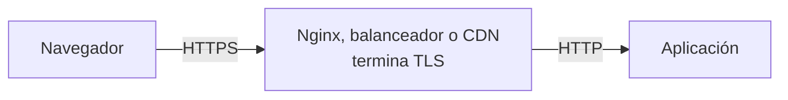

---
seo:
  title: "ERR_TOO_MANY_REDIRECTS con Nginx"
  description: "Por qué un sitio detrás de Nginx entra en un bucle de redirecciones al forzar HTTPS: dónde termina TLS, X-Forwarded-Proto y cómo diagnosticarlo con curl."
---

# ERR_TOO_MANY_REDIRECTS: Nginx, HTTPS y redirecciones

Un sitio detrás de Nginx funciona por HTTP. Le pones el certificado, activas "forzar HTTPS" en la
aplicación y el navegador deja de cargar la página: **ERR_TOO_MANY_REDIRECTS**. Borras cookies,
pruebas en otro navegador y nada. No es el navegador: alguien en el camino responde a cada petición
con una redirección que lleva otra vez a la misma petición.

## El camino de una petición

Delante de la aplicación hay un **proxy inverso**: Nginx recibe la conexión del navegador y la
reenvía a la aplicación (Gunicorn, PHP-FPM, Node…) por una red interna. A veces hay más saltos: un
balanceador o una CDN delante de Nginx.



La clave es **dónde termina TLS**: el primer equipo que descifra HTTPS. A partir de ahí, la petición
suele seguir por HTTP. La aplicación recibe una petición por HTTP aunque el usuario haya escrito
`https://`, y si su regla es "si no es HTTPS, redirige a HTTPS", redirige. El navegador sigue la
redirección, vuelve a entrar por HTTPS, el proxy vuelve a hablar HTTP con la aplicación… y así hasta
que el navegador se rinde.

## Diagnosticar con curl

Antes de tocar nada, mira quién redirige y a dónde:

```bash
curl -sIL https://example.com | rg -i '^(HTTP|location)'
```

`-I` pide solo las cabeceras, `-L` sigue las redirecciones (curl se para a las 50) y `-s` quita la
barra de progreso. Un bucle se ve así:

```text
HTTP/2 301
location: https://example.com/
HTTP/2 301
location: https://example.com/
HTTP/2 301
location: https://example.com/
```

La misma URL redirigiendo a sí misma: la aplicación (o algo entre medias) cree que la petición no
es HTTPS. Si las `location` alternan entre dos URL (`https://www.example.com/` y
`https://example.com/`), son dos reglas que se contradicen.

Para saber **quién** responde, compara las cabeceras: `server: nginx` frente a la de la aplicación o
la CDN, o lanza la misma petición saltándote un salto (directamente al puerto de la aplicación
desde el servidor, por ejemplo).

## X-Forwarded-Proto: decirle a la aplicación cómo llegó el usuario

El proxy que termina TLS sabe que la petición original era HTTPS; la aplicación no. Se lo cuenta con
una cabecera, **`X-Forwarded-Proto`**, que vale `https` o `http`. En Nginx, `$scheme` es el esquema
con el que llegó la petición a Nginx:

```nginx
proxy_set_header X-Forwarded-Proto $scheme;
```

Y la aplicación tiene que **leerla**, porque por defecto no se fía de ella. Con eso se arreglan los
dos casos más habituales.

### Django con `SECURE_SSL_REDIRECT`

`SECURE_SSL_REDIRECT = True` redirige a HTTPS toda petición que Django no considera segura. Detrás de
un proxy, Django ve HTTP siempre. La propia documentación lo dice: si activarlo provoca redirecciones
infinitas, es que estás detrás de un proxy y falta `SECURE_PROXY_SSL_HEADER`:

```python
# settings.py
SECURE_SSL_REDIRECT = True
SECURE_PROXY_SSL_HEADER = ("HTTP_X_FORWARDED_PROTO", "https")
```

:::warning[Solo si controlas el proxy]

Con `SECURE_PROXY_SSL_HEADER`, Django cree lo que diga esa cabecera. Actívalo solo si el proxy la
sobrescribe en cada petición, como hace `proxy_set_header`; si no, un cliente podría enviarla él
mismo.

:::

El montaje completo de Nginx delante de Django lo cuento en
[Django con Docker, Gunicorn y Nginx](django-docker-gunicorn-nginx.md).

### WordPress con la URL del sitio en `https://`

Con la URL del sitio en `https://` y TLS terminado en el proxy, WordPress también entra en bucle: la
documentación lo menciona expresamente y la solución es la misma idea, leer `X-Forwarded-Proto` en
`wp-config.php` y marcar la petición como HTTPS:

```php
// wp-config.php
if (isset($_SERVER['HTTP_X_FORWARDED_PROTO'])
    && strpos($_SERVER['HTTP_X_FORWARDED_PROTO'], 'https') !== false) {
    $_SERVER['HTTPS'] = 'on';
}
```

## La configuración de Nginx

Cuando Nginx termina TLS, lo más sencillo es que la redirección a HTTPS la haga **solo Nginx**, en el
servidor del puerto 80, y que el del 443 no redirija nada:

```nginx
# /etc/nginx/sites-available/example.com
server {
    listen 80;
    server_name example.com www.example.com;
    return 301 https://$host$request_uri;
}

server {
    listen 443 ssl;
    server_name example.com www.example.com;

    ssl_certificate     /etc/letsencrypt/live/example.com/fullchain.pem;
    ssl_certificate_key /etc/letsencrypt/live/example.com/privkey.pem;

    location / {
        proxy_set_header Host $host;
        proxy_set_header X-Forwarded-For $proxy_add_x_forwarded_for;
        proxy_set_header X-Forwarded-Proto $scheme;
        proxy_pass http://127.0.0.1:8000;
    }
}
```

- **Puerto 80**: `return 301` responde sin pasar por la aplicación. `$host` es el dominio pedido y
  `$request_uri` la ruta original con sus parámetros, así que `/carrito?id=3` acaba en la misma
  ruta por HTTPS.
- **Puerto 443**: aquí `$scheme` vale siempre `https`, y es lo que recibe la aplicación.

El certificado lo emite Let's Encrypt. `sudo certbot --nginx -d example.com -d www.example.com`
obtiene el certificado, lo guarda en `/etc/letsencrypt/live/example.com/` y edita la configuración
de Nginx; por defecto añade también la redirección de HTTP a HTTPS. La mayoría de instalaciones de
Certbot dejan programada la renovación.

Con la redirección en Nginx, el ajuste de la aplicación (`SECURE_SSL_REDIRECT`, el plugin de turno)
sobra. Puedes dejarlo como red de seguridad, pero entonces la aplicación tiene que leer
`X-Forwarded-Proto` bien.

## Cuando TLS termina antes de Nginx

Si delante de Nginx hay un balanceador (un ALB en AWS, por ejemplo) o una CDN que termina TLS, Nginx
recibe **HTTP**. Dos consecuencias:

- **`return 301 https://…` en Nginx provoca el bucle.** El usuario llega por HTTPS al balanceador,
  este habla HTTP con Nginx, Nginx redirige a HTTPS, vuelta a empezar. La redirección va en el
  equipo que termina TLS: en el ALB es una regla del *listener* del puerto 80 con una acción
  `redirect` a HTTPS.
- **`$scheme` vale `http`.** Nginx tiene que reenviar la cabecera que le llega del balanceador, no
  generar una nueva:

```nginx
proxy_set_header X-Forwarded-Proto $http_x_forwarded_proto;
```

En [Arquitectura básica en AWS](aws-arquitectura-basica.md) uso justo ese montaje: el ALB termina
HTTPS con un certificado de ACM.

### Una CDN en modo "flexible"

Cloudflare en modo **Flexible** cifra entre el navegador y Cloudflare, pero habla **HTTP** con tu
servidor. Si tu servidor redirige HTTP a HTTPS (el `return 301` de arriba), cada petición de
Cloudflare recibe una redirección, que el navegador sigue y vuelve a llegar a Cloudflare: bucle. La
documentación de Cloudflare propone quitar la redirección del origen o, más sencillo, poner un
certificado en el origen y usar el modo **Full (strict)**, que habla HTTPS con él.

## www contra sin www

El otro bucle clásico no tiene que ver con HTTPS: Nginx redirige `www.example.com` a
`example.com` y la aplicación (o la CDN, o una regla en el panel del hosting) redirige
`example.com` a `www.example.com`. En el `curl` se ve como dos `location` que se alternan.

Decide cuál es el dominio canónico y haz la redirección **en un solo sitio**. En Nginx, un `server`
para el dominio que no quieres:

```nginx
server {
    listen 443 ssl;
    server_name www.example.com;
    ssl_certificate     /etc/letsencrypt/live/example.com/fullchain.pem;
    ssl_certificate_key /etc/letsencrypt/live/example.com/privkey.pem;
    return 301 https://example.com$request_uri;
}
```

El certificado tiene que cubrir los dos nombres: el navegador comprueba el certificado antes de
ver la redirección.

## En resumen

- El bucle aparece cuando alguien redirige a HTTPS una petición que, para él, llegó por HTTP.
- Averigua dónde termina TLS: a partir de ese punto la petición viaja por HTTP.
- `curl -sIL … | rg -i '^(HTTP|location)'` te dice quién redirige y a dónde.
- Redirige en un solo sitio, el que termina TLS, y pasa `X-Forwarded-Proto` a la aplicación.
- Con una CDN, usa un certificado en el origen y el modo Full (strict) en lugar de Flexible.

## Referencias

- [Nginx: variables de `ngx_http_core_module` (`$scheme`, `$host`, `$request_uri`)](https://nginx.org/en/docs/http/ngx_http_core_module.html)
- [Nginx: directiva `return`](https://nginx.org/en/docs/http/ngx_http_rewrite_module.html#return)
- [Nginx: módulo `ngx_http_proxy_module`](https://nginx.org/en/docs/http/ngx_http_proxy_module.html)
- [Django: `SECURE_SSL_REDIRECT` y `SECURE_PROXY_SSL_HEADER`](https://docs.djangoproject.com/en/stable/ref/settings/#secure-proxy-ssl-header)
- [WordPress: administración por HTTPS](https://developer.wordpress.org/advanced-administration/security/https/)
- [Certbot: plugin de Nginx y renovación](https://eff-certbot.readthedocs.io/en/stable/using.html)
- [AWS: cabeceras `X-Forwarded` del Application Load Balancer](https://docs.aws.amazon.com/elasticloadbalancing/latest/application/x-forwarded-headers.html)
- [AWS: acciones `redirect` en las reglas del listener](https://docs.aws.amazon.com/elasticloadbalancing/latest/application/rule-action-types.html)
- [Cloudflare: ERR_TOO_MANY_REDIRECTS](https://developers.cloudflare.com/ssl/troubleshooting/too-many-redirects/)
- [Cloudflare: modo Flexible](https://developers.cloudflare.com/ssl/origin-configuration/ssl-modes/flexible/)
- [curl: manual](https://curl.se/docs/manpage.html)
