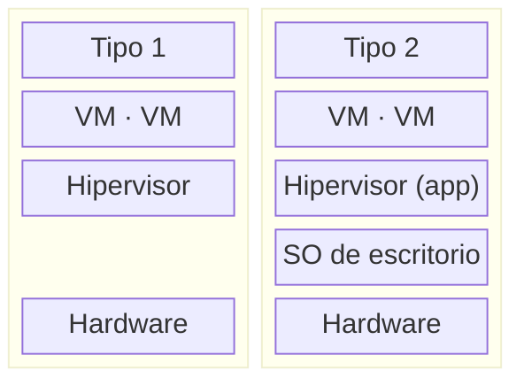

---
seo:
  title: "Proxmox: laboratorio y preproducción"
  description: "Qué es Proxmox VE, para qué lo uso (laboratorio, pruebas y preproducción), por qué no lo elegiría para producción seria y consejos prácticos para empezar."
---

# Proxmox para un laboratorio o preproducción

Antes de pagar por infraestructura en la nube, me gusta poder montar y romper esa infraestructura
en casa. Para eso uso Proxmox VE: un servidor (o un ordenador viejo) se convierte en un pequeño
centro de datos con máquinas virtuales y contenedores que puedo crear, clonar y destruir en
minutos. En este artículo explico qué es, para qué me resulta útil y dónde creo que están sus
límites.

## Qué es Proxmox VE

Proxmox Virtual Environment es una plataforma de virtualización de código abierto (licencia AGPLv3)
basada en Debian. Se instala directamente sobre el hardware, sin otro sistema operativo debajo, y
ofrece:

- **Máquinas virtuales con KVM/QEMU**: cualquier sistema operativo completo, Linux o Windows.
- **Contenedores LXC**: contenedores de sistema que comparten el kernel del anfitrión. Arrancan en
  segundos y consumen mucho menos que una VM; no son contenedores de Docker, sino «máquinas
  ligeras» con su propio sistema de inicio.
- **Interfaz web** para gestionar VMs, contenedores, almacenamiento y red, además de línea de
  comandos y API.
- **Snapshots** de VMs y contenedores, cuando el almacenamiento lo admite (por ejemplo, ZFS,
  LVM-thin o ficheros qcow2).
- **Copias de seguridad** integradas con `vzdump`, y opcionalmente Proxmox Backup Server, que añade
  deduplicación, cifrado en el cliente y sincronización a otro sitio.
- **Clúster** de varios nodos (Corosync y el sistema de ficheros de clúster de Proxmox), **alta
  disponibilidad** con su propio gestor de HA y **Ceph** integrado para almacenamiento distribuido.

El software es gratuito. Proxmox vende suscripciones que dan acceso al repositorio empresarial y a
soporte; sin suscripción se usan los repositorios públicos.

## Tipo 1 frente a tipo 2: por qué Proxmox consume menos

Un **hipervisor** es el software que crea y ejecuta máquinas virtuales: reparte la CPU, la RAM y los
discos del equipo entre ellas. Hay dos tipos, y la diferencia está en **qué hay entre el hardware y
tus máquinas virtuales**.



| | Tipo 1 (*bare-metal*) | Tipo 2 (*hosted*) |
|---|---|---|
| **Dónde se instala** | Directamente sobre el hardware | Como una aplicación más, dentro de tu sistema operativo |
| **Qué hay debajo** | Nada, o un sistema mínimo sin escritorio | Un sistema operativo completo: escritorio, navegador, actualizaciones… |
| **Recursos** | Casi toda la RAM y la CPU van a las máquinas virtuales | El sistema anfitrión se queda su parte antes de empezar |
| **Para qué** | Servidores dedicados a virtualizar | Probar algo en tu ordenador de trabajo |
| **Ejemplos** | Proxmox VE (KVM), VMware ESXi, Microsoft Hyper-V | VirtualBox, VMware Workstation Pro (Windows y Linux), VMware Fusion Pro y Parallels Desktop (Mac), UTM (Mac) |

### La capa que te ahorras

En un tipo 2 hay **una capa más**: el sistema operativo de escritorio. Windows o macOS consumen RAM y
CPU por su cuenta (interfaz gráfica, servicios, antivirus, actualizaciones) antes de que arranque la
primera máquina virtual. Las instrucciones de la VM se ejecutan directamente en la CPU gracias a
VT-x o AMD-V, pero la entrada y salida de dispositivos (disco, red, USB) pasa por ese sistema
operativo.

En Proxmox esa capa no existe. Debajo hay un Debian mínimo, sin escritorio, y el hipervisor (KVM)
forma parte del propio kernel de Linux: cada máquina virtual es un proceso que el kernel gestiona
directamente. Con la misma RAM caben más máquinas virtuales, y rinden mejor. Es la principal razón
por la que lo prefiero para un laboratorio.

:::note[Dos matices]

- **KVM y el «tipo 1».** Como debajo hay un Linux, hay quien discute la etiqueta. Red Hat, que
  desarrolla buena parte de KVM, lo describe como un hipervisor de tipo 1 que convierte el propio
  kernel en hipervisor. Lo importante en la práctica es que no hay un sistema de escritorio en medio.
- **Hyper-V, el caso curioso.** Al activarlo en Windows, el hipervisor pasa a estar debajo y el
  propio Windows se convierte en una partición especial (la *root partition*) que corre encima de
  él. Por eso es de tipo 1, aunque lo actives desde tu Windows de siempre.

:::

Sobre el precio: VMware Workstation Pro y Fusion Pro eran de pago, pero desde noviembre de 2024
Broadcom los ofrece gratis, también para uso comercial. VirtualBox y UTM son gratuitos; Parallels
Desktop es de pago.

## Para qué me resulta útil

- **Un laboratorio local barato.** Con un único equipo con bastante RAM puedo tener una red con
  varias VMs: un servidor de aplicaciones, una base de datos, un proxy, un runner de CI.
- **Probar antes de desplegar.** Ensayar una actualización de sistema operativo, una migración de
  base de datos o un cambio de configuración en una copia, no en el sistema real.
- **Pequeños entornos de preproducción.** Un entorno donde el equipo pueda probar la aplicación con
  una topología parecida a la de producción sin pagar por horas de nube.
- **Reproducir infraestructura antes de pagarla.** Si voy a montar en la nube tres servidores y una
  base de datos, primero lo monto aquí, escribo la automatización (Ansible, Terraform con un
  proveedor para Proxmox, scripts) y compruebo que funciona. Proxmox no publica un proveedor de
  Terraform oficial: los que hay los mantiene la comunidad, como `bpg/proxmox`.

## Mi opinión sobre producción

Esto es una opinión, no una regla: **para laboratorio, pruebas y preproducción, Proxmox me parece
excelente; para un entorno de producción serio, yo no lo elegiría.**

Mis motivos son prácticos. En producción quiero que el hardware, la red, la energía, el
almacenamiento redundante y las copias fuera del sitio sean problema de otro. Con Proxmox todo eso
es responsabilidad tuya: si falla un disco a las tres de la mañana, alguien tiene que ir a
cambiarlo. Para un equipo pequeño, pagar a un proveedor de nube por servicios gestionados suele
salir más a cuenta que mantener esa capa.

Dicho esto, hay equipos que sí ejecutan producción sobre Proxmox, y entiendo por qué:

- Ofrece **clústeres con alta disponibilidad**: si un nodo cae, el gestor de HA reinicia sus VMs en
  otro. La documentación pide al menos tres nodos para tener un quórum fiable, almacenamiento
  compartido y hardware redundante.
- **Ceph integrado** proporciona almacenamiento distribuido y replicado entre los nodos.
- El **coste** a largo plazo puede ser menor que la nube si ya tienes hardware, un centro de datos
  y gente que sepa operarlo.
- Da **control total** sobre dónde están los datos, algo que a veces es un requisito.

Con un equipo de operaciones, hardware adecuado y un clúster bien diseñado, es una opción
legítima. Mi reserva es para equipos pequeños sin esa capacidad.

## Consejos prácticos

### Plantillas y clones

Instala y configura una VM base una vez (sistema actualizado, usuario, clave SSH, agente de QEMU) y
conviértela en **plantilla**. Una plantilla ya no se puede arrancar; se usa para crear clones:

- **Clon completo**: una copia independiente, que ocupa lo mismo que el original.
- **Clon enlazado**: ocupa mucho menos porque comparte los datos de la plantilla, pero depende de
  ella. Requiere un almacenamiento compatible (por ejemplo, ZFS, LVM-thin o ficheros qcow2).

Con cloud-init en la plantilla, cada clon arranca con su propio nombre, red y claves.

### Snapshot antes de cualquier cambio arriesgado

Antes de actualizar un sistema, tocar una base de datos o probar un script de despliegue, hago un
snapshot. Si algo sale mal, vuelvo atrás en segundos:

```sh
qm snapshot 101 before-upgrade
# ... risky change ...
qm rollback 101 before-upgrade
```

Pero un snapshot no es una copia de seguridad: vive en el mismo almacenamiento que la VM. Para eso
están `vzdump` o Proxmox Backup Server, idealmente en otro disco u otra máquina.

### Red básica

- El instalador crea un puente, `vmbr0`, conectado a la interfaz de gestión. Las VMs conectadas a
  él se comportan como si estuvieran enchufadas directamente a la red física, cada una con su MAC.
- Si quieres separar redes (por ejemplo, laboratorio y casa), activa la opción **VLAN aware** en
  el puente y asigna una etiqueta VLAN a cada tarjeta virtual.
- Si las VMs solo tienen IPs privadas, puedes configurar **masquerading (NAT)** en el anfitrión para
  que salgan a internet a través de su IP.

### Recursos

- Los contenedores LXC son ideales para servicios Linux sencillos; deja las VMs para lo que
  necesita un kernel propio o un sistema operativo distinto. Para contenedores de aplicación
  (Docker), la documentación de Proxmox sigue recomendando ejecutarlos dentro de una VM cuando
  necesitas el máximo aislamiento o migración en caliente. Desde Proxmox VE 9.1 se pueden crear
  contenedores LXC a partir de imágenes OCI, y además, como *technology preview*, ejecutar
  contenedores de aplicación a partir de imágenes OCI adecuadas.
- No reserves más RAM de la que el equipo tiene sumando todas las VMs encendidas, salvo que sepas
  lo que haces con el *ballooning*.

## En resumen

Proxmox VE convierte un servidor en una plataforma de virtualización completa, gratuita y con
interfaz web: VMs con KVM, contenedores LXC, snapshots, copias de seguridad y clústeres. Para mí es
la mejor forma de tener un laboratorio, ensayar cambios y montar preproducción barata. Para
producción seria prefiero servicios gestionados, aunque reconozco que con un clúster bien montado y
un equipo que lo opere también funciona.

## Referencias

- [Proxmox VE: guía de administración](https://pve.proxmox.com/pve-docs/pve-admin-guide.html)
- [Proxmox VE: plantillas y clones de VM](https://pve.proxmox.com/wiki/VM_Templates_and_Clones)
- [Proxmox VE: configuración de red](https://pve.proxmox.com/wiki/Network_Configuration)
- [Proxmox VE: alta disponibilidad](https://pve.proxmox.com/wiki/High_Availability)
- [Proxmox VE: copias de seguridad y restauración](https://pve.proxmox.com/wiki/Backup_and_Restore)
- [Proxmox VE: repositorios de paquetes](https://pve.proxmox.com/wiki/Package_Repositories)
- [Proxmox VE: contenedores Linux](https://pve.proxmox.com/wiki/Linux_Container)
- [Proxmox VE: cloud-init](https://pve.proxmox.com/wiki/Cloud-Init_Support)
- [Proxmox Backup Server](https://www.proxmox.com/en/products/proxmox-backup-server/overview)
- [Red Hat: qué es un hipervisor](https://www.redhat.com/en/topics/virtualization/what-is-a-hypervisor)
- [Red Hat: qué es KVM](https://www.redhat.com/es/topics/virtualization/what-is-KVM)
- [Microsoft: arquitectura de Hyper-V](https://learn.microsoft.com/en-us/windows-server/virtualization/hyper-v/architecture)
- [Broadcom: VMware Workstation Pro y Fusion Pro gratuitos](https://knowledge.broadcom.com/external/article?articleNumber=368667)
