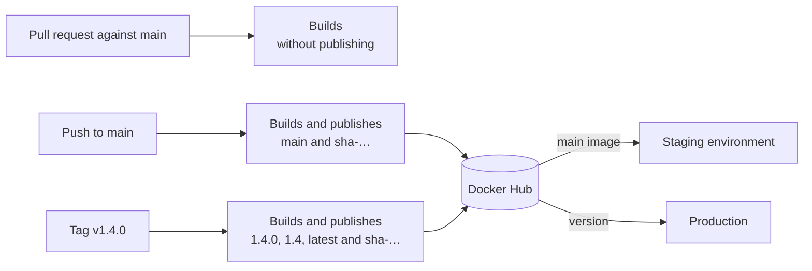

# GitHub Actions: build, version and publish Docker images

Publishing a version of the API by hand is a list of steps from memory: build the image, tag it,
log in to Docker Hub and push it. All it takes is being on the wrong branch to publish, under the
right version tag, an image with different code. And nobody notices until the deployment.

That is why I leave that job to continuous integration.

## CI and workflows in two lines

**Continuous integration (CI)** means every change that reaches the repository is built and
checked automatically, without anyone having to remember to do it. In GitHub Actions, that is
described in a **workflow**: a YAML file in `.github/workflows/` that says when it runs (the
triggers) and what steps it follows.

## The workflow

The image is the one from the [multi-stage Dockerfile](../contenedores/dockerfile-multietapa.md),
and the workflow builds its `prod` stage:

```yaml
name: Docker image

on:
  push:
    branches: [main]
    tags: ["v*.*.*"]
  pull_request:
    branches: [main]

permissions:
  contents: read

jobs:
  docker:
    runs-on: ubuntu-latest
    steps:
      - name: Docker metadata
        id: meta
        uses: docker/metadata-action@v6
        with:
          images: ${{ vars.DOCKERHUB_USERNAME }}/api
          tags: |
            type=semver,pattern={{version}}
            type=semver,pattern={{major}}.{{minor}}
            type=ref,event=branch
            type=ref,event=pr
            type=sha

      - name: Set up Docker Buildx
        uses: docker/setup-buildx-action@v4

      - name: Log in to Docker Hub
        if: github.event_name != 'pull_request'
        uses: docker/login-action@v4
        with:
          username: ${{ vars.DOCKERHUB_USERNAME }}
          password: ${{ secrets.DOCKERHUB_TOKEN }}

      - name: Build and push
        uses: docker/build-push-action@v7
        with:
          target: prod
          build-args: APP_VERSION=${{ steps.meta.outputs.version }}
          push: ${{ github.event_name != 'pull_request' }}
          tags: ${{ steps.meta.outputs.tags }}
          labels: ${{ steps.meta.outputs.labels }}
          cache-from: type=gha
          cache-to: type=gha,mode=max
```

There is no `actions/checkout`: `build-push-action` builds straight from the repository at the
commit that triggered the workflow. If an earlier step had to generate files for the image, then
you would need the checkout and `context: .`.

## The triggers

The `on` block defines three situations, and I do something different in each one:

- **Pull request against `main`**: I build the image, but **I don't publish it**. It tells me the
  Dockerfile still works before merging.
- **Push to `main`**: I build and publish an image tagged with the branch and the commit. That is
  the one I deploy to the staging environment.
- **Push of a `v1.4.0` tag**: I build and publish the version. That is the one that goes to
  production.

What comes out of each trigger:



The condition `github.event_name != 'pull_request'` appears twice: on the login and on `push`.
A pull request from a fork doesn't receive the repository's secrets, so the login would fail, and
I don't want code from a fork ending up in my registry either.

## The tagging strategy

`docker/metadata-action` works out the tags from the event, and I only declare the rules:

| Event | Generated tags |
|---|---|
| Git tag `v1.4.0` | `1.4.0`, `1.4`, `latest`, `sha-<commit>` |
| Push to `main` | `main`, `sha-<commit>` |
| Pull request 12 | `pr-12`, `sha-<commit>` (not published) |

The version comes from **Git tags**: when I want to publish, I create `v1.4.0` and push it. The
`1.4` tag moves with every patch, for anyone who wants updates without API changes. The action
adds `latest` by default only with semver tags, never with a push to `main`.

The `sha-<commit>` tag is the one I use to deploy: it is immutable and tells me exactly what code
the image contains. The others are convenient names that move.

:::note[Versioning from commits]

I used to work out the version from the commit messages (`feat:` bumps the minor version) with a
semantic versioning action. It works, but with Git tags I decide the version when I publish, and
it is simpler to follow.

:::

`steps.meta.outputs.version` also reaches the Dockerfile as `APP_VERSION`, so the application
knows which version it is.

## The registry secrets

For Docker Hub I use a **personal access token**, not the account password: it can be limited to
reading and writing repositories and revoked without touching anything else. You create it in your
Docker Hub account settings.

In GitHub, under **Settings › Secrets and variables › Actions**:

- The token as the **secret** `DOCKERHUB_TOKEN`. Secrets are masked in the logs.
- The username as the **variable** `DOCKERHUB_USERNAME`. It isn't secret, and as a variable it is
  visible in the logs, which helps with debugging.

`docker/login-action` passes the token to Docker without writing it on the command line. Avoid
`docker login -p` in a `run` step: the password ends up as a process argument.

`permissions: contents: read` limits the workflow's `GITHUB_TOKEN` to reading the repository. This
workflow doesn't need anything more.

## The cache

Each run starts on a clean machine, without the layers from the previous one. `cache-from` and
`cache-to` with `type=gha` store the build cache in the GitHub Actions cache, and `mode=max`
includes the layers of the intermediate stages, not just the final one. In a multi-stage
Dockerfile, that is what lets you reuse the `npm ci` from the dependency stages.

## When to publish

| Situation | Do I publish? |
|---|---|
| Pull request | No: I only build |
| Push to `main` | Yes, with `main` and `sha-` |
| `vX.Y.Z` tag | Yes, with the version and `latest` |
| Push to another branch | It doesn't run |

## Summary

- A workflow that builds on every pull request and only publishes from `main` and from version
  tags.
- `metadata-action` generates the tags: semver from Git tags, and `sha-` to deploy something
  immutable.
- Access token as a secret, username as a variable, and `login-action` instead of
  `docker login -p`.
- `type=gha` cache with `mode=max` so the stages that haven't changed aren't rebuilt.

## References

- [GitHub Actions: workflow syntax](https://docs.github.com/en/actions/reference/workflows-and-actions/workflow-syntax)
- [GitHub Actions: events that trigger workflows](https://docs.github.com/en/actions/reference/workflows-and-actions/events-that-trigger-workflows)
- [GitHub Actions: secrets](https://docs.github.com/en/actions/how-tos/write-workflows/choose-what-workflows-do/use-secrets)
- [Docker: GitHub Actions](https://docs.docker.com/build/ci/github-actions/)
- [Docker: tags and labels in GitHub Actions](https://docs.docker.com/build/ci/github-actions/manage-tags-labels/)
- [Docker: cache in GitHub Actions](https://docs.docker.com/build/ci/github-actions/cache/)
- [docker/metadata-action](https://github.com/docker/metadata-action)
- [docker/build-push-action](https://github.com/docker/build-push-action)
- [Docker Hub: personal access tokens](https://docs.docker.com/security/access-tokens/)
