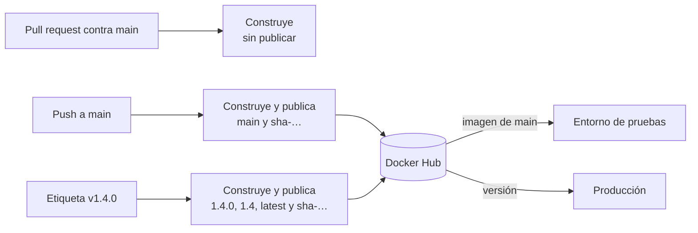

---
seo:
  title: "GitHub Actions e imágenes Docker"
  description: "Un workflow de GitHub Actions que construye, etiqueta con semver y sha y publica imágenes Docker en Docker Hub: disparadores, secretos y caché."
  image:
    src: /og/articulos/sistemas/ci-cd/github-actions-imagenes-docker.png
    alt: "GitHub Actions e imágenes Docker"
  schema:
    - '@type': TechArticle
      headline: "GitHub Actions: construir, versionar y publicar imágenes Docker"
      description: "Un workflow de GitHub Actions que construye, etiqueta con semver y sha y publica imágenes Docker en Docker Hub: disparadores, secretos y caché."
      image: https://velezanthony.github.io/og/articulos/sistemas/ci-cd/github-actions-imagenes-docker.png
      inLanguage: es
      datePublished: '2026-11-21'
      dateModified: '2026-11-22'
      author:
        '@type': Person
        '@id': https://velezanthony.github.io/#anthony
        name: Anthony Velez Tapia
        url: https://velezanthony.github.io/
---

# GitHub Actions: construir, versionar y publicar imágenes Docker

Publicar una versión de la API a mano es una lista de pasos de memoria: construir la imagen,
ponerle la etiqueta, iniciar sesión en Docker Hub y subirla. Basta con estar en la rama que no
toca para publicar, con la etiqueta de la versión buena, una imagen con otro código. Y nadie se
entera hasta el despliegue.

Por eso ese trabajo se lo dejo a la integración continua.

## CI y workflows en dos líneas

**Integración continua (CI)** es que cada cambio que llega al repositorio se construya y se
compruebe solo, sin que nadie se acuerde de hacerlo. En GitHub Actions, eso se describe en un
**workflow**: un fichero YAML en `.github/workflows/` que dice cuándo se ejecuta (los
disparadores) y qué pasos sigue.

## El workflow

La imagen es la del [Dockerfile multietapa](../contenedores/dockerfile-multietapa.md), y el workflow construye su
etapa `prod`:

```yaml
name: Docker image

on:
  push:
    branches: [main]
    tags: ["v*.*.*"]
  pull_request:
    branches: [main]

permissions:
  contents: read

jobs:
  docker:
    runs-on: ubuntu-latest
    steps:
      - name: Docker metadata
        id: meta
        uses: docker/metadata-action@v6
        with:
          images: ${{ vars.DOCKERHUB_USERNAME }}/api
          tags: |
            type=semver,pattern={{version}}
            type=semver,pattern={{major}}.{{minor}}
            type=ref,event=branch
            type=ref,event=pr
            type=sha

      - name: Set up Docker Buildx
        uses: docker/setup-buildx-action@v4

      - name: Log in to Docker Hub
        if: github.event_name != 'pull_request'
        uses: docker/login-action@v4
        with:
          username: ${{ vars.DOCKERHUB_USERNAME }}
          password: ${{ secrets.DOCKERHUB_TOKEN }}

      - name: Build and push
        uses: docker/build-push-action@v7
        with:
          target: prod
          build-args: APP_VERSION=${{ steps.meta.outputs.version }}
          push: ${{ github.event_name != 'pull_request' }}
          tags: ${{ steps.meta.outputs.tags }}
          labels: ${{ steps.meta.outputs.labels }}
          cache-from: type=gha
          cache-to: type=gha,mode=max
```

No hay `actions/checkout`: `build-push-action` construye directamente desde el repositorio en el
commit que disparó el workflow. Si un paso anterior tuviera que generar ficheros para la imagen,
entonces sí haría falta el checkout y `context: .`.

## Los disparadores

El bloque `on` define tres situaciones, y en cada una hago algo distinto:

- **Pull request contra `main`**: construyo la imagen, pero **no la publico**. Sirve para saber
  que el Dockerfile sigue funcionando antes de fusionar.
- **Push a `main`**: construyo y publico una imagen etiquetada con la rama y el commit. Es la que
  despliego en el entorno de pruebas.
- **Push de una etiqueta `v1.4.0`**: construyo y publico la versión. Es la que va a producción.

Lo que sale de cada disparador:



La condición `github.event_name != 'pull_request'` aparece dos veces: en el login y en `push`.
Un pull request desde un fork no recibe los secretos del repositorio, así que el login fallaría,
y tampoco quiero que el código de un fork acabe en mi registro.

## La estrategia de etiquetas

`docker/metadata-action` calcula las etiquetas a partir del evento, y yo solo declaro las reglas:

| Evento | Etiquetas generadas |
|---|---|
| Etiqueta Git `v1.4.0` | `1.4.0`, `1.4`, `latest`, `sha-<commit>` |
| Push a `main` | `main`, `sha-<commit>` |
| Pull request 12 | `pr-12`, `sha-<commit>` (no se publican) |

La versión sale de **etiquetas Git**: cuando quiero publicar, creo `v1.4.0` y la subo. La etiqueta
`1.4` se mueve con cada parche, para quien quiera actualizaciones sin cambios de API. `latest` la
añade la acción por defecto solo con las etiquetas semver, nunca con un push a `main`.

La etiqueta `sha-<commit>` es la que uso para desplegar: es inmutable y me dice exactamente qué
código lleva la imagen. Las demás son nombres cómodos que se mueven.

:::note[Versionar desde los commits]

Antes calculaba la versión a partir de los mensajes de commit (`feat:` sube la versión menor) con
una acción de versionado semántico. Funciona, pero con etiquetas Git la versión la decido yo al
publicar, y es más sencillo de seguir.

:::

`steps.meta.outputs.version` también llega al Dockerfile como `APP_VERSION`, así la aplicación
sabe qué versión es.

## Los secretos del registro

Para Docker Hub uso un **token de acceso personal**, no la contraseña de la cuenta: se puede
limitar a lectura y escritura de repositorios y revocar sin tocar nada más. Se crea en la
configuración de la cuenta de Docker Hub.

En GitHub, en **Settings › Secrets and variables › Actions**:

- El token como **secreto** `DOCKERHUB_TOKEN`. Los secretos se enmascaran en los logs.
- El usuario como **variable** `DOCKERHUB_USERNAME`. No es secreto, y como variable se ve en los
  logs, lo que ayuda a depurar.

`docker/login-action` pasa el token a Docker sin escribirlo en la línea de comandos. Evita
`docker login -p` en un paso `run`: la contraseña queda como argumento del proceso.

`permissions: contents: read` limita el `GITHUB_TOKEN` del workflow a leer el repositorio. Este
workflow no necesita más.

## La caché

Cada ejecución arranca en una máquina limpia, sin las capas de la anterior. `cache-from` y
`cache-to` con `type=gha` guardan la caché de construcción en la caché de GitHub Actions, y
`mode=max` incluye las capas de las etapas intermedias, no solo las de la final. En un Dockerfile
multietapa es lo que permite reutilizar el `npm ci` de las etapas de dependencias.

## Cuándo publicar

| Situación | ¿Publico? |
|---|---|
| Pull request | No: solo construyo |
| Push a `main` | Sí, con `main` y `sha-` |
| Etiqueta `vX.Y.Z` | Sí, con la versión y `latest` |
| Push a otra rama | No se ejecuta |

## En resumen

- Un workflow que construye en cada pull request y publica solo desde `main` y desde etiquetas
  de versión.
- `metadata-action` genera las etiquetas: semver desde etiquetas Git, y `sha-` para desplegar
  algo inmutable.
- Token de acceso como secreto, usuario como variable, y `login-action` en lugar de `docker login -p`.
- Caché `type=gha` con `mode=max` para no reconstruir las etapas que no cambian.

## Referencias

- [GitHub Actions: sintaxis de workflows](https://docs.github.com/es/actions/reference/workflows-and-actions/workflow-syntax)
- [GitHub Actions: eventos que disparan workflows](https://docs.github.com/es/actions/reference/workflows-and-actions/events-that-trigger-workflows)
- [GitHub Actions: secretos](https://docs.github.com/es/actions/how-tos/write-workflows/choose-what-workflows-do/use-secrets)
- [Docker: GitHub Actions](https://docs.docker.com/build/ci/github-actions/)
- [Docker: etiquetas y labels en GitHub Actions](https://docs.docker.com/build/ci/github-actions/manage-tags-labels/)
- [Docker: caché en GitHub Actions](https://docs.docker.com/build/ci/github-actions/cache/)
- [docker/metadata-action](https://github.com/docker/metadata-action)
- [docker/build-push-action](https://github.com/docker/build-push-action)
- [Docker Hub: tokens de acceso personal](https://docs.docker.com/security/access-tokens/)
