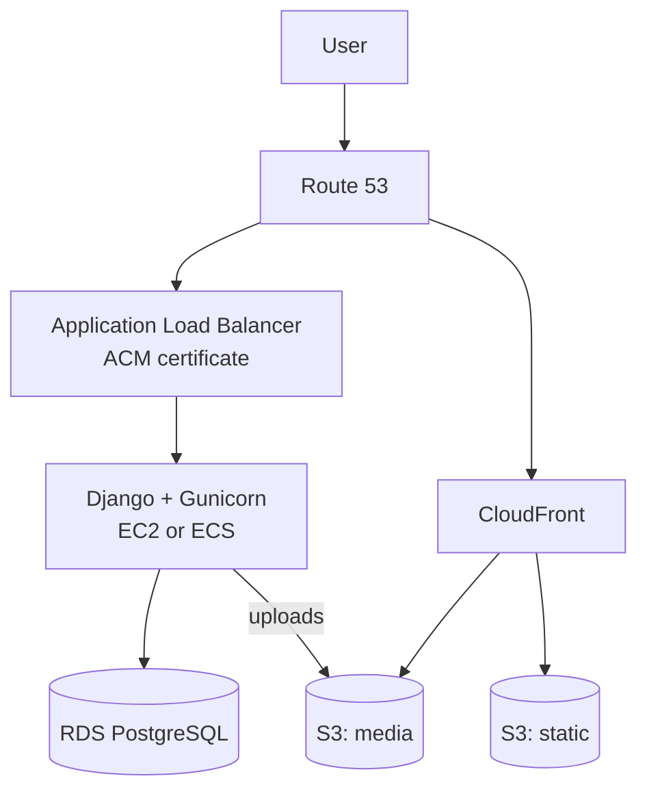
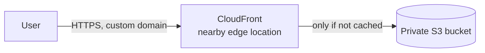

# Basic architecture on AWS: Django and static sites

AWS has hundreds of services, but a normal web application uses about a dozen. In this article I
go through what each basic piece is for, how a Django application would fit and, above all, how to
serve a static site with no server at all, using S3 with a CDN in front (CloudFront).

## The basic pieces

- **VPC**: your private network inside AWS. Everything else (servers, databases, load balancers)
  lives inside it.
- **Subnets**: divisions of the VPC. Public ones have direct access to the internet; private ones
  don't, and that is where the database and, ideally, the application should be.
- **Security groups**: firewalls at instance or service level. For example: "the database only
  accepts connections on port 5432 from the application's security group".
- **EC2**: virtual machines. The most direct option if you want full control of the server.
- **ECS (with Fargate)**: runs containers without managing the machines underneath. If your
  application is already in Docker, it is the natural next step.
- **Application Load Balancer (ALB)**: distributes HTTP/HTTPS traffic across instances or
  containers and checks their health.
- **RDS**: managed databases (PostgreSQL, MySQL…). AWS takes care of patches, automatic backups
  and replicas.
- **S3**: object storage. Static files, user uploads, backups and, as we'll see, complete static
  sites.
- **CloudFront**: AWS's CDN. It serves content from locations spread around the world, close to
  the user.
- **Route 53**: the DNS. It points your domain at CloudFront, the load balancer or wherever it
  needs to go.
- **ACM (Certificate Manager)**: free TLS certificates to use with CloudFront and load balancers,
  with automatic renewal.
- **IAM**: users, roles and permissions. Each service gets a role with only the permissions it
  needs; no administrator keys inside the application.

## A Django application on AWS

Broadly speaking, a Django application fits like this:



- The application runs on EC2 or in containers on ECS, in private subnets, behind an ALB that
  terminates HTTPS with an ACM certificate.
- The database is an RDS instance that only the application's security group can reach.
- Static files (`collectstatic`) and user uploads go to S3, usually through a storage library for
  Django. The application writes to S3, but users download them through CloudFront, not through the
  application.
- Credentials aren't in the code: the application gets S3 permissions through its IAM role, and
  secrets (database password, `SECRET_KEY`) are injected as environment variables from a secrets
  manager.

How the application itself is packaged (Dockerfile, Gunicorn, Nginx) I explain in
[Django with Docker, Gunicorn and Nginx](../../contenedores/django-docker-gunicorn-nginx.md). On
AWS, Nginx's role can be partly taken over by the ALB (proxy and HTTPS) and by S3 with CloudFront
(static files).

## A static site doesn't need a server

A static site is a set of HTML, CSS, JavaScript and image files that are generated once, at build
time, and served as they are. There is no process rendering a page when a request comes in. This
category includes:

- The output of a static site generator such as Astro (in its default static mode).
- Hand-written HTML.
- An SPA built with Angular or React: the result of `ng build` or the React build is an
  `index.html` and some JavaScript files. The logic runs in the browser; if it needs data, it asks
  an API that lives somewhere else.

Since it is all files, you only need to upload them to an S3 bucket and serve them. There is no
server to patch, scale or monitor.

## Step 1: serving the site with S3 alone

S3 has a "static website hosting" mode: you upload the files, switch it on and S3 gives you a URL.
It works, but it has three problems:

1. **There is no HTTPS.** That website URL only works over HTTP. Today, a site without HTTPS is a
   site the browser flags as "not secure".
2. **The bucket has to be public.** Anyone can read everything inside it.
3. **Everything comes from a single place.** The bucket lives in one region, for example Ireland.
   A user in Mexico or Japan waits for every file to cross half the world.

S3's own documentation recommends putting CloudFront in front. And here is the key: **CloudFront
is AWS's CDN**.

## Step 2: a CDN in front of S3

### What a CDN is

A **CDN** (*Content Delivery Network*) is a network of servers spread around the world, in what are
called **edge locations**. Each one keeps a **cached copy** of your files.

When a user requests your site:

1. The request reaches the edge location **closest** to them, not your bucket.
2. If that location already has the file cached, it returns it straight away.
3. If not, it asks the S3 bucket (the **origin**) for it once, stores it and returns it. The next
   users in that area get it from the cache.



The user in Japan no longer waits for Ireland: a location in Japan serves them.

### The CDN doesn't read the bucket on every visit

This is the key idea: **CloudFront doesn't go to S3 every time someone visits your site**. Each
edge location requests it once, stores it and from then on serves it from its cache. S3 only gets
requests again when a location doesn't have the file or its copy has expired.

But that has a consequence that catches everyone out: **uploading a new build to the bucket
doesn't update the CDN**. CloudFront doesn't find out that S3 has changed. It keeps serving the old
copy until one of these two things happens:

| What happens | When |
|---|---|
| **The copy expires** | When its time to live (TTL) runs out. With the **CachingOptimized** managed cache policy, the usual one for an S3 origin, the default is **24 hours**, unless the file says otherwise with `Cache-Control` |
| **You invalidate it** | As soon as you create an **invalidation**: CloudFront discards the copy and the next request goes to S3 for the new one |

So deploying isn't just uploading: you have to decide how long each file can be cached and, for
the ones whose content changes without their name changing, invalidate. I go into detail in
step 3.

### What you gain

- **Speed.** Content comes from a point close to the user, and most requests never even reach S3.
- **HTTPS with your domain.** You attach a free ACM certificate to CloudFront. A detail that often
  catches people out: for CloudFront, the certificate has to be requested in the US East
  (N. Virginia) region, `us-east-1`, even if the rest of your infrastructure is in another region.
- **Private bucket.** With **Origin Access Control (OAC)**, the bucket is no longer public: only
  your CloudFront distribution can read it. AWS recommends OAC over the older mechanism (OAI).
  OAC works with the bucket's normal endpoint, not the website one, so in this setup S3's website
  mode is **not** switched on.
- **Usually cheaper.** I explain this in the next section.

### Is it cheaper?

For a small site, almost always. I checked AWS's pricing pages in November 2026:

| | Serving straight from S3 | Serving through CloudFront |
|---|---|---|
| **From S3 to the CDN** | Not applicable | **Free**: transfer from S3 to CloudFront isn't charged |
| **Free tier for data out to the internet** | 100 GB a month, **shared** across all AWS services | **1 TB a month** for CloudFront alone, always free |
| **Price per GB beyond that** | Depends on the bucket's region | Depends on where the visitor is: more expensive from Japan, South America or India than from the US or Europe |
| **Requests to S3** | All of them, and S3 charges for every request | Only the ones not in the cache |

On top of that, CloudFront has flat-rate plans. The free one includes, per distribution, 1 million
requests and 100 GB of transfer a month.

What you can't say is that a CloudFront GB is always cheaper than an S3 one: it depends on where
your visitors are. For a specific case, do the maths with the AWS calculator. But for a typical
static site, the 1 TB free tier and the requests S3 is spared thanks to the cache make CloudFront
in front of S3 faster, more secure and, usually, cheaper.

## Step 3: the details of the setup

- **SPA routes.** In Angular or React, a URL such as `/pedidos/42` doesn't exist as a file in the
  bucket: the browser's router resolves it. If someone goes straight to that URL, S3 responds with
  an error (with OAC and no list permission, it is usually a 403). The usual solution is to
  configure custom error responses in CloudFront that, for 403 and 404, return `/index.html` with a
  200 status, so that the SPA starts up and its router shows the page. The cost is that real 404s
  also become 200s, so the SPA needs its own "not found" page.
- **Multi-page sites like Astro.** Here each page does exist as a file (`/blog/index.html`), but
  the URL requested is `/blog/`. With OAC there is no automatic index document, so you use a
  CloudFront Function that appends `index.html` to URLs without a file name; AWS publishes an
  official example of that function.
- **Deploying: hashed files first, then the HTML.** Angular, React and Astro put a **hash** in the
  names of JavaScript and CSS files (`main.3f9a1c.js`). Each build generates new names, so to the
  CDN they are files it has never seen: they can be cached for a year without worry. Everything
  else keeps its name between builds: all the HTML (on a multi-page site like Astro, one per page)
  and unhashed files, such as those in `public/` (favicon, `robots.txt`, images). Those are the
  ones you need to revalidate and invalidate:

```sh
# 1. Hashed assets first, cached for a year (Astro's folder; adjust for your build)
aws s3 sync dist/_astro/ s3://my-site-bucket/_astro/   --cache-control "public, max-age=31536000, immutable"
# 2. Then the HTML and the unhashed files, always revalidated
aws s3 sync dist/ s3://my-site-bucket --exclude "_astro/*" --cache-control "no-cache"
# 3. Drop CloudFront's copies of everything that kept its name
aws cloudfront create-invalidation --distribution-id E123EXAMPLE --paths "/*"
```

  The order matters: if the new HTML arrived before its files, it would point at something that
  doesn't exist yet. Invalidating `"/*"` counts as a single path (the first 1,000 each month are
  free) and covers every page and the files in `public/`.

  And there is no `--delete`. For a while there will still be old HTML in caches you don't control
  (the browser, or the CDN while the invalidation finishes), and that HTML points at the previous
  hashed files. If you delete them when deploying, those visits get 404s on their styles and
  scripts. Delete the old files later, after a few days, for example with a separate
  `sync --delete`.

## Summary

- For a Django application: the application on EC2 or ECS behind an ALB, RDS for the database,
  S3 for static files and media, IAM for permissions.
- A static site (Astro, HTML, a built SPA) doesn't need a server: S3 is enough.
- But S3 alone doesn't give you HTTPS, forces a public bucket and serves everything from one
  region. That is why you put a CDN in front: **CloudFront**.
- CloudFront serves from the location closest to the user, gives you HTTPS with ACM (in
  `us-east-1`), allows a private bucket with OAC and, for a small site, usually works out cheaper.
- The CDN doesn't read the bucket on every visit: it keeps a copy and doesn't notice changes by
  itself. When deploying, upload the hashed files first (long cache), then the HTML (`no-cache`),
  and invalidate `"/*"`; otherwise it may keep serving the old version for up to 24 hours. Old
  files are deleted afterwards, not in the same deployment.

## References

- [Amazon VPC: what it is](https://docs.aws.amazon.com/vpc/latest/userguide/what-is-amazon-vpc.html)
- [Amazon EC2](https://docs.aws.amazon.com/ec2/)
- [Amazon ECS](https://docs.aws.amazon.com/ecs/)
- [Amazon RDS](https://docs.aws.amazon.com/rds/)
- [Elastic Load Balancing](https://docs.aws.amazon.com/elasticloadbalancing/)
- [IAM](https://docs.aws.amazon.com/iam/)
- [Route 53](https://docs.aws.amazon.com/route53/)
- [S3: website endpoints (no HTTPS)](https://docs.aws.amazon.com/AmazonS3/latest/userguide/WebsiteEndpoints.html)
- [CloudFront: restricting access to an S3 origin (OAC)](https://docs.aws.amazon.com/AmazonCloudFront/latest/DeveloperGuide/private-content-restricting-access-to-s3.html)
- [CloudFront: certificate requirements (ACM in `us-east-1`)](https://docs.aws.amazon.com/AmazonCloudFront/latest/DeveloperGuide/cnames-and-https-requirements.html)
- [CloudFront: custom error responses](https://docs.aws.amazon.com/AmazonCloudFront/latest/DeveloperGuide/GeneratingCustomErrorResponses.html)
- [CloudFront Functions: appending `index.html` to URLs without a file name](https://docs.aws.amazon.com/AmazonCloudFront/latest/DeveloperGuide/example_cloudfront_functions_url_rewrite_single_page_apps_section.html)
- [CloudFront: invalidating files](https://docs.aws.amazon.com/AmazonCloudFront/latest/DeveloperGuide/Invalidation.html)
- [CloudFront: how long content stays in the cache](https://docs.aws.amazon.com/AmazonCloudFront/latest/DeveloperGuide/Expiration.html)
- [CloudFront: managed cache policies (default TTL)](https://docs.aws.amazon.com/AmazonCloudFront/latest/DeveloperGuide/using-managed-cache-policies.html)
- [Amazon S3 pricing](https://aws.amazon.com/s3/pricing/)
- [Amazon CloudFront pricing](https://aws.amazon.com/cloudfront/pricing/)
- [CloudFront: flat-rate pricing plans](https://docs.aws.amazon.com/AmazonCloudFront/latest/DeveloperGuide/flat-rate-pricing-plan.html)
- [AWS Pricing Calculator](https://calculator.aws/)
