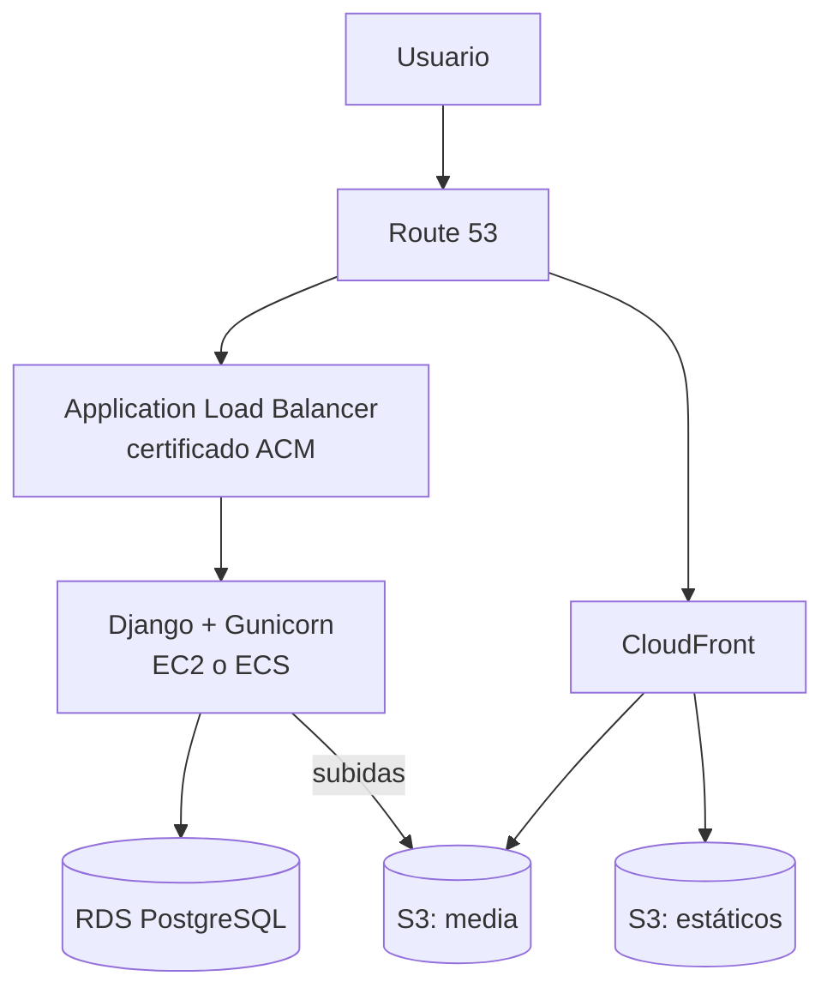
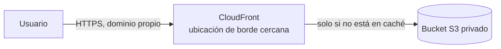

---
seo:
  title: "Arquitectura básica en AWS"
  description: "Las piezas básicas de AWS, Django en AWS y cómo servir una web estática desde S3 con una CDN (CloudFront) delante: más rápido, seguro y barato."
  schema:
    - '@type': TechArticle
      headline: "Arquitectura básica en AWS: Django y webs estáticas"
      description: "Las piezas básicas de AWS, Django en AWS y cómo servir una web estática desde S3 con una CDN (CloudFront) delante: más rápido, seguro y barato."
      inLanguage: es
      datePublished: '2026-11-21'
      dateModified: '2026-11-22'
      author:
        '@type': Person
        '@id': https://velezanthony.github.io/#anthony
        name: Anthony Velez Tapia
        url: https://velezanthony.github.io/
---

# Arquitectura básica en AWS: Django y webs estáticas

AWS tiene cientos de servicios, pero una aplicación web normal usa una docena. En este artículo
repaso para qué sirve cada pieza básica, cómo encajaría una aplicación Django y, sobre todo, cómo
servir una web estática sin ningún servidor, con S3 y una CDN delante (CloudFront).

## Las piezas básicas

- **VPC**: tu red privada dentro de AWS. Todo lo demás (servidores, bases de datos, balanceadores)
  vive dentro de ella.
- **Subredes**: divisiones de la VPC. Las públicas tienen salida directa a internet; las privadas
  no, y es donde deberían estar la base de datos y, idealmente, la aplicación.
- **Security groups**: cortafuegos a nivel de instancia o servicio. Por ejemplo: «la base de datos
  solo acepta conexiones al puerto 5432 desde el security group de la aplicación».
- **EC2**: máquinas virtuales. La opción más directa si quieres control total del servidor.
- **ECS (con Fargate)**: ejecuta contenedores sin gestionar las máquinas que hay debajo. Si tu
  aplicación ya está en Docker, es el paso natural.
- **Application Load Balancer (ALB)**: reparte el tráfico HTTP/HTTPS entre instancias o
  contenedores y comprueba su salud.
- **RDS**: bases de datos gestionadas (PostgreSQL, MySQL…). AWS se encarga de parches, copias de
  seguridad automáticas y réplicas.
- **S3**: almacenamiento de objetos. Ficheros estáticos, subidas de usuarios, copias de seguridad
  y, como veremos, webs estáticas completas.
- **CloudFront**: la CDN de AWS. Sirve contenido desde ubicaciones repartidas por el mundo,
  cerca del usuario.
- **Route 53**: el DNS. Apunta tu dominio a CloudFront, al balanceador o a donde corresponda.
- **ACM (Certificate Manager)**: certificados TLS gratuitos para usar con CloudFront y los
  balanceadores, con renovación automática.
- **IAM**: usuarios, roles y permisos. Cada servicio recibe un rol con solo los permisos que
  necesita; nada de claves de administrador dentro de la aplicación.

## Una aplicación Django en AWS

A grandes rasgos, una aplicación Django encaja así:



- La aplicación corre en EC2 o en contenedores en ECS, en subredes privadas, detrás de un ALB que
  termina HTTPS con un certificado de ACM.
- La base de datos es un RDS al que solo puede llegar el security group de la aplicación.
- Los ficheros estáticos (`collectstatic`) y los subidos por los usuarios van a S3, normalmente
  con una librería de almacenamiento para Django. La aplicación escribe en S3, pero los usuarios los
  descargan a través de CloudFront, no de la aplicación.
- Las credenciales no están en el código: la aplicación obtiene permisos de S3 mediante su rol de
  IAM, y los secretos (contraseña de la base de datos, `SECRET_KEY`) se inyectan como variables de
  entorno desde un gestor de secretos.

Cómo se empaqueta la aplicación en sí (Dockerfile, Gunicorn, Nginx) lo explico en
[Django con Docker, Gunicorn y Nginx](../../contenedores/django-docker-gunicorn-nginx.md). En AWS, el papel de Nginx lo
pueden asumir en parte el ALB (proxy y HTTPS) y S3 con CloudFront (estáticos).

## Una web estática no necesita servidor

Una web estática es un conjunto de ficheros HTML, CSS, JavaScript e imágenes que se generan una
vez, al compilar, y se sirven tal cual. No hay ningún proceso que renderice una página cuando
llega una petición. Entran en esta categoría:

- La salida de un generador de sitios estáticos como Astro (en su modo estático por defecto).
- HTML escrito a mano.
- Una SPA compilada en Angular o React: el resultado de `ng build` o del build de React es un
  `index.html` y unos ficheros JavaScript. La lógica corre en el navegador; si necesita datos, los
  pide a una API que vive en otro sitio.

Como todo son ficheros, basta con subirlos a un bucket de S3 y servirlos. No hay servidor que
parchear, escalar ni vigilar.

## Paso 1: servir la web solo con S3

S3 tiene un modo de «alojamiento de sitio web estático»: subes los ficheros, lo activas y S3 te da
una URL. Funciona, pero tiene tres problemas:

1. **No hay HTTPS.** Esa URL de sitio web solo funciona por HTTP. Hoy, una web sin HTTPS es una web
   que el navegador marca como «no segura».
2. **El bucket tiene que ser público.** Cualquiera puede leer todo lo que hay dentro.
3. **Todo sale de un único sitio.** El bucket vive en una región, por ejemplo Irlanda. Un usuario
   de México o de Japón espera a que cada fichero cruce medio mundo.

La propia documentación de S3 recomienda poner CloudFront delante. Y aquí está la clave: **CloudFront
es la CDN de AWS**.

## Paso 2: una CDN delante de S3

### Qué es una CDN

Una **CDN** (*Content Delivery Network*, red de distribución de contenido) es una red de servidores
repartidos por todo el mundo, en lo que se llaman **ubicaciones de borde** (*edge locations*). Cada
uno guarda una **copia en caché** de tus ficheros.

Cuando un usuario pide tu web:

1. La petición llega a la ubicación de borde **más cercana** a él, no a tu bucket.
2. Si esa ubicación ya tiene el fichero en caché, lo devuelve al momento.
3. Si no lo tiene, lo pide una vez al bucket S3 (el **origen**), lo guarda y lo devuelve. Los
   siguientes usuarios de esa zona ya lo reciben de la caché.



El usuario de Japón ya no espera a Irlanda: lo sirve una ubicación de Japón.

### La CDN no lee el bucket a cada visita

Esta es la idea clave: **CloudFront no va a S3 cada vez que alguien visita tu web**. Cada ubicación
de borde lo pide una vez, lo guarda y a partir de ahí lo sirve desde su caché. S3 solo vuelve a
recibir peticiones cuando una ubicación no tiene el fichero o su copia ha caducado.

Pero eso tiene una consecuencia que pilla a todo el mundo: **subir un build nuevo al bucket no
actualiza la CDN**. CloudFront no se entera de que S3 ha cambiado. Sigue sirviendo la copia vieja
hasta que pasa una de estas dos cosas:

| Qué pasa | Cuándo |
|---|---|
| **La copia caduca** | Cuando pasa su tiempo de vida (TTL). Con la política de caché gestionada **CachingOptimized**, la habitual para un origen S3, por defecto son **24 horas**, salvo que el fichero diga otra cosa con `Cache-Control` |
| **Tú la invalidas** | En cuanto creas una **invalidación**: CloudFront descarta la copia y la próxima petición va a S3 a por la nueva |

Así que desplegar no es solo subir: hay que decidir cuánto tiempo puede guardarse cada fichero en
caché y, para los que cambian de contenido sin cambiar de nombre, invalidar. Lo detallo en el
paso 3.

### Qué ganas

- **Velocidad.** El contenido sale de un punto cercano al usuario, y la mayoría de peticiones ni
  siquiera llegan a S3.
- **HTTPS con tu dominio.** Asocias a CloudFront un certificado gratuito de ACM. Un detalle que suele
  pillar a la gente: para CloudFront, el certificado tiene que pedirse en la región US East
  (N. Virginia), `us-east-1`, aunque el resto de tu infraestructura esté en otra región.
- **Bucket privado.** Con **Origin Access Control (OAC)**, el bucket deja de ser público: solo tu
  distribución de CloudFront puede leerlo. AWS recomienda OAC frente al mecanismo antiguo (OAI).
  OAC funciona con el endpoint normal del bucket, no con el de sitio web, así que en este montaje
  **no** se activa el modo de sitio web de S3.
- **Normalmente, más barato.** Lo explico en el siguiente apartado.

### ¿Es más barato?

Para una web pequeña, casi siempre. Lo comprobé en las páginas de precios de AWS en noviembre de
2026:

| | Servir desde S3 directamente | Servir a través de CloudFront |
|---|---|---|
| **De S3 a la CDN** | No aplica | **Gratis**: la transferencia de S3 a CloudFront no se cobra |
| **Capa gratuita de salida a internet** | 100 GB al mes, **compartidos** entre todos los servicios de AWS | **1 TB al mes** solo para CloudFront, siempre gratis |
| **Precio por GB a partir de ahí** | Según la región del bucket | Según dónde está quien visita: más caro desde Japón, Sudamérica o India que desde EE. UU. o Europa |
| **Peticiones a S3** | Todas, y S3 cobra cada petición | Solo las que no están en caché |

Además, CloudFront tiene planes de tarifa plana. El gratuito incluye, por distribución, 1 millón de
peticiones y 100 GB de transferencia al mes.

Lo que no se puede decir es que el GB de CloudFront sea siempre más barato que el de S3: depende de
dónde estén tus visitantes. Para un caso concreto, haz el cálculo con la calculadora de AWS. Pero
para una web estática típica, la capa gratuita de 1 TB y las peticiones que se ahorra S3 gracias a
la caché hacen que CloudFront delante de S3 sea más rápido, más seguro y, normalmente, más
barato.

## Paso 3: los detalles del montaje

- **Rutas de una SPA.** En Angular o React, una URL como `/pedidos/42` no existe como fichero en el
  bucket: la resuelve el router del navegador. Si alguien entra directamente en esa URL, S3 responde
  con un error (con OAC y sin permiso de listar, suele ser un 403). La solución habitual es
  configurar en CloudFront respuestas de error personalizadas que, para 403 y 404, devuelvan
  `/index.html` con código 200, de forma que la SPA arranque y su router muestre la página. El
  coste es que los 404 reales también se convierten en 200, así que la SPA debe tener su propia
  página de «no encontrado».
- **Webs multipágina como Astro.** Aquí cada página sí existe como fichero
  (`/blog/index.html`), pero la URL que se pide es `/blog/`. Con OAC no hay documento índice
  automático, así que se usa una CloudFront Function que añade `index.html` a las URLs sin nombre
  de fichero; AWS publica un ejemplo oficial de esa función.
- **Desplegar: primero lo que tiene hash, después el HTML.** Angular, React y Astro ponen un
  **hash** en el nombre de los ficheros JavaScript y CSS (`main.3f9a1c.js`). Cada build genera
  nombres nuevos, así que para la CDN son ficheros que no ha visto nunca: se pueden guardar en caché
  un año sin miedo. El resto conserva su nombre entre builds: todo el HTML (en una web multipágina
  como Astro, uno por página) y los ficheros sin hash, como los de `public/` (favicon,
  `robots.txt`, imágenes). Esos son los que hay que revalidar e invalidar:

```sh
# 1. Hashed assets first, cached for a year (Astro's folder; adjust for your build)
aws s3 sync dist/_astro/ s3://my-site-bucket/_astro/   --cache-control "public, max-age=31536000, immutable"
# 2. Then the HTML and the unhashed files, always revalidated
aws s3 sync dist/ s3://my-site-bucket --exclude "_astro/*" --cache-control "no-cache"
# 3. Drop CloudFront's copies of everything that kept its name
aws cloudfront create-invalidation --distribution-id E123EXAMPLE --paths "/*"
```

  El orden importa: si el HTML nuevo llegara antes que sus ficheros, apuntaría a algo que aún no
  existe. Invalidar `"/*"` cuenta como una sola ruta (las 1.000 primeras de cada mes son gratis) y
  cubre todas las páginas y los ficheros de `public/`.

  Y no hay `--delete`. Durante un rato seguirá habiendo HTML viejo en cachés que no controlas (el
  navegador, o la CDN mientras termina la invalidación), y ese HTML apunta a los ficheros con hash
  anteriores. Si los borras al desplegar, esas visitas reciben 404 en sus estilos y scripts. Borra
  los ficheros viejos más tarde, pasados unos días, por ejemplo con un `sync --delete` aparte.

## En resumen

- Para una aplicación Django: aplicación en EC2 o ECS detrás de un ALB, RDS para la base de datos,
  S3 para estáticos y media, IAM para los permisos.
- Una web estática (Astro, HTML, una SPA compilada) no necesita servidor: basta con S3.
- Pero S3 solo no da HTTPS, obliga a un bucket público y sirve todo desde una región. Por eso se
  pone delante una CDN: **CloudFront**.
- CloudFront sirve desde la ubicación más cercana al usuario, da HTTPS con ACM (en `us-east-1`),
  permite un bucket privado con OAC y, para una web pequeña, normalmente sale más barato.
- La CDN no lee el bucket a cada visita: guarda una copia y no se entera sola de los cambios. Al
  desplegar, sube primero los ficheros con hash (caché larga), después el HTML (`no-cache`), e
  invalida `"/*"`; si no, puede seguir sirviendo la versión vieja hasta 24 horas. Los ficheros
  viejos se borran después, no en el mismo despliegue.

## Referencias

- [Amazon VPC: qué es](https://docs.aws.amazon.com/vpc/latest/userguide/what-is-amazon-vpc.html)
- [Amazon EC2](https://docs.aws.amazon.com/ec2/)
- [Amazon ECS](https://docs.aws.amazon.com/ecs/)
- [Amazon RDS](https://docs.aws.amazon.com/rds/)
- [Elastic Load Balancing](https://docs.aws.amazon.com/elasticloadbalancing/)
- [IAM](https://docs.aws.amazon.com/iam/)
- [Route 53](https://docs.aws.amazon.com/route53/)
- [S3: endpoints de sitio web (sin HTTPS)](https://docs.aws.amazon.com/AmazonS3/latest/userguide/WebsiteEndpoints.html)
- [CloudFront: restringir el acceso a un origen S3 (OAC)](https://docs.aws.amazon.com/AmazonCloudFront/latest/DeveloperGuide/private-content-restricting-access-to-s3.html)
- [CloudFront: requisitos de certificados (ACM en `us-east-1`)](https://docs.aws.amazon.com/AmazonCloudFront/latest/DeveloperGuide/cnames-and-https-requirements.html)
- [CloudFront: respuestas de error personalizadas](https://docs.aws.amazon.com/AmazonCloudFront/latest/DeveloperGuide/GeneratingCustomErrorResponses.html)
- [CloudFront Functions: añadir `index.html` a las URLs sin fichero](https://docs.aws.amazon.com/AmazonCloudFront/latest/DeveloperGuide/example_cloudfront_functions_url_rewrite_single_page_apps_section.html)
- [CloudFront: invalidar ficheros](https://docs.aws.amazon.com/AmazonCloudFront/latest/DeveloperGuide/Invalidation.html)
- [CloudFront: cuánto tiempo se queda el contenido en caché](https://docs.aws.amazon.com/AmazonCloudFront/latest/DeveloperGuide/Expiration.html)
- [CloudFront: políticas de caché gestionadas (TTL por defecto)](https://docs.aws.amazon.com/AmazonCloudFront/latest/DeveloperGuide/using-managed-cache-policies.html)
- [Precios de Amazon S3](https://aws.amazon.com/s3/pricing/)
- [Precios de Amazon CloudFront](https://aws.amazon.com/cloudfront/pricing/)
- [CloudFront: planes de tarifa plana](https://docs.aws.amazon.com/AmazonCloudFront/latest/DeveloperGuide/flat-rate-pricing-plan.html)
- [Calculadora de precios de AWS](https://calculator.aws/)
