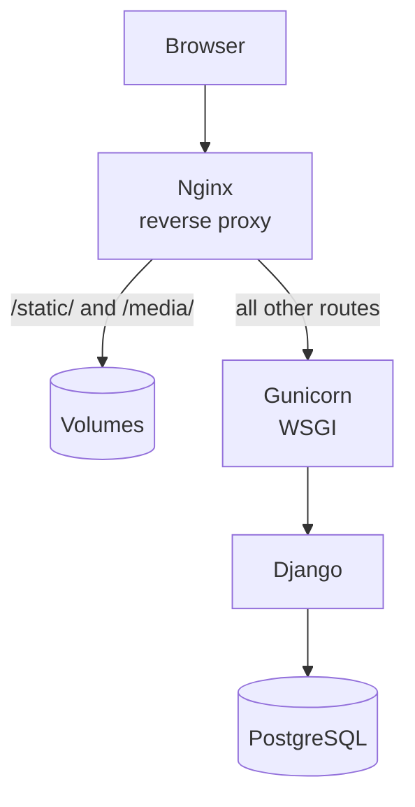

# Django with Docker, Gunicorn and Nginx

`manage.py runserver` is for development. In production, a Django application needs a WSGI server
to run the code and, in front of it, a reverse proxy to receive the traffic. In this article I set
up the combination I use most: Gunicorn, Nginx and PostgreSQL, each in its own container and
orchestrated with Docker Compose. All the examples fit together.

## What each piece does



- **Gunicorn** is the WSGI server: it starts several *worker* processes that import your Django
  application and answer requests.
- **Nginx** is the reverse proxy: it receives client connections, serves static and uploaded files
  directly, and forwards everything else to Gunicorn. The Gunicorn documentation recommends putting
  it behind a buffering proxy, because with synchronous workers a slow client can block a worker.
- **`collectstatic`** copies the static files of every app into `STATIC_ROOT`, and that is the
  folder Nginx serves. Django should not serve static files in production.

## The Dockerfile

```dockerfile
FROM python:3.14-slim

ENV PYTHONDONTWRITEBYTECODE=1 \
    PYTHONUNBUFFERED=1

WORKDIR /app

# Dependencies first: this layer is cached until requirements.txt changes
COPY requirements.txt .
RUN pip install --no-cache-dir -r requirements.txt

COPY . .

RUN chmod +x entrypoint.sh \
    && useradd --create-home --uid 1000 app \
    && mkdir -p /app/staticfiles /app/media \
    && chown -R app:app /app/staticfiles /app/media
USER app

EXPOSE 8000
ENTRYPOINT ["./entrypoint.sh"]
CMD ["gunicorn", "config.wsgi:application", "--config", "gunicorn.conf.py"]
```

Besides Django, `requirements.txt` has to include the server and the PostgreSQL driver:

```text
Django
gunicorn
psycopg[binary]
```

`psycopg[binary]` ships its own `libpq`, so the `slim` image does not need to compile anything. It
is a deliberate trade-off: the psycopg documentation recommends the binary package for most people,
but for production it prefers the local installation (`psycopg[c]`), which is built against the
system's `libpq` and `libssl` and picks up their security patches. That requires a compiler, Python
headers, `libpq-dev` and `pg_config` in the image (the clean way is a multi-stage build that
compiles in one stage and copies the result, with `libpq5` in the final one). Here I stick with
`[binary]` for simplicity.

In a real project, pin exact versions in `requirements.txt` (`Django==…`), by hand or by generating
the file with `pip-compile` or `uv pip compile`. Without versions, two builds of the same image can
install different things.

Three decisions:

- **`slim` image**: the Docker documentation recommends starting from a minimal image; fewer
  packages means a smaller attack surface.
- **Dependencies before the code**: Docker reuses the `pip install` layer as long as
  `requirements.txt` does not change, so changing a view does not reinstall everything.
- **Unprivileged user**: if the process does not need to be root, it should not be (`USER`).

Add a `.dockerignore` with `.git`, `.env`, `__pycache__` and the like so they do not end up in the
image.

The `entrypoint.sh` prepares the application and then hands control over to the command:

```sh
#!/bin/sh
set -e
if [ "${RUN_MIGRATIONS:-0}" = "1" ]; then
    python manage.py migrate --noinput
fi
python manage.py collectstatic --noinput
exec "$@"
```

- Migrations only run if `RUN_MIGRATIONS=1`. That way you decide when to migrate (I explain it in
  [Migrations during deployment](#migrations-during-deployment)).
- `exec` makes Gunicorn replace the shell and receive stop signals directly.
- The `chmod +x` in the Dockerfile guarantees the script is executable, even if the permission is
  lost on your machine (it often happens on Windows).

## Gunicorn

```python
# gunicorn.conf.py
import multiprocessing
import os

bind = "0.0.0.0:8000"
# WEB_CONCURRENCY wins when set; otherwise, the docs' starting point
workers = int(os.environ.get("WEB_CONCURRENCY", multiprocessing.cpu_count() * 2 + 1))
timeout = 30
# Nginx reaches Gunicorn from another container; Gunicorn's port is not published,
# so only containers on the Compose network can connect.
forwarded_allow_ips = "*"
accesslog = "-"
```

- **`workers`**: the Gunicorn documentation suggests `(2 × cores) + 1` as a starting point, then
  tuning it according to the load. Careful: inside a container, `cpu_count()` returns the host's
  cores, not the container's CPU limit, so if you limit the CPU, set the number with the
  `WEB_CONCURRENCY` variable. Gunicorn already reads it on its own (its default for `workers` is
  that variable, or 1 if it does not exist), but as soon as the file assigns `workers`, the file
  wins; that is why this one checks it before calculating anything.
- **`timeout`**: a worker that does not respond within that time is restarted. 30 seconds is the
  default; if you have longer requests, move them to background tasks before raising it.
- **`forwarded_allow_ips`**: the IPs from which Gunicorn accepts secure-scheme headers
  (`X-Forwarded-Proto` and the like) to mark the request as HTTPS in `wsgi.url_scheme`. It defaults
  to `127.0.0.1,::1`, and Nginx is in another container, so it has to be widened. Careful: it only
  affects what Gunicorn works out; Django's `SECURE_PROXY_SSL_HEADER` reads the header on its own,
  regardless of this setting. `"*"` is only acceptable if nothing but the proxy can reach Gunicorn,
  which is what not publishing its port guarantees.

## Nginx

```nginx
# nginx/default.conf
upstream django {
    server web:8000;
}

server {
    listen 80;
    server_name example.com;
    client_max_body_size 10M;

    location /static/ {
        alias /srv/static/;
    }

    location /media/ {
        alias /srv/media/;
    }

    location / {
        proxy_set_header Host $host;
        proxy_set_header X-Forwarded-For $proxy_add_x_forwarded_for;
        proxy_set_header X-Forwarded-Proto $scheme;
        proxy_redirect off;
        proxy_pass http://django;
    }
}
```

`X-Forwarded-Proto` tells Django whether the original request arrived over HTTPS. Here Nginx
listens on port 80 to keep things simple; in production it would terminate TLS on 443 with a
certificate, or a load balancer in front would. If another proxy terminates TLS before Nginx,
`$scheme` would be `http` and you would have to forward the header you receive instead of
generating it.

## compose.yaml

```yaml
services:
  db:
    image: postgres:19
    environment:
      POSTGRES_DB: app
      POSTGRES_USER: app
      POSTGRES_PASSWORD: ${POSTGRES_PASSWORD}
    volumes:
      - pgdata:/var/lib/postgresql
    healthcheck:
      test: ["CMD-SHELL", "pg_isready -U $${POSTGRES_USER} -d $${POSTGRES_DB}"]
      interval: 10s
      retries: 5

  web:
    build: .
    env_file: .env
    depends_on:
      db:
        condition: service_healthy
    volumes:
      - static:/app/staticfiles
      - media:/app/media
    healthcheck:
      test: ["CMD", "python", "-c", "import urllib.request; urllib.request.urlopen('http://localhost:8000/healthz/')"]
      interval: 30s
      retries: 3

  nginx:
    image: nginx:1.30-alpine
    ports:
      - "80:80"
    volumes:
      - ./nginx/default.conf:/etc/nginx/conf.d/default.conf:ro
      - static:/srv/static:ro
      - media:/srv/media:ro
    depends_on:
      - web

volumes:
  pgdata:
  static:
  media:
```

- `depends_on` with `condition: service_healthy` makes Compose wait until PostgreSQL answers
  `pg_isready` before starting `web`, so the start-up migrations do not fail.
- Since PostgreSQL 18, the official image stores data in a per-version folder
  (`PGDATA=/var/lib/postgresql/19/docker`) and the volume is mounted at `/var/lib/postgresql`, not
  at `/var/lib/postgresql/data` as up to 17. If you are coming from an earlier version, changing the
  tag is not enough: a major version change requires migrating the data (`pg_upgrade` or dump and
  restore).
- The `static` and `media` volumes are shared by `web` (which writes) and `nginx` (which only
  reads).
- Only Nginx publishes a port. Gunicorn and PostgreSQL are only reachable inside the Compose
  network.
- The `slim` image does not include `curl`, which is why the `web` healthcheck uses Python. The
  `/healthz/` view is yours: something as simple as returning a 200, or also checking the database
  connection if you want the healthcheck to cover it.
- The healthcheck calls `localhost`, so `localhost` has to be in `ALLOWED_HOSTS` (see the `.env`
  below). Otherwise Django responds with a 400 and the container is never marked healthy.
- The healthcheck talks HTTP directly to Gunicorn. If you enable `SECURE_SSL_REDIRECT = True`
  (`check --deploy` suggests it), Django answers it with a 301 to HTTPS and the healthcheck fails.
  Exempt the route with `SECURE_REDIRECT_EXEMPT = [r"^healthz/$"]` (no leading slash).

## Django settings for production

Sensitive variables go in `.env` (outside the repository) or in your platform's secrets manager,
never in the image:

```python
# settings.py
import os

SECRET_KEY = os.environ["DJANGO_SECRET_KEY"]
DEBUG = False
ALLOWED_HOSTS = os.environ["DJANGO_ALLOWED_HOSTS"].split(",")
CSRF_TRUSTED_ORIGINS = os.environ["DJANGO_CSRF_TRUSTED_ORIGINS"].split(",")

SECURE_PROXY_SSL_HEADER = ("HTTP_X_FORWARDED_PROTO", "https")

STATIC_URL = "/static/"
STATIC_ROOT = "/app/staticfiles"
MEDIA_URL = "/media/"
MEDIA_ROOT = "/app/media"

DATABASES = {
    "default": {
        "ENGINE": "django.db.backends.postgresql",
        "HOST": "db",
        "NAME": "app",
        "USER": "app",
        "PASSWORD": os.environ["POSTGRES_PASSWORD"],
    }
}
```

And the matching `.env` (with your values):

```sh
DJANGO_SECRET_KEY=change-me
DJANGO_ALLOWED_HOSTS=example.com,localhost
DJANGO_CSRF_TRUSTED_ORIGINS=https://example.com
POSTGRES_PASSWORD=change-me
```

- **`ALLOWED_HOSTS`**: the domains the application accepts in the `Host` header. It includes
  `localhost` because of the healthcheck.
- **`CSRF_TRUSTED_ORIGINS`**: since Django 4.0 the values must include the scheme
  (`https://example.com`), not just the domain.
- **`SECURE_PROXY_SSL_HEADER`**: makes `request.is_secure()` trust `X-Forwarded-Proto`. The Django
  documentation warns that it should only be enabled if you control the proxy and it always
  overwrites that header; otherwise a client could spoof it. In `nginx/default.conf`,
  `proxy_set_header` replaces it on every request.

Run `python manage.py check --deploy` before the first deployment: it reviews the most common
security settings.

## Migrations during deployment

There are two ways to migrate, and `entrypoint.sh` supports both:

- **With a single `web` container**: set `RUN_MIGRATIONS=1` in `.env` and it will migrate on
  start-up. It is the most convenient option.
- **With several replicas**: leave it unset (it defaults to `0`), or they would all try to migrate
  at once. In Compose, by default, `web` is a single container; you get replicas if you ask for
  them with `docker compose up -d --scale web=3` or with `deploy.replicas` on the service. Migrate
  in a separate step, once, before bringing up the new version:

```sh
docker compose build web
docker compose run --rm -e RUN_MIGRATIONS=1 web true
docker compose up -d
```

The first builds the new image; without it, the migration would run with the old code. The second
starts a temporary container with that image, which migrates in `entrypoint.sh` and finishes by
running `true`. The third recreates the containers whose image has changed: it stops the old ones
and starts the new ones, which no longer migrate (there will be a brief outage in the meantime).

Migrations should be compatible with the previous version of the code (add before you delete):
between the second and third commands, the old code keeps serving requests against the new schema.

## Summary

- Gunicorn runs Django; Nginx receives the traffic, serves static and media files, and acts as a
  buffer.
- A Dockerfile with a `slim` image, dependencies in their own layer and an unprivileged user.
- Workers starting from `(2 × cores) + 1`, tuned according to the load and the container's limits.
- `X-Forwarded-Proto` in Nginx and `SECURE_PROXY_SSL_HEADER` in Django, only if the proxy controls
  that header.
- Healthchecks in Compose to start in order, and migrations as an explicit deployment step.

## References

- [Django: deploying with Gunicorn](https://docs.djangoproject.com/en/stable/howto/deployment/wsgi/gunicorn/)
- [Django: deployment checklist](https://docs.djangoproject.com/en/stable/howto/deployment/checklist/)
- [Django: static files in production](https://docs.djangoproject.com/en/stable/howto/static-files/deployment/)
- [Django: `SECURE_PROXY_SSL_HEADER`, `ALLOWED_HOSTS` and `CSRF_TRUSTED_ORIGINS`](https://docs.djangoproject.com/en/stable/ref/settings/)
- [Gunicorn: design and number of workers](https://gunicorn.org/design/)
- [Gunicorn: deploying behind Nginx](https://gunicorn.org/deploy/)
- [Gunicorn: settings (`workers`, `timeout`, `forwarded_allow_ips`)](https://gunicorn.org/reference/settings/)
- [Docker: Dockerfile best practices](https://docs.docker.com/build/building/best-practices/)
- [Docker Compose: start-up order and healthchecks](https://docs.docker.com/compose/how-tos/startup-order/)
- [Nginx: `ngx_http_proxy_module` module](https://nginx.org/en/docs/http/ngx_http_proxy_module.html)
