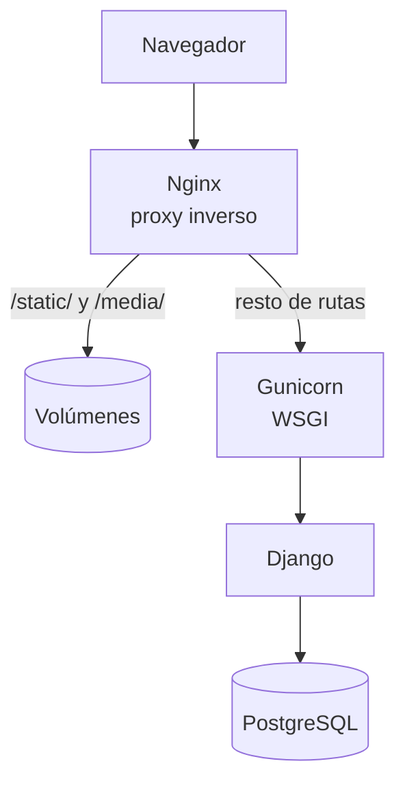

---
seo:
  description: "Cómo desplegar Django con Docker, Gunicorn y Nginx: Dockerfile, Gunicorn, configuración de Nginx, compose.yaml con PostgreSQL, ajustes de proxy y migraciones."
  image:
    src: /og/articulos/sistemas/contenedores/django-docker-gunicorn-nginx.png
    alt: "Django con Docker, Gunicorn y Nginx"
  schema:
    - '@type': TechArticle
      headline: "Django con Docker, Gunicorn y Nginx"
      description: "Cómo desplegar Django con Docker, Gunicorn y Nginx: Dockerfile, Gunicorn, configuración de Nginx, compose.yaml con PostgreSQL, ajustes de proxy y migraciones."
      image: https://velezanthony.github.io/og/articulos/sistemas/contenedores/django-docker-gunicorn-nginx.png
      inLanguage: es
      datePublished: '2026-11-21'
      dateModified: '2026-11-22'
      author:
        '@type': Person
        '@id': https://velezanthony.github.io/#anthony
        name: Anthony Velez Tapia
        url: https://velezanthony.github.io/
---

# Django con Docker, Gunicorn y Nginx

`manage.py runserver` es para desarrollo. En producción, una aplicación Django necesita un servidor
WSGI que ejecute el código y, delante, un proxy inverso que reciba el tráfico. En este artículo
monto la combinación que más uso: Gunicorn, Nginx y PostgreSQL, cada uno en su contenedor y
orquestados con Docker Compose. Todos los ejemplos encajan entre sí.

## Qué hace cada pieza



- **Gunicorn** es el servidor WSGI: arranca varios procesos *worker* que importan tu aplicación
  Django y responden a las peticiones.
- **Nginx** es el proxy inverso: recibe las conexiones de los clientes, sirve directamente los
  ficheros estáticos y subidos, y reenvía el resto a Gunicorn. La documentación de Gunicorn
  recomienda ponerlo detrás de un proxy que haga de búfer, porque con los workers síncronos un
  cliente lento puede bloquear un worker.
- **`collectstatic`** copia los estáticos de todas las apps en `STATIC_ROOT`, y es esa carpeta la
  que sirve Nginx. Django no debe servir estáticos en producción.

## El Dockerfile

```dockerfile
FROM python:3.14-slim

ENV PYTHONDONTWRITEBYTECODE=1 \
    PYTHONUNBUFFERED=1

WORKDIR /app

# Dependencies first: this layer is cached until requirements.txt changes
COPY requirements.txt .
RUN pip install --no-cache-dir -r requirements.txt

COPY . .

RUN chmod +x entrypoint.sh \
    && useradd --create-home --uid 1000 app \
    && mkdir -p /app/staticfiles /app/media \
    && chown -R app:app /app/staticfiles /app/media
USER app

EXPOSE 8000
ENTRYPOINT ["./entrypoint.sh"]
CMD ["gunicorn", "config.wsgi:application", "--config", "gunicorn.conf.py"]
```

`requirements.txt` tiene que incluir, además de Django, el servidor y el driver de PostgreSQL:

```text
Django
gunicorn
psycopg[binary]
```

`psycopg[binary]` trae su propia `libpq`, así que la imagen `slim` no necesita compilar nada. Es
un compromiso consciente: la documentación de psycopg recomienda el paquete binario para la
mayoría, pero para producción prefiere la instalación local (`psycopg[c]`), que se compila contra
la `libpq` y la `libssl` del sistema y recibe sus parches de seguridad. Eso exige compilador,
cabeceras de Python, `libpq-dev` y `pg_config` en la imagen (lo limpio es una construcción
multi-etapa que compila en una etapa y copia el resultado, con `libpq5` en la final). Aquí me quedo
con `[binary]` por sencillez.

En un proyecto real, fija versiones exactas en `requirements.txt` (`Django==…`), a mano o generando
el fichero con `pip-compile` o `uv pip compile`. Sin versiones, dos construcciones de la misma
imagen pueden instalar cosas distintas.

Tres decisiones:

- **Imagen `slim`**: la documentación de Docker recomienda partir de una imagen mínima; menos
  paquetes es menos superficie de ataque.
- **Dependencias antes que el código**: Docker reutiliza la capa de `pip install` mientras
  `requirements.txt` no cambie, así que cambiar una vista no reinstala todo.
- **Usuario sin privilegios**: si el proceso no necesita ser root, no debe serlo (`USER`).

Añade un `.dockerignore` con `.git`, `.env`, `__pycache__` y similares para que no acaben en la
imagen.

El `entrypoint.sh` prepara la aplicación y después cede el control al comando:

```sh
#!/bin/sh
set -e
if [ "${RUN_MIGRATIONS:-0}" = "1" ]; then
    python manage.py migrate --noinput
fi
python manage.py collectstatic --noinput
exec "$@"
```

- Las migraciones solo se ejecutan si `RUN_MIGRATIONS=1`. Así decides tú cuándo migrar (lo explico
  en [Migraciones en el despliegue](#migraciones-en-el-despliegue)).
- `exec` hace que Gunicorn sustituya al shell y reciba directamente las señales de parada.
- El `chmod +x` del Dockerfile garantiza que el script es ejecutable, aunque el permiso se pierda en
  tu máquina (pasa a menudo en Windows).

## Gunicorn

```python
# gunicorn.conf.py
import multiprocessing
import os

bind = "0.0.0.0:8000"
# WEB_CONCURRENCY wins when set; otherwise, the docs' starting point
workers = int(os.environ.get("WEB_CONCURRENCY", multiprocessing.cpu_count() * 2 + 1))
timeout = 30
# Nginx reaches Gunicorn from another container; Gunicorn's port is not published,
# so only containers on the Compose network can connect.
forwarded_allow_ips = "*"
accesslog = "-"
```

- **`workers`**: la documentación de Gunicorn propone `(2 × núcleos) + 1` como punto de partida y
  ajustarlo después según la carga. Ojo: dentro de un contenedor, `cpu_count()` devuelve los
  núcleos de la máquina, no el límite de CPU del contenedor, así que si limitas la CPU fija el
  número con la variable `WEB_CONCURRENCY`. Gunicorn ya la lee por su cuenta (su valor por defecto
  de `workers` es esa variable, o 1 si no existe), pero en cuanto el archivo asigna `workers`, el
  archivo manda; por eso este la consulta antes de calcular nada.
- **`timeout`**: un worker que no responde en ese tiempo se reinicia. 30 segundos es el valor por
  defecto; si tienes peticiones más largas, muévelas a tareas en segundo plano antes de subirlo.
- **`forwarded_allow_ips`**: las IP desde las que Gunicorn acepta las cabeceras de esquema seguro
  (`X-Forwarded-Proto` y similares) para marcar la petición como HTTPS en `wsgi.url_scheme`. Por
  defecto es `127.0.0.1,::1`, y Nginx está en otro contenedor, así que hay que ampliarlo. Ojo: solo
  afecta a lo que Gunicorn calcula; `SECURE_PROXY_SSL_HEADER` de Django lee la cabecera por su
  cuenta, sin mirar este ajuste. `"*"` solo es aceptable si nadie más que el proxy puede llegar a
  Gunicorn, que es lo que garantiza no publicar su puerto.

## Nginx

```nginx
# nginx/default.conf
upstream django {
    server web:8000;
}

server {
    listen 80;
    server_name example.com;
    client_max_body_size 10M;

    location /static/ {
        alias /srv/static/;
    }

    location /media/ {
        alias /srv/media/;
    }

    location / {
        proxy_set_header Host $host;
        proxy_set_header X-Forwarded-For $proxy_add_x_forwarded_for;
        proxy_set_header X-Forwarded-Proto $scheme;
        proxy_redirect off;
        proxy_pass http://django;
    }
}
```

`X-Forwarded-Proto` le dice a Django si la petición original llegó por HTTPS. Aquí Nginx escucha en
el puerto 80 para simplificar; en producción terminaría TLS en el 443 con un certificado, o lo haría
un balanceador delante. Si el TLS lo termina otro proxy antes que Nginx, `$scheme` sería `http` y
tendrías que reenviar la cabecera que te llega en lugar de generarla.

## compose.yaml

```yaml
services:
  db:
    image: postgres:19
    environment:
      POSTGRES_DB: app
      POSTGRES_USER: app
      POSTGRES_PASSWORD: ${POSTGRES_PASSWORD}
    volumes:
      - pgdata:/var/lib/postgresql
    healthcheck:
      test: ["CMD-SHELL", "pg_isready -U $${POSTGRES_USER} -d $${POSTGRES_DB}"]
      interval: 10s
      retries: 5

  web:
    build: .
    env_file: .env
    depends_on:
      db:
        condition: service_healthy
    volumes:
      - static:/app/staticfiles
      - media:/app/media
    healthcheck:
      test: ["CMD", "python", "-c", "import urllib.request; urllib.request.urlopen('http://localhost:8000/healthz/')"]
      interval: 30s
      retries: 3

  nginx:
    image: nginx:1.30-alpine
    ports:
      - "80:80"
    volumes:
      - ./nginx/default.conf:/etc/nginx/conf.d/default.conf:ro
      - static:/srv/static:ro
      - media:/srv/media:ro
    depends_on:
      - web

volumes:
  pgdata:
  static:
  media:
```

- `depends_on` con `condition: service_healthy` hace que Compose espere a que PostgreSQL responda a
  `pg_isready` antes de arrancar `web`, así las migraciones del arranque no fallan.
- Desde PostgreSQL 18, la imagen oficial guarda los datos en una carpeta por versión
  (`PGDATA=/var/lib/postgresql/19/docker`) y el volumen se monta en `/var/lib/postgresql`, no en
  `/var/lib/postgresql/data` como hasta la 17. Si vienes de una versión anterior, no basta con
  cambiar la etiqueta: un cambio de versión mayor exige migrar los datos (`pg_upgrade` o volcado y
  restauración).
- Los volúmenes `static` y `media` los comparten `web` (que escribe) y `nginx` (que solo lee).
- Solo Nginx publica un puerto. Gunicorn y PostgreSQL solo son accesibles dentro de la red de
  Compose.
- La imagen `slim` no trae `curl`, por eso el healthcheck de `web` usa Python. La vista
  `/healthz/` es tuya: algo tan simple como devolver un 200, o comprobar también la conexión a la
  base de datos si quieres que el healthcheck lo cubra.
- El healthcheck llama a `localhost`, así que `localhost` tiene que estar en `ALLOWED_HOSTS` (ver el
  `.env` de abajo). Si no, Django responde 400 y el contenedor nunca se marca como sano.
- El healthcheck habla HTTP directamente con Gunicorn. Si activas `SECURE_SSL_REDIRECT = True` (lo
  sugiere `check --deploy`), Django le responde con un 301 hacia HTTPS y el healthcheck falla.
  Exime la ruta con `SECURE_REDIRECT_EXEMPT = [r"^healthz/$"]` (sin barra inicial).

## Ajustes de Django para producción

Las variables sensibles van en `.env` (fuera del repositorio) o en el gestor de secretos de tu
plataforma, nunca en la imagen:

```python
# settings.py
import os

SECRET_KEY = os.environ["DJANGO_SECRET_KEY"]
DEBUG = False
ALLOWED_HOSTS = os.environ["DJANGO_ALLOWED_HOSTS"].split(",")
CSRF_TRUSTED_ORIGINS = os.environ["DJANGO_CSRF_TRUSTED_ORIGINS"].split(",")

SECURE_PROXY_SSL_HEADER = ("HTTP_X_FORWARDED_PROTO", "https")

STATIC_URL = "/static/"
STATIC_ROOT = "/app/staticfiles"
MEDIA_URL = "/media/"
MEDIA_ROOT = "/app/media"

DATABASES = {
    "default": {
        "ENGINE": "django.db.backends.postgresql",
        "HOST": "db",
        "NAME": "app",
        "USER": "app",
        "PASSWORD": os.environ["POSTGRES_PASSWORD"],
    }
}
```

Y el `.env` correspondiente (con tus valores):

```sh
DJANGO_SECRET_KEY=change-me
DJANGO_ALLOWED_HOSTS=example.com,localhost
DJANGO_CSRF_TRUSTED_ORIGINS=https://example.com
POSTGRES_PASSWORD=change-me
```

- **`ALLOWED_HOSTS`**: los dominios que la aplicación acepta en la cabecera `Host`. Incluye
  `localhost` por el healthcheck.
- **`CSRF_TRUSTED_ORIGINS`**: desde Django 4.0 los valores deben incluir el esquema
  (`https://example.com`), no solo el dominio.
- **`SECURE_PROXY_SSL_HEADER`**: hace que `request.is_secure()` confíe en `X-Forwarded-Proto`.
  La documentación de Django advierte que solo debe activarse si controlas el proxy y este
  sobrescribe esa cabecera siempre; si no, un cliente podría falsearla. En `nginx/default.conf`,
  `proxy_set_header` la sustituye en cada petición.

Ejecuta `python manage.py check --deploy` antes del primer despliegue: revisa los ajustes de
seguridad más habituales.

## Migraciones en el despliegue

Hay dos formas de migrar, y el `entrypoint.sh` permite las dos:

- **Con un solo contenedor `web`**: pon `RUN_MIGRATIONS=1` en el `.env` y migrará al arrancar. Es
  lo más cómodo.
- **Con varias réplicas**: déjalo sin poner (vale `0`), o todas intentarían migrar a la vez. En
  Compose, sin más, `web` es un solo contenedor; hay réplicas si las pides con
  `docker compose up -d --scale web=3` o con `deploy.replicas` en el servicio. Migra en un paso
  separado, una vez, antes de levantar la versión nueva:

```sh
docker compose build web
docker compose run --rm -e RUN_MIGRATIONS=1 web true
docker compose up -d
```

El primero construye la imagen nueva; sin él, la migración correría con el código anterior. El
segundo arranca un contenedor temporal con esa imagen, que migra en el `entrypoint.sh` y termina
ejecutando `true`. El tercero recrea los contenedores cuya imagen ha cambiado: para los antiguos y
arranca los nuevos, que ya no migran (habrá un corte breve mientras tanto).

Conviene que las migraciones sean compatibles con la versión anterior del código (añadir antes de
borrar): entre el segundo y el tercer comando, el código antiguo sigue sirviendo peticiones contra
el esquema nuevo.

## En resumen

- Gunicorn ejecuta Django; Nginx recibe el tráfico, sirve estáticos y media, y hace de búfer.
- Dockerfile con imagen `slim`, dependencias en su propia capa y usuario sin privilegios.
- Workers a partir de `(2 × núcleos) + 1`, ajustando según la carga y los límites del contenedor.
- `X-Forwarded-Proto` en Nginx y `SECURE_PROXY_SSL_HEADER` en Django, solo si el proxy controla
  esa cabecera.
- Healthchecks en Compose para arrancar en orden y migraciones como paso explícito del despliegue.

## Referencias

- [Django: desplegar con Gunicorn](https://docs.djangoproject.com/en/stable/howto/deployment/wsgi/gunicorn/)
- [Django: lista de comprobación de despliegue](https://docs.djangoproject.com/en/stable/howto/deployment/checklist/)
- [Django: ficheros estáticos en producción](https://docs.djangoproject.com/en/stable/howto/static-files/deployment/)
- [Django: `SECURE_PROXY_SSL_HEADER`, `ALLOWED_HOSTS` y `CSRF_TRUSTED_ORIGINS`](https://docs.djangoproject.com/en/stable/ref/settings/)
- [Gunicorn: diseño y número de workers](https://gunicorn.org/design/)
- [Gunicorn: despliegue detrás de Nginx](https://gunicorn.org/deploy/)
- [Gunicorn: ajustes (`workers`, `timeout`, `forwarded_allow_ips`)](https://gunicorn.org/reference/settings/)
- [Docker: buenas prácticas para Dockerfile](https://docs.docker.com/build/building/best-practices/)
- [Docker Compose: orden de arranque y healthchecks](https://docs.docker.com/compose/how-tos/startup-order/)
- [Nginx: módulo `ngx_http_proxy_module`](https://nginx.org/en/docs/http/ngx_http_proxy_module.html)
