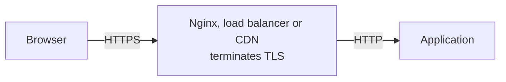

# ERR_TOO_MANY_REDIRECTS: Nginx, HTTPS and redirects

A site behind Nginx works over HTTP. You add the certificate, enable "force HTTPS" in the
application and the browser stops loading the page: **ERR_TOO_MANY_REDIRECTS**. You clear cookies,
try another browser and nothing. It is not the browser: something along the way answers every
request with a redirect that leads back to the same request.

## The path of a request

In front of the application there is a **reverse proxy**: Nginx receives the browser's connection
and forwards it to the application (Gunicorn, PHP-FPM, Node…) over an internal network. Sometimes
there are more hops: a load balancer or a CDN in front of Nginx.



The key is **where TLS terminates**: the first box that decrypts HTTPS. From there on, the request
usually continues over HTTP. The application receives a request over HTTP even though the user
typed `https://`, and if its rule is "if it is not HTTPS, redirect to HTTPS", it redirects. The
browser follows the redirect, comes back in over HTTPS, the proxy talks HTTP to the application
again… and so on until the browser gives up.

## Diagnosing with curl

Before touching anything, look at who redirects and where to:

```bash
curl -sIL https://example.com | rg -i '^(HTTP|location)'
```

`-I` asks for headers only, `-L` follows redirects (curl stops at 50) and `-s` removes the progress
bar. A loop looks like this:

```text
HTTP/2 301
location: https://example.com/
HTTP/2 301
location: https://example.com/
HTTP/2 301
location: https://example.com/
```

The same URL redirecting to itself: the application (or something in between) thinks the request is
not HTTPS. If the `location` values alternate between two URLs (`https://www.example.com/` and
`https://example.com/`), there are two rules contradicting each other.

To find out **who** is responding, compare the headers: `server: nginx` versus the application's or
the CDN's, or send the same request skipping a hop (straight to the application's port from the
server, for example).

## X-Forwarded-Proto: telling the application how the user arrived

The proxy that terminates TLS knows the original request was HTTPS; the application does not. It
tells it with a header, **`X-Forwarded-Proto`**, set to `https` or `http`. In Nginx, `$scheme` is
the scheme the request arrived at Nginx with:

```nginx
proxy_set_header X-Forwarded-Proto $scheme;
```

And the application has to **read it**, because by default it does not trust it. That fixes the two
most common cases.

### Django with `SECURE_SSL_REDIRECT`

`SECURE_SSL_REDIRECT = True` redirects to HTTPS every request Django does not consider secure.
Behind a proxy, Django always sees HTTP. The documentation itself says so: if enabling it causes
infinite redirects, you are behind a proxy and `SECURE_PROXY_SSL_HEADER` is missing:

```python
# settings.py
SECURE_SSL_REDIRECT = True
SECURE_PROXY_SSL_HEADER = ("HTTP_X_FORWARDED_PROTO", "https")
```

:::warning[Only if you control the proxy]

With `SECURE_PROXY_SSL_HEADER`, Django believes whatever that header says. Enable it only if the
proxy overwrites it on every request, as `proxy_set_header` does; otherwise a client could send it
themselves.

:::

I cover the full setup of Nginx in front of Django in
[Django with Docker, Gunicorn and Nginx](../contenedores/django-docker-gunicorn-nginx.md).

### WordPress with the site URL on `https://`

With the site URL on `https://` and TLS terminated at the proxy, WordPress also loops: the
documentation mentions it explicitly and the solution is the same idea, read `X-Forwarded-Proto` in
`wp-config.php` and mark the request as HTTPS:

```php
// wp-config.php
if (isset($_SERVER['HTTP_X_FORWARDED_PROTO'])
    && strpos($_SERVER['HTTP_X_FORWARDED_PROTO'], 'https') !== false) {
    $_SERVER['HTTPS'] = 'on';
}
```

## The Nginx configuration

When Nginx terminates TLS, the simplest approach is for **only Nginx** to redirect to HTTPS, in the
port 80 server, and for the 443 one not to redirect anything:

```nginx
# /etc/nginx/sites-available/example.com
server {
    listen 80;
    server_name example.com www.example.com;
    return 301 https://$host$request_uri;
}

server {
    listen 443 ssl;
    server_name example.com www.example.com;

    ssl_certificate     /etc/letsencrypt/live/example.com/fullchain.pem;
    ssl_certificate_key /etc/letsencrypt/live/example.com/privkey.pem;

    location / {
        proxy_set_header Host $host;
        proxy_set_header X-Forwarded-For $proxy_add_x_forwarded_for;
        proxy_set_header X-Forwarded-Proto $scheme;
        proxy_pass http://127.0.0.1:8000;
    }
}
```

- **Port 80**: `return 301` responds without going through the application. `$host` is the
  requested domain and `$request_uri` the original path with its parameters, so `/cart?id=3` ends up
  at the same path over HTTPS.
- **Port 443**: here `$scheme` is always `https`, and that is what the application receives.

The certificate is issued by Let's Encrypt. `sudo certbot --nginx -d example.com -d www.example.com`
obtains the certificate, stores it in `/etc/letsencrypt/live/example.com/` and edits the Nginx
configuration; by default it also adds the HTTP-to-HTTPS redirect. Most Certbot installations leave
renewal scheduled.

With the redirect in Nginx, the application's setting (`SECURE_SSL_REDIRECT`, whatever plugin you
use) is unnecessary. You can keep it as a safety net, but then the application has to read
`X-Forwarded-Proto` correctly.

## When TLS terminates before Nginx

If there is a load balancer (an ALB on AWS, for example) or a CDN in front of Nginx that terminates
TLS, Nginx receives **HTTP**. Two consequences:

- **`return 301 https://…` in Nginx causes the loop.** The user reaches the load balancer over
  HTTPS, it talks HTTP to Nginx, Nginx redirects to HTTPS, and round it goes again. The redirect
  belongs on the box that terminates TLS: on the ALB it is a rule on the port 80 *listener* with a
  `redirect` action to HTTPS.
- **`$scheme` is `http`.** Nginx has to forward the header it receives from the load balancer, not
  generate a new one:

```nginx
proxy_set_header X-Forwarded-Proto $http_x_forwarded_proto;
```

In [Basic architecture on AWS](../cloud/aws/aws-arquitectura-basica.md) I use exactly that setup:
the ALB terminates HTTPS with an ACM certificate.

### A CDN in "flexible" mode

Cloudflare in **Flexible** mode encrypts between the browser and Cloudflare, but talks **HTTP** to
your server. If your server redirects HTTP to HTTPS (the `return 301` above), every request from
Cloudflare gets a redirect, which the browser follows and reaches Cloudflare again: a loop.
Cloudflare's documentation suggests removing the redirect from the origin or, more simply, putting a
certificate on the origin and using **Full (strict)** mode, which talks HTTPS to it.

## www versus no www

The other classic loop has nothing to do with HTTPS: Nginx redirects `www.example.com` to
`example.com` and the application (or the CDN, or a rule in the hosting panel) redirects
`example.com` to `www.example.com`. In the `curl` output it shows up as two alternating `location`
values.

Decide which is the canonical domain and do the redirect **in one place only**. In Nginx, a
`server` for the domain you do not want:

```nginx
server {
    listen 443 ssl;
    server_name www.example.com;
    ssl_certificate     /etc/letsencrypt/live/example.com/fullchain.pem;
    ssl_certificate_key /etc/letsencrypt/live/example.com/privkey.pem;
    return 301 https://example.com$request_uri;
}
```

The certificate has to cover both names: the browser checks the certificate before it sees the
redirect.

## Summary

- The loop appears when something redirects to HTTPS a request that, as far as it is concerned,
  arrived over HTTP.
- Find out where TLS terminates: from that point on the request travels over HTTP.
- `curl -sIL … | rg -i '^(HTTP|location)'` tells you who redirects and where to.
- Redirect in one place only, the one that terminates TLS, and pass `X-Forwarded-Proto` to the
  application.
- With a CDN, use a certificate on the origin and Full (strict) mode instead of Flexible.

## References

- [Nginx: `ngx_http_core_module` variables (`$scheme`, `$host`, `$request_uri`)](https://nginx.org/en/docs/http/ngx_http_core_module.html)
- [Nginx: `return` directive](https://nginx.org/en/docs/http/ngx_http_rewrite_module.html#return)
- [Nginx: `ngx_http_proxy_module` module](https://nginx.org/en/docs/http/ngx_http_proxy_module.html)
- [Django: `SECURE_SSL_REDIRECT` and `SECURE_PROXY_SSL_HEADER`](https://docs.djangoproject.com/en/stable/ref/settings/#secure-proxy-ssl-header)
- [WordPress: administration over HTTPS](https://developer.wordpress.org/advanced-administration/security/https/)
- [Certbot: Nginx plugin and renewal](https://eff-certbot.readthedocs.io/en/stable/using.html)
- [AWS: Application Load Balancer `X-Forwarded` headers](https://docs.aws.amazon.com/elasticloadbalancing/latest/application/x-forwarded-headers.html)
- [AWS: `redirect` actions in listener rules](https://docs.aws.amazon.com/elasticloadbalancing/latest/application/rule-action-types.html)
- [Cloudflare: ERR_TOO_MANY_REDIRECTS](https://developers.cloudflare.com/ssl/troubleshooting/too-many-redirects/)
- [Cloudflare: Flexible mode](https://developers.cloudflare.com/ssl/origin-configuration/ssl-modes/flexible/)
- [curl: manual](https://curl.se/docs/manpage.html)
