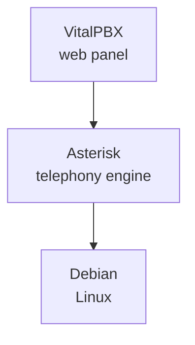

# Your own PBX: Asterisk and VitalPBX versus Twilio

An AI phone agent, the kind that answers and holds a conversation with you, is usually built with
**Twilio**, which provides the number and the call, and a voice service such as **ElevenLabs**,
which provides the conversation. Both charge per minute: the more calls, the more you pay both of
them. You can do the Twilio part yourself with **Asterisk**, and that is what I set up with
VitalPBX.

## From Asterisk to VitalPBX



**Asterisk** is the engine: an open-source PBX that receives calls, connects them between
extensions and decides what to do with each one. It is configured with text files from the
terminal. For example, to make dialling any extension starting with 6 ring it:

```ini
; extensions.conf
[internal]
exten => _6XXX,1,Dial(PJSIP/${EXTEN},20)
```

It works, but every extension, queue or voice menu is more text by hand.

**VitalPBX** puts a web panel on top. You install it on Debian, which is still a terminal server,
and from the browser you create extensions, queues, voice menus and trunks. Underneath, what
handles the calls is still Asterisk: VitalPBX writes its configuration for you.

## What you get rid of and what you don't

With your own PBX you get rid of Twilio: you contract the number and the line from a SIP provider
and they reach your Asterisk.

What you do not get rid of is the voice. The agent has to understand what it hears, work out the
answer with an LLM and speak, and a service such as ElevenLabs still does that. The nice part is
that it connects to your PBX **over SIP**, as if it were just another trunk: the call comes in,
Asterisk passes it to an extension and the agent answers on that extension.

- **Simpler with Twilio**: starting today, with no server and no provider.
- **Simpler with Asterisk**: keeping costs under control as the number of calls grows.

## Why in a virtual machine

VitalPBX is not a program you install anywhere: it is a whole server, a Debian with Asterisk, its
web panel, databases and firewall. Docker recommends one service per container, and on top of that
Asterisk needs to open thousands of ports for audio (10000 to 20000 by default). It can be forced,
but it is simpler with a virtual machine: a Debian on Proxmox or VirtualBox, with its own IP on
your network. I explain the difference between the two in
[Proxmox as a lab](../virtualizacion/proxmox-laboratorio.md).

## How far I got

I got as far as calls on the local network, with no provider. To avoid installing anything, I used
**VitXi**, VitalPBX's web phone: a colleague logged in from the browser with their virtual extension
and could call me and I could call them. For it to work, the extension is created with the WebRTC
profile that ships with VitalPBX and the WebRTC client option enabled. I left it
documented, and the trunk with the provider, to make and receive outside calls, and the move to the
cloud were left pending.

## Summary

- Asterisk is the telephony engine; VitalPBX, a web panel on top, installed on Debian.
- With your own PBX you get rid of Twilio, but not the voice service, which connects over SIP.
- For testing, a virtual machine is simpler than Docker.

## References

- [Asterisk: documentation](https://docs.asterisk.org/)
- [VitalPBX: installing on Debian](https://docs.vitalpbx.com/vitalpbx/installation-vitalpbx/installing-vitalpbx-in-a-debian-and-vps-installation/)
- [VitalPBX: creating an extension for VitXi](https://wiki.vitalpbx.com/wiki/vitxi/create-a-vitxi-extension/)
- [VitalPBX: NAT and firewall](https://docs.vitalpbx.com/vitalpbx/connectivity/nat-settings-and-firewall-overview/)
- [ElevenLabs: SIP trunking](https://elevenlabs.io/docs/eleven-agents/phone-numbers/sip-trunking)
- [Twilio: voice pricing](https://www.twilio.com/en-us/voice/pricing/es)
- [ElevenLabs: Agents pricing](https://elevenlabs.io/pricing/agents)
- [Docker: running multiple services in a container](https://docs.docker.com/engine/containers/multi-service_container/)
- [Asterisk: sample rtp.conf](https://github.com/asterisk/asterisk/blob/master/configs/samples/rtp.conf.sample)
