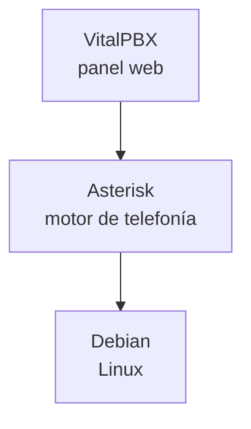

---
seo:
  title: "Asterisk y VitalPBX frente a Twilio"
  description: "Montar tu propia centralita con Asterisk y VitalPBX en lugar de pagar Twilio por minuto, qué sigues necesitando para la IA de voz y por qué en una VM."
---

# Tu propia centralita: Asterisk y VitalPBX frente a Twilio

Un agente telefónico con IA, de los que te contestan y conversan contigo, suele montarse con
**Twilio**, que pone el número y la llamada, y un servicio de voz como **ElevenLabs**, que pone la
conversación. Los dos cobran por minuto: cuantas más llamadas, más pagas a los dos. La parte de
Twilio la puedes hacer tú con **Asterisk**, y es lo que monté con VitalPBX.

## De Asterisk a VitalPBX



**Asterisk** es el motor: una centralita de código abierto que recibe las llamadas, las conecta
entre extensiones y decide qué hacer con cada una. Se configura con ficheros de texto desde la
terminal. Por ejemplo, para que marcar cualquier extensión que empiece por 6 la haga sonar:

```ini
; extensions.conf
[internal]
exten => _6XXX,1,Dial(PJSIP/${EXTEN},20)
```

Funciona, pero cada extensión, cola o menú de voz es más texto a mano.

**VitalPBX** pone un panel web encima. Lo instalas sobre un Debian, que sigue siendo un servidor de
terminal, y desde el navegador creas extensiones, colas, menús de voz y troncales. Por debajo, el
que atiende las llamadas sigue siendo Asterisk: VitalPBX escribe su configuración por ti.

## Qué te quitas y qué no

Con tu propia centralita te quitas Twilio: el número y la línea los contratas a un operador SIP y
llegan a tu Asterisk.

Lo que no te quitas es la voz. El agente tiene que entender lo que oye, pensar la respuesta con un
LLM y hablar, y eso lo sigue haciendo un servicio como ElevenLabs. La gracia es que se conecta a tu
centralita **por SIP**, como si fuera un troncal más: la llamada entra, Asterisk la pasa a una
extensión y en esa extensión contesta el agente.

- **Más sencillo con Twilio**: empezar hoy, sin servidor ni operador.
- **Más sencillo con Asterisk**: controlar el coste cuando crece el número de llamadas.

## Por qué en una máquina virtual

VitalPBX no es un programa que instalas en cualquier sitio: es un servidor entero, un Debian con
Asterisk, su panel web, bases de datos y firewall. Docker recomienda un servicio por contenedor, y
además Asterisk necesita abrir miles de puertos para el audio (de 10000 a 20000 por defecto). Se
puede forzar, pero es más sencillo con una máquina virtual: un Debian en Proxmox o en VirtualBox,
con su IP en tu red. Cuento la diferencia entre los dos en
[Proxmox como laboratorio](../virtualizacion/proxmox-laboratorio.md).

## Hasta dónde llegué

Llegué a las llamadas en la red local, sin operador. Para no instalar nada, usé **VitXi**, el
teléfono web de VitalPBX: un compañero entraba desde el navegador, iniciaba sesión con su extensión
virtual y podía llamarme y yo a él. Para que funcione, la extensión se crea con el perfil WebRTC que
trae VitalPBX y la opción de cliente WebRTC activada. Lo dejé
documentado, y quedaron pendientes el troncal con el operador, para llamar y recibir llamadas de
fuera, y el paso a la nube.

## En resumen

- Asterisk es el motor de telefonía; VitalPBX, un panel web encima, instalado sobre Debian.
- Con tu propia centralita te quitas Twilio, pero no el servicio de voz, que se conecta por SIP.
- Para probar, una máquina virtual es más sencilla que Docker.

## Referencias

- [Asterisk: documentación](https://docs.asterisk.org/)
- [VitalPBX: instalación en Debian](https://docs.vitalpbx.com/vitalpbx/installation-vitalpbx/installing-vitalpbx-in-a-debian-and-vps-installation/)
- [VitalPBX: crear una extensión para VitXi](https://wiki.vitalpbx.com/wiki/vitxi/create-a-vitxi-extension/)
- [VitalPBX: NAT y firewall](https://docs.vitalpbx.com/vitalpbx/connectivity/nat-settings-and-firewall-overview/)
- [ElevenLabs: troncal SIP](https://elevenlabs.io/docs/eleven-agents/phone-numbers/sip-trunking)
- [Twilio: precios de voz](https://www.twilio.com/en-us/voice/pricing/es)
- [ElevenLabs: precios de Agents](https://elevenlabs.io/pricing/agents)
- [Docker: varios servicios en un contenedor](https://docs.docker.com/engine/containers/multi-service_container/)
- [Asterisk: rtp.conf de ejemplo](https://github.com/asterisk/asterisk/blob/master/configs/samples/rtp.conf.sample)
