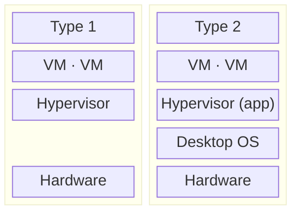

# Proxmox for a lab or pre-production

Before paying for cloud infrastructure, I like to be able to build and break that infrastructure at
home. For that I use Proxmox VE: a server (or an old computer) becomes a small data centre with
virtual machines and containers that I can create, clone and destroy in minutes. In this article I
explain what it is, what I find it useful for and where I think its limits are.

## What Proxmox VE is

Proxmox Virtual Environment is an open-source virtualisation platform (AGPLv3 licence) based on
Debian. It is installed directly on the hardware, with no other operating system underneath, and
offers:

- **Virtual machines with KVM/QEMU**: any full operating system, Linux or Windows.
- **LXC containers**: system containers that share the host's kernel. They start in seconds and use
  far less than a VM; they are not Docker containers, but "lightweight machines" with their own init
  system.
- **Web interface** to manage VMs, containers, storage and networking, plus a command line and an
  API.
- **Snapshots** of VMs and containers, when the storage supports them (for example, ZFS, LVM-thin or
  qcow2 files).
- **Built-in backups** with `vzdump`, and optionally Proxmox Backup Server, which adds
  deduplication, client-side encryption and syncing to another site.
- **Clustering** of several nodes (Corosync and the Proxmox cluster file system), **high
  availability** with its own HA manager and built-in **Ceph** for distributed storage.

The software is free. Proxmox sells subscriptions that give access to the enterprise repository and
to support; without a subscription you use the public repositories.

## Type 1 versus type 2: why Proxmox uses fewer resources

A **hypervisor** is the software that creates and runs virtual machines: it shares the machine's
CPU, RAM and disks among them. There are two types, and the difference lies in **what sits between
the hardware and your virtual machines**.



| | Type 1 (*bare-metal*) | Type 2 (*hosted*) |
|---|---|---|
| **Where it is installed** | Directly on the hardware | As just another application, inside your operating system |
| **What is underneath** | Nothing, or a minimal system with no desktop | A full operating system: desktop, browser, updates… |
| **Resources** | Almost all the RAM and CPU go to the virtual machines | The host system takes its share before anything starts |
| **What for** | Servers dedicated to virtualisation | Trying something out on your work computer |
| **Examples** | Proxmox VE (KVM), VMware ESXi, Microsoft Hyper-V | VirtualBox, VMware Workstation Pro (Windows and Linux), VMware Fusion Pro and Parallels Desktop (Mac), UTM (Mac) |

### The layer you save

In a type 2 there is **one more layer**: the desktop operating system. Windows or macOS use RAM and
CPU of their own (graphical interface, services, antivirus, updates) before the first virtual
machine starts. The VM's instructions run directly on the CPU thanks to VT-x or AMD-V, but device
input and output (disk, network, USB) goes through that operating system.

In Proxmox that layer does not exist. Underneath there is a minimal Debian, with no desktop, and the
hypervisor (KVM) is part of the Linux kernel itself: each virtual machine is a process that the
kernel manages directly. With the same RAM, more virtual machines fit, and they perform better. It
is the main reason I prefer it for a lab.

:::note[Two caveats]

- **KVM and "type 1".** Because there is a Linux underneath, some people dispute the label. Red Hat,
  which develops a good part of KVM, describes it as a type 1 hypervisor that turns the kernel
  itself into a hypervisor. What matters in practice is that there is no desktop system in between.
- **Hyper-V, the odd case.** When you enable it on Windows, the hypervisor moves underneath and
  Windows itself becomes a special partition (the *root partition*) that runs on top of it. That is
  why it is type 1, even though you enable it from your usual Windows.

:::

On price: VMware Workstation Pro and Fusion Pro used to be paid, but since November 2024 Broadcom
offers them free, including for commercial use. VirtualBox and UTM are free; Parallels Desktop is
paid.

## What I find it useful for

- **A cheap local lab.** With a single machine with plenty of RAM I can have a network with several
  VMs: an application server, a database, a proxy, a CI runner.
- **Testing before deploying.** Rehearsing an operating system upgrade, a database migration or a
  configuration change on a copy, not on the real system.
- **Small pre-production environments.** An environment where the team can test the application
  with a topology similar to production without paying for cloud hours.
- **Reproducing infrastructure before paying for it.** If I am going to set up three servers and a
  database in the cloud, I first build it here, write the automation (Ansible, Terraform with a
  Proxmox provider, scripts) and check that it works. Proxmox does not publish an official Terraform
  provider: the existing ones are community-maintained, such as `bpg/proxmox`.

## My view on production

This is an opinion, not a rule: **for a lab, testing and pre-production, I find Proxmox excellent;
for a serious production environment, I would not choose it.**

My reasons are practical. In production I want the hardware, the network, the power, the redundant
storage and the off-site backups to be someone else's problem. With Proxmox all of that is your
responsibility: if a disk fails at three in the morning, someone has to go and replace it. For a
small team, paying a cloud provider for managed services usually works out better than maintaining
that layer.

That said, some teams do run production on Proxmox, and I understand why:

- It offers **high-availability clusters**: if a node goes down, the HA manager restarts its VMs on
  another. The documentation asks for at least three nodes for a reliable quorum, shared storage and
  redundant hardware.
- **Built-in Ceph** provides distributed storage replicated across the nodes.
- The long-term **cost** can be lower than the cloud if you already have hardware, a data centre and
  people who know how to run it.
- It gives **full control** over where the data lives, which is sometimes a requirement.

With an operations team, suitable hardware and a well-designed cluster, it is a legitimate option.
My reservation is for small teams without that capacity.

## Practical tips

### Templates and clones

Install and configure a base VM once (updated system, user, SSH key, QEMU agent) and turn it into a
**template**. A template can no longer be started; it is used to create clones:

- **Full clone**: an independent copy, which takes up as much space as the original.
- **Linked clone**: takes up much less because it shares the template's data, but depends on it. It
  requires compatible storage (for example, ZFS, LVM-thin or qcow2 files).

With cloud-init in the template, each clone boots with its own name, network and keys.

### Snapshot before any risky change

Before upgrading a system, touching a database or trying a deployment script, I take a snapshot. If
something goes wrong, I roll back in seconds:

```sh
qm snapshot 101 before-upgrade
# ... risky change ...
qm rollback 101 before-upgrade
```

But a snapshot is not a backup: it lives on the same storage as the VM. That is what `vzdump` or
Proxmox Backup Server are for, ideally on another disk or another machine.

### Basic networking

- The installer creates a bridge, `vmbr0`, connected to the management interface. VMs connected to
  it behave as if they were plugged straight into the physical network, each with its own MAC.
- If you want to separate networks (for example, lab and home), enable the **VLAN aware** option on
  the bridge and assign a VLAN tag to each virtual network card.
- If the VMs only have private IPs, you can configure **masquerading (NAT)** on the host so they
  reach the internet through its IP.

### Resources

- LXC containers are ideal for simple Linux services; keep VMs for whatever needs its own kernel or
  a different operating system. For application containers (Docker), the Proxmox documentation
  still recommends running them inside a VM when you need maximum isolation or live migration.
  Since Proxmox VE 9.1 you can create LXC containers from OCI images and, as a *technology
  preview*, also run application containers from suitable OCI images.
- Do not allocate more RAM than the machine has across all running VMs, unless you know what you
  are doing with *ballooning*.

## Summary

Proxmox VE turns a server into a complete, free virtualisation platform with a web interface: VMs
with KVM, LXC containers, snapshots, backups and clusters. For me it is the best way to have a lab,
rehearse changes and set up cheap pre-production. For serious production I prefer managed services,
although I recognise that with a well-built cluster and a team to run it, it works too.

## References

- [Proxmox VE: administration guide](https://pve.proxmox.com/pve-docs/pve-admin-guide.html)
- [Proxmox VE: VM templates and clones](https://pve.proxmox.com/wiki/VM_Templates_and_Clones)
- [Proxmox VE: network configuration](https://pve.proxmox.com/wiki/Network_Configuration)
- [Proxmox VE: high availability](https://pve.proxmox.com/wiki/High_Availability)
- [Proxmox VE: backup and restore](https://pve.proxmox.com/wiki/Backup_and_Restore)
- [Proxmox VE: package repositories](https://pve.proxmox.com/wiki/Package_Repositories)
- [Proxmox VE: Linux containers](https://pve.proxmox.com/wiki/Linux_Container)
- [Proxmox VE: cloud-init](https://pve.proxmox.com/wiki/Cloud-Init_Support)
- [Proxmox Backup Server](https://www.proxmox.com/en/products/proxmox-backup-server/overview)
- [Red Hat: what is a hypervisor](https://www.redhat.com/en/topics/virtualization/what-is-a-hypervisor)
- [Red Hat: what is KVM](https://www.redhat.com/en/topics/virtualization/what-is-KVM)
- [Microsoft: Hyper-V architecture](https://learn.microsoft.com/en-us/windows-server/virtualization/hyper-v/architecture)
- [Broadcom: VMware Workstation Pro and Fusion Pro free of charge](https://knowledge.broadcom.com/external/article?articleNumber=368667)
