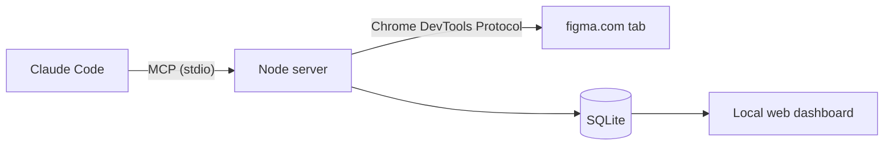
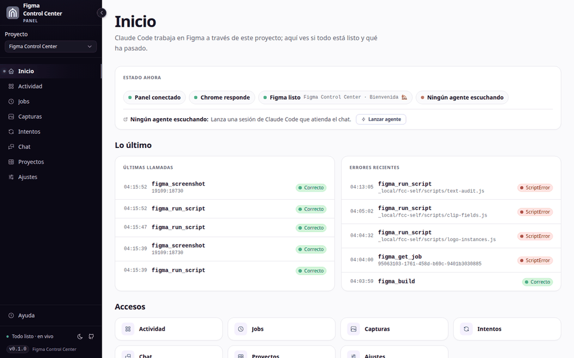
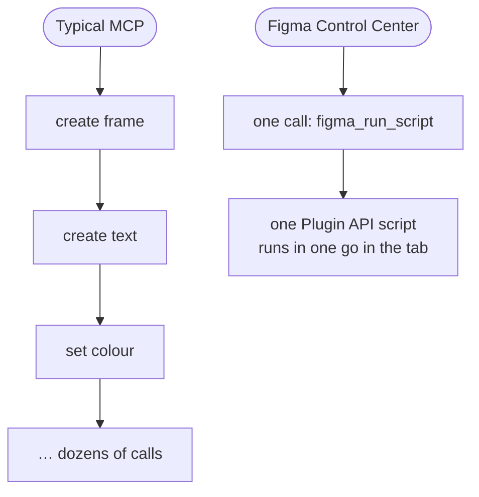
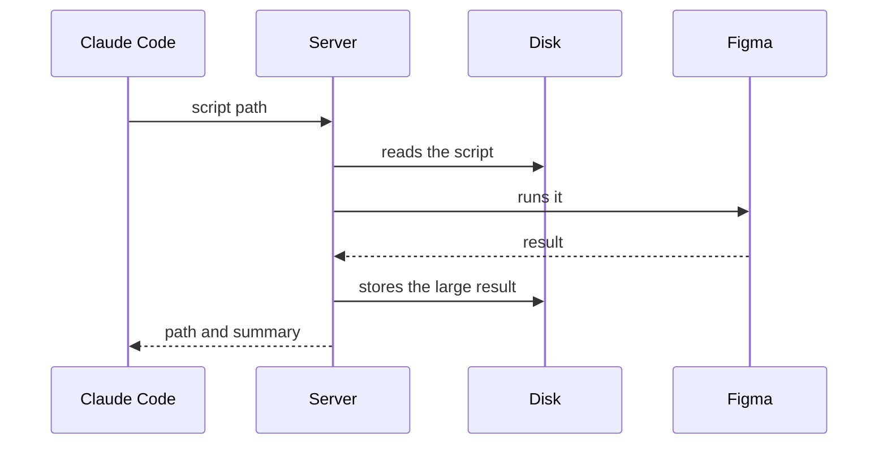
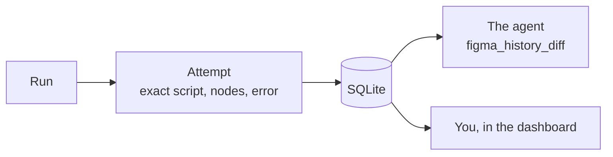
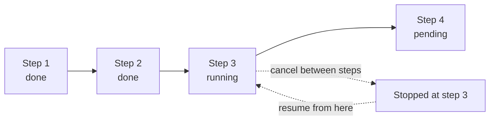

## The problem

On one project we built the design system straight in code, without going through Figma. I
wanted to bring it into Figma so that, if a designer ever joined, they could work on the designs.

Figma’s official MCP has a usage limit, and it ran out quickly. Doing it by hand meant hours of
work: the same click, component after component.

## What it is

A local MCP server that lets Claude Code read and edit Figma files, with a web dashboard and a
SQLite database that records everything it does.

It has three parts:

- **Tools that expect code.** Claude does not ask to “create a rectangle” and then “give it this
  colour”: it writes a Figma Plugin API script and the server runs it in the tab. You say “my
  components look like this” and the agent writes the code that builds them.
- **A history in SQLite.** Every call, batch and attempt is stored with the exact script it used,
  the nodes it touched and the error, if any.
- **A local web dashboard.** It shows, live, the calls, the running batches, the node screenshots
  and the attempt history, with the diff between any two of them.

## Decisions

### The agent writes code instead of chaining tools

A typical MCP server exposes one tool per operation, and every intermediate call takes up
context. That is the argument behind “traditional MCP is dead”: Cloudflare reduced over 2,500
endpoints to two tools that take code
([Code Mode](https://blog.cloudflare.com/code-mode-mcp/)), and Anthropic proposes the same in
[Code execution with MCP](https://www.anthropic.com/engineering/code-execution-with-mcp).

Writes go through `figma_run_script` and `figma_build`. It is not the radical two-tool version:
reads, diagnostics and history have tools of their own.

### File paths, not code in the call

A script of several megabytes costs the model the same as a one-liner.

### A SQLite history to keep track of changes

It answers “what changed between the time it worked and the time it did not?” without repeating
anything in Figma, and it survives Claude Code restarts.

### Work in batches

`figma_build` replaces the hours of clicks: long work is described once and runs on its own. If
you switch files halfway, it refuses to go on.

### Also

- **Hexagonal architecture with checked boundaries.** All access to Figma lives in a single
  adapter; ESLint and dependency-cruiser stop, for example, the dashboard from talking to Figma.
- **Versioned contracts.** Each project brings its data as versioned JSON: the server knows no
  project, and a broken contract fails at validation, not halfway through a build.

## Limitations

- **It needs a Chrome with the debugging port and your Figma session.** It does not use an
  official write API: it works on the web app, with your account and your edit permissions.
- **It depends on Figma’s web app.** If Figma changes how the tab exposes the Plugin API, the
  adapter has to follow.
- **A running script cannot be interrupted.** Figma offers no way to; that is why long work goes in
  steps with `figma_build`, which can be cancelled between steps.
- **The dashboard is local only.** It has no authentication and only listens on the machine itself.

## What I would change

- **I would store jobs in SQLite from the start.** The database already existed for the history,
  and keeping jobs in memory means a server restart loses the batch it was following.
- **I would start the dashboard smaller: history and attempts.** It grew a chat, an agent,
  settings and help, and the chat depends on Claude Code channels, still in preview: it is the
  part most likely to break.
- **I would test macOS and Windows from the first startup script.** The helper scripts use Linux
  tools, and I have not tested them on other systems.

And there is the dependency I accept: Figma’s web app and a Chrome with debugging. That is why I
isolated that part in a single adapter; if Figma offered an official route with that reach, I
would switch to it.

## Status

Beta, version 0.1. It is already usable: it builds and reads Figma files end to end, but some
things still need adjusting. Documentation in English and Spanish, open source under the MIT
licence.
