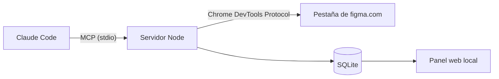
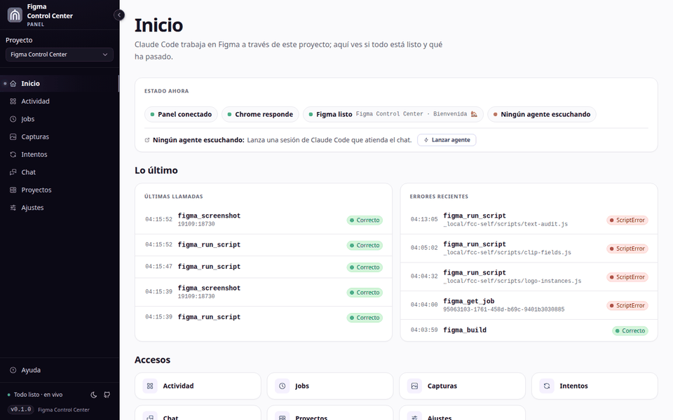
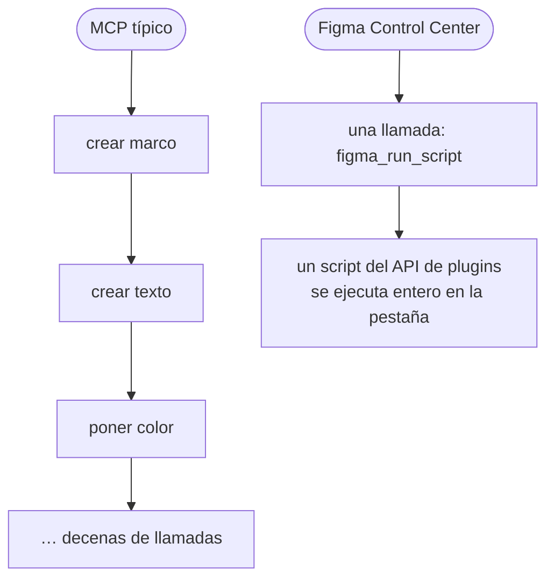
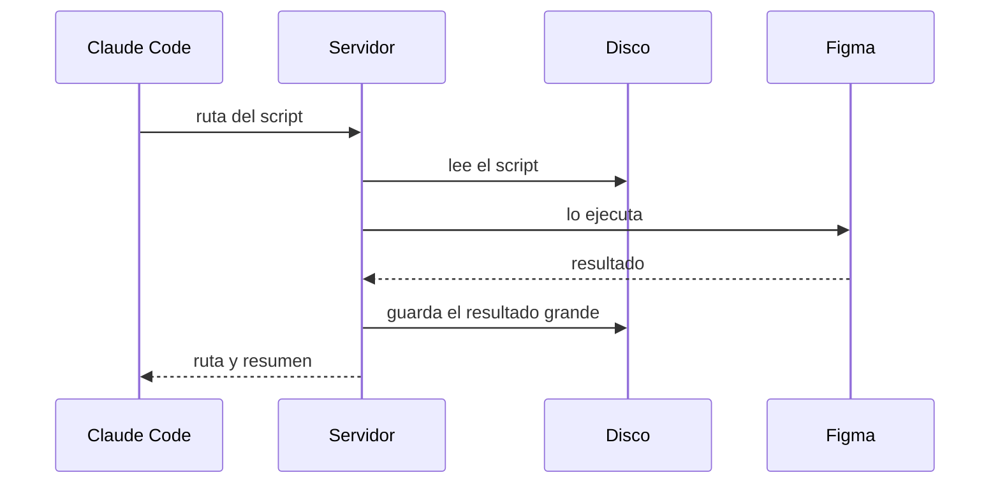
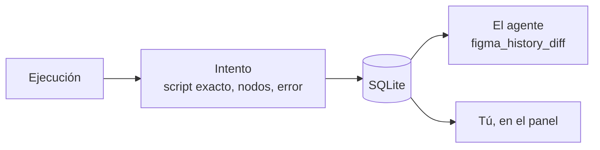
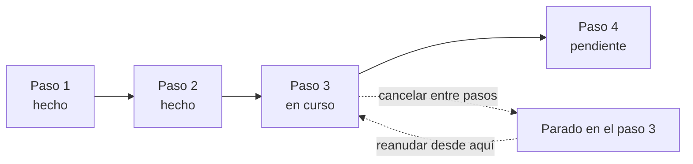

## El problema

En un proyecto hicimos el design system directamente en código, sin pasar por Figma. Quería
llevarlo a Figma para que, si algún día entraba un diseñador, pudiera trabajar sobre los diseños.

El MCP oficial de Figma tiene un límite de uso y se acababa enseguida. Y hacerlo a mano era
trabajo de horas: el mismo clic, componente tras componente.

## Qué es

Un servidor MCP local que deja a Claude Code leer y editar archivos de Figma, con un panel web y
una base SQLite que guarda todo lo que hace.

Tiene tres piezas:

- **Herramientas que esperan código.** Claude no pide «crea un rectángulo» y luego «ponle este
  color»: escribe un script del API de plugins de Figma y el servidor lo ejecuta en la pestaña. Le
  dices «mis componentes se ven así» y el agente escribe el código que los construye.
- **Un histórico en SQLite.** Cada llamada, cada lote y cada intento se guarda con el script exacto
  que usó, los nodos que tocó y el error si lo hubo.
- **Un panel web local.** Enseña en directo las llamadas, los lotes en curso, las capturas de
  pantalla de los nodos y el historial de intentos con el diff entre dos de ellos.

## Decisiones

### El agente escribe código, no encadena herramientas

Un MCP típico expone una herramienta por operación, y cada llamada intermedia ocupa contexto. Es
el argumento de los que dicen que «el MCP tradicional está muerto»: Cloudflare dejó más de 2.500
endpoints en dos herramientas que reciben código
([Code Mode](https://blog.cloudflare.com/code-mode-mcp/)), y Anthropic propone lo mismo en
[Code execution with MCP](https://www.anthropic.com/engineering/code-execution-with-mcp).

Las escrituras pasan por `figma_run_script` y `figma_build`. No es la versión radical de dos
herramientas: las lecturas, el diagnóstico y el histórico tienen las suyas.

### Rutas de fichero, no código en la llamada

Un script de varios megas le cuesta al modelo lo mismo que uno de una línea.

### Un histórico en SQLite para tener control de los cambios

Responde a «¿qué cambió entre la vez que funcionó y la que no?» sin repetir nada en Figma, y
sobrevive a los reinicios de Claude Code.

### Trabajo en bloques

`figma_build` sustituye a las horas de clics: el trabajo largo se describe una vez y se ejecuta
solo. Si cambias de archivo a mitad, se niega a seguir.

### Además

- **Arquitectura hexagonal con fronteras comprobadas.** Todo el acceso a Figma vive en un único
  adaptador; ESLint y dependency-cruiser impiden, por ejemplo, que el panel hable con Figma.
- **Contratos versionados.** Cada proyecto aporta sus datos en JSON versionado: el servidor no
  conoce ningún proyecto y un contrato roto falla al validar, no a mitad de construir.

## Limitaciones

- **Necesita un Chrome con el puerto de depuración y tu sesión de Figma.** No usa una API oficial
  de escritura: trabaja sobre la aplicación web, con tu cuenta y tus permisos de edición.
- **Depende de la web de Figma.** Si Figma cambia cómo expone el API de plugins en la pestaña,
  hay que adaptar el adaptador.
- **Un script en marcha no se puede interrumpir.** Figma no ofrece cómo; por eso el trabajo largo
  va en pasos con `figma_build`, que sí se cancela entre pasos.
- **El panel es solo local.** No tiene autenticación y solo escucha en la propia máquina.

## Qué haría distinto

- **Guardaría los jobs en SQLite desde el principio.** La base ya existía para el histórico, y
  dejar los jobs en memoria hace que un reinicio del servidor pierda el lote que seguía.
- **Empezaría el panel más pequeño: histórico e intentos.** Creció con chat, agente, ajustes y
  ayuda, y el chat depende de los canales de Claude Code, que aún están en preview: es la parte
  que más se puede romper.
- **Probaría macOS y Windows desde el primer script de arranque.** Los scripts de ayuda usan
  herramientas de Linux y no los he probado en otros sistemas.

Y queda la dependencia que asumo: la web de Figma y un Chrome con depuración. Por eso aislé esa
parte en un único adaptador; si Figma ofreciera una vía oficial con ese alcance, la cambiaría.

## Estado

Beta, versión 0.1. Ya es usable: construye y lee archivos de Figma de principio a fin, pero aún
quedan cosas por ajustar. Documentación en inglés y castellano, y código abierto con licencia MIT.
